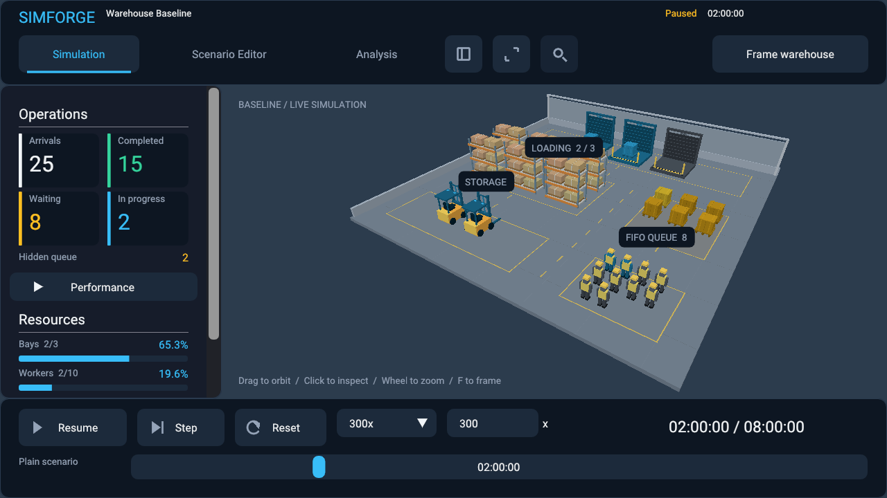
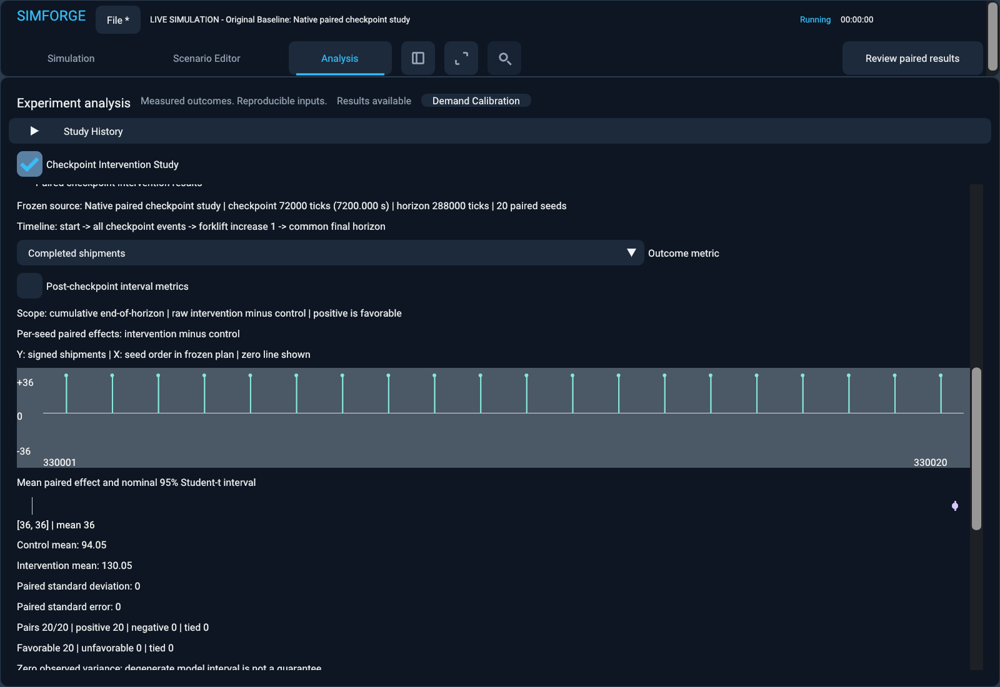

# SimForge

SimForge is a C++23 warehouse simulation and analysis workspace with a custom Vulkan viewer. Model arrivals, queues and resource constraints; compare capacity changes; and inspect the actual simulated outcomes in playback.

The simulation core runs independently of the renderer. Seeded workloads, complete checkpoints, paired experiments and versioned project files keep inputs and results reproducible within the documented platform and generator limits.



## What you can do

- Edit warehouse scenarios and replay arrivals, processing, queues and resource activity.
- Run paired capacity comparisons, sensitivity sweeps and two-factor studies with explicit seeds.
- Calibrate demand from observed CSV data with coverage windows, holdout validation, dispersion diagnostics and predictive uncertainty.
- Test a resource intervention at an exact checkpoint in each seed's own simulation, then inspect control and intervention playback with matched workloads.
- Save projects and study history, export JSON/CSV evidence, or run experiments through the headless executable.



These are conditional simulation results, not guarantees about a real warehouse. The [checkpoint study guide](docs/checkpoint-intervention-studies.md) explains pairing, interval assumptions and limitations. Try the [five measured intervention examples](examples/checkpoint-interventions) or explore the [usage guide](docs/usage-guide.md) and [screenshot gallery](docs/screenshot-gallery.md).

## Building and Testing Locally

Automated tests are executed locally. This repository intentionally does not use hosted CI: GitHub Actions, scheduled workflows and automated release pipelines are not configured. The results below describe local Windows runs, not tests run on GitHub.

Use an **x64 Visual Studio developer PowerShell/terminal** with a C++23-capable MSVC toolchain, CMake 3.25 or newer, Ninja, and vcpkg. Set `VCPKG_ROOT` to your vcpkg checkout. The manifest pins its dependency baseline; configuration installs the required dependencies. The verified environment uses Visual Studio 2026 Build Tools.

Renderer builds also need the official Vulkan SDK (headers 1.4.335 or newer), `VULKAN_SDK`, SDK tools including `glslc`, a Vulkan 1.1 runtime, and a driver supporting swapchain-maintenance1 presentation fences. See [Vulkan setup](docs/vulkan-renderer.md). The renderer-disabled preset does not require a GPU or Vulkan SDK.

Run these commands from the repository root. On a machine with a display, supported GPU and Khronos validation layers, enable the visible graphics tests explicitly:

```powershell
cmake --preset windows-debug -DSIMFORGE_GRAPHICS_TESTS=ON
cmake --build --preset windows-debug
ctest --preset windows-debug --output-on-failure

cmake --preset windows-release -DSIMFORGE_GRAPHICS_TESTS=ON
cmake --build --preset windows-release
ctest --test-dir build/windows-release --output-on-failure

cmake --preset windows-headless
cmake --build --preset windows-headless
ctest --preset windows-headless --output-on-failure
```

The existing presets have Debug and headless CTest presets; Release uses CTest's explicit build directory. Run suites sequentially. Graphics tests open real windows and can take several minutes. To build with the renderer but omit display tests, configure Debug or Release with `-DSIMFORGE_GRAPHICS_TESTS=OFF`; that run does not validate graphics. Use `windows-headless` to verify that the renderer is disabled entirely.

To repeat the checkpoint walkthrough with Vulkan validation, capture actual frames, and reopen the saved project in a fresh process:

```powershell
powershell -NoProfile -ExecutionPolicy Bypass -File scripts/run-graphics-test.ps1 -Executable build/windows-debug/apps/sandbox/simforge_sandbox.exe -Scenario examples/warehouse-baseline.json -Live -Checkpoint -Mode Review -Frames 180
```

The script checks process results and validation diagnostics and manages its generated files under `build/test-artifacts`. See [artifact retention and cleanup](docs/build-artifact-management.md).

Fresh local publication checks passed: Debug **795/795**, Release **795/795** (each including all 21 graphics tests), and renderer-disabled **754/754**. The checkpoint walkthrough and fresh-process reopen recorded **zero Vulkan errors and warnings**. See the [publication plan and audit](docs/github-publication-plan.md) for timings and evidence. The earlier [Commit #33 validation record](docs/commit-33-validation.md) retains its original results, including the initial Debug failures and subsequent fixes/rechecks.

## Run a scenario or experiment

```powershell
# Interactive warehouse playback
build/windows-release/apps/sandbox/simforge_sandbox.exe --scenario examples/warehouse-baseline.json --live --speed 300

# Renderer-independent command-line execution
build/windows-headless/apps/sandbox/simforge_headless.exe --headless --scenario examples/warehouse-baseline.json
```

See the [usage guide](docs/usage-guide.md) for experiment exports, replay, controls and additional benchmarks. Example data is synthetic and curated; raw benchmark output and local project files belong under `build/`.

## Engineering documentation

| Topic | Guide |
|---|---|
| Simulation and checkpoints | [Warehouse model](docs/warehouse-simulation.md), [snapshot design](docs/warehouse-snapshots.md) |
| Arrival processes | [Workload modeling](docs/workload-modeling.md), [coverage and seeded arrivals](docs/stochastic-arrivals-and-coverage.md) |
| Demand evidence | [Calibration](docs/demand-calibration.md), [diagnostics and uncertainty](docs/demand-diagnostics.md) |
| Statistical studies | [Paired experiments](docs/statistical-experiments.md), [sensitivity](docs/sensitivity-analysis.md), [checkpoint interventions](docs/checkpoint-intervention-studies.md) |
| Viewer and projects | [Scenario workspace](docs/scenario-workspace.md), [project persistence](docs/project-persistence.md) |
| Publication | [Manual publication plan and audit](docs/github-publication-plan.md), [third-party notices](THIRD_PARTY.md) |

Windows/MSVC is verified; other platforms are unverified. Logical replay is supported within the documented assumptions; cross-platform bitwise determinism is not promised.

## License and releases

SimForge is licensed under [Apache License 2.0](LICENSE), copyright 2026 Achal Sood. See [NOTICE](NOTICE) and [third-party notices](THIRD_PARTY.md). The bundled Roboto font retains its [Apache 2.0 license and provenance](assets/fonts/README.md).

Releases remain manual. Any future `v0.1.0` executable must be built and tested locally, have its runtime dependencies and required notices verified, and receive separate approval before binaries or a release are published. No release is created by this preparation work.
