# SimForge

## Calibrate a stochastic arrival process from multi-shift warehouse data.

Open `examples/stochastic-coverage/homogeneous.json` and **Scenario Editor → Workload patterns**. Choose homogeneous or piecewise Poisson intensity, enter arrivals/second and an explicit seed, and run it. The expected count and actual realization are distinct; restarting the same seed reproduces the submitted workload.

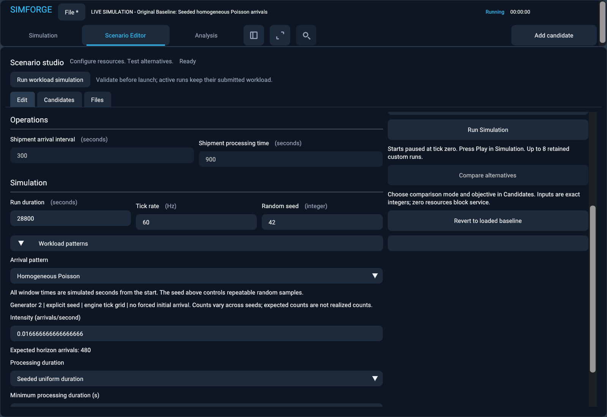
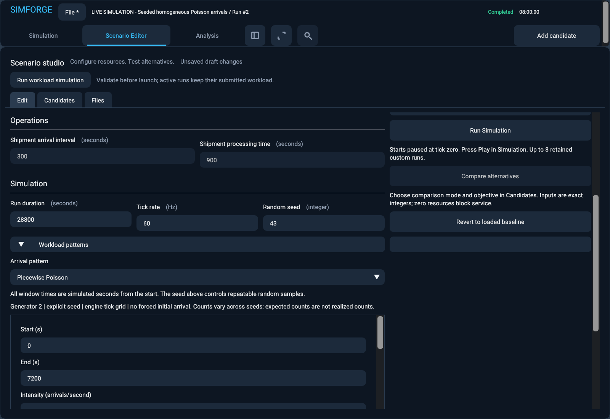

In **Analysis → Demand Calibration → Import**, select **Use explicit coverage windows**, load `examples/stochastic-coverage/multi-shift.json`, then import and validate. Inspect observed shifts, closed periods and collection interruptions. The fixture contains 210 arrivals across 23 observed hours; 49 elapsed hours are excluded.

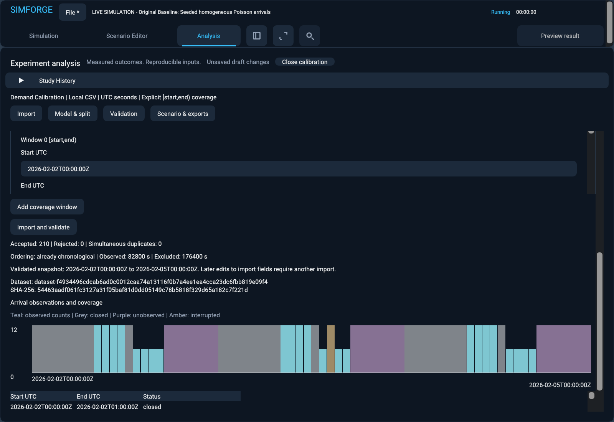

Choose the chronological split in **Model & split**. Fit constant intensity, then a predefined UTC daily profile. Training contains 138 arrivals across 15 observed hours; holdout contains 72 across eight hours. Rates for hours without training exposure remain unavailable. The daily profile predicts 72 holdout arrivals using its observed exposure.

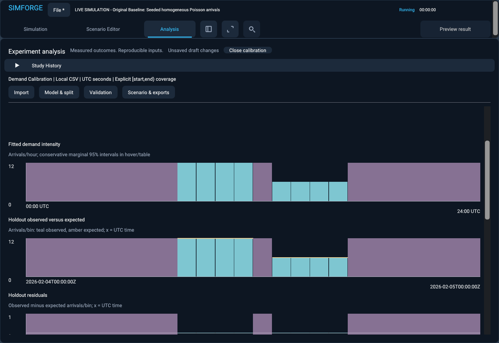
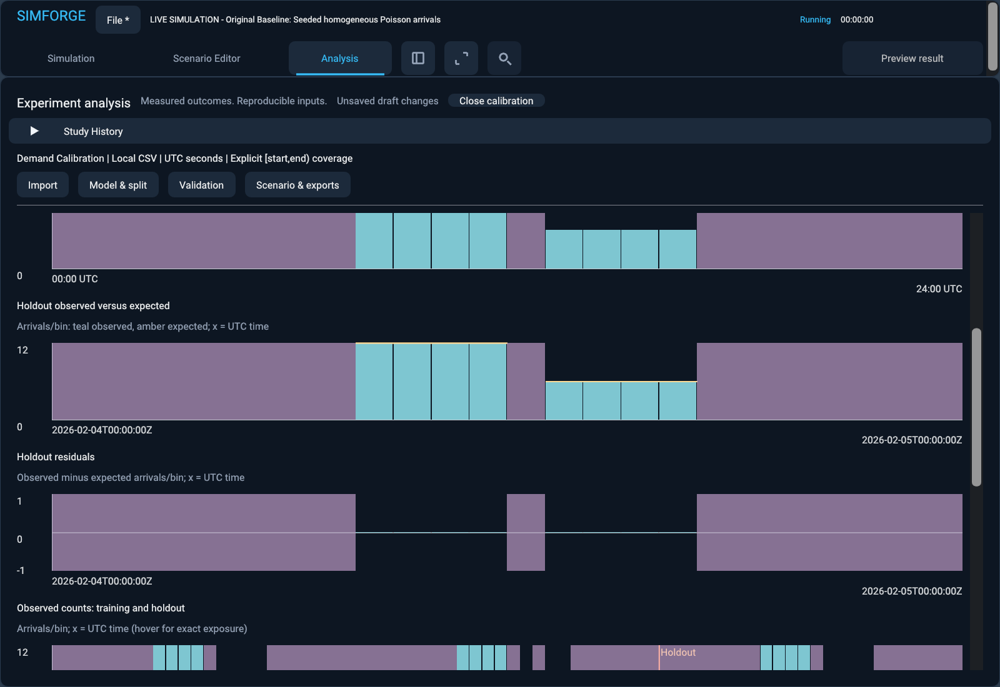

Save the study. In **Scenario & exports**, choose **Seeded Poisson realization**, seed `54321`, UTC alignment `2026-02-02T08:00:00Z`, and explicitly exclude unestimated UTC hours from the simulated schedule. This operating policy is separate from historical coverage. The eight-hour scenario expects 66 arrivals; this seed generates 72. Review the real realization chart and create independent 3D playback with preserved service/resources. Project Save/Open retains evidence, generator identity, seed and playback.

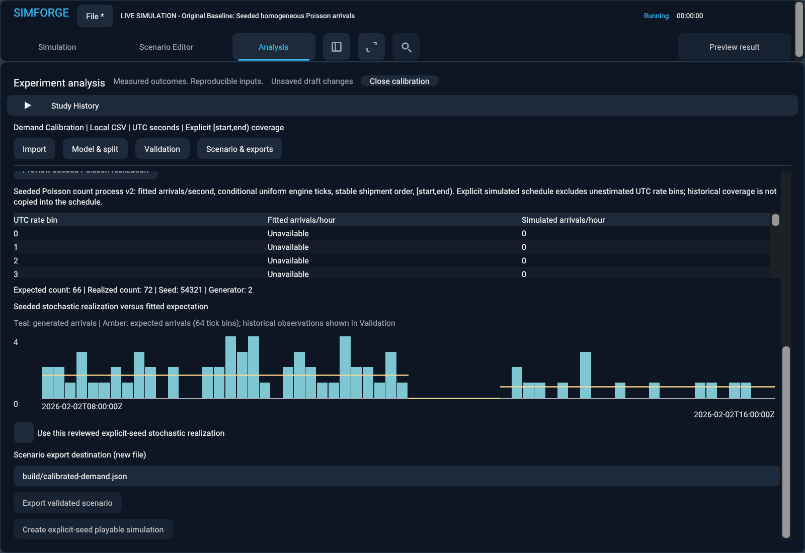
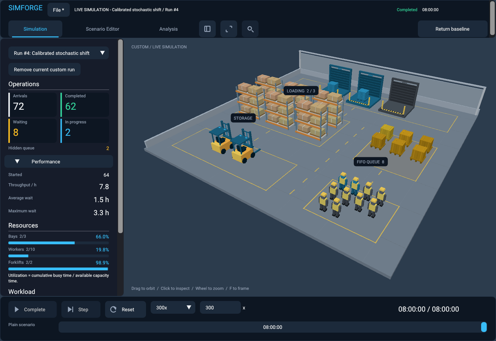

Read the [stochastic arrival and coverage contract, CLI examples, reproducibility limits and measurements](docs/stochastic-arrivals-and-coverage.md) and [Commit 31 validation report](docs/commit-31-validation.md). Generator 2 uses the engine tick grid; universal cross-platform bitwise identity is not claimed. The periodic surrogate remains available with explicit approximation acceptance.

## Calibrate warehouse demand from historical shipment-arrival records

Open **Analysis → Demand Calibration**. Select a local CSV with one `timestamp` column of UTC second timestamps, declare the continuous `[start,end)` observation window, and import it. Inspect coverage, accepted records, simultaneous arrivals, ordering and the dataset fingerprint before fitting.

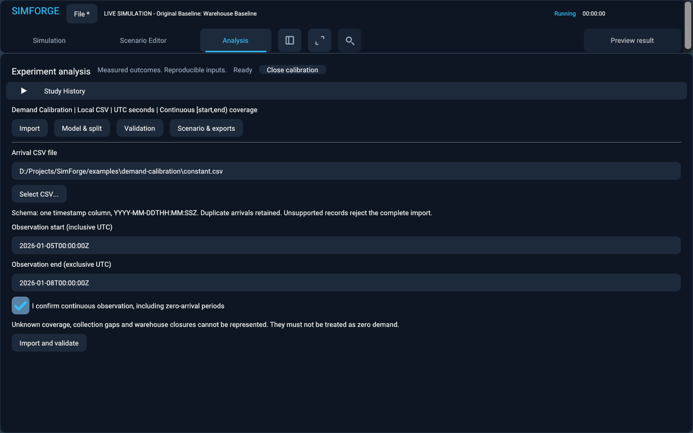
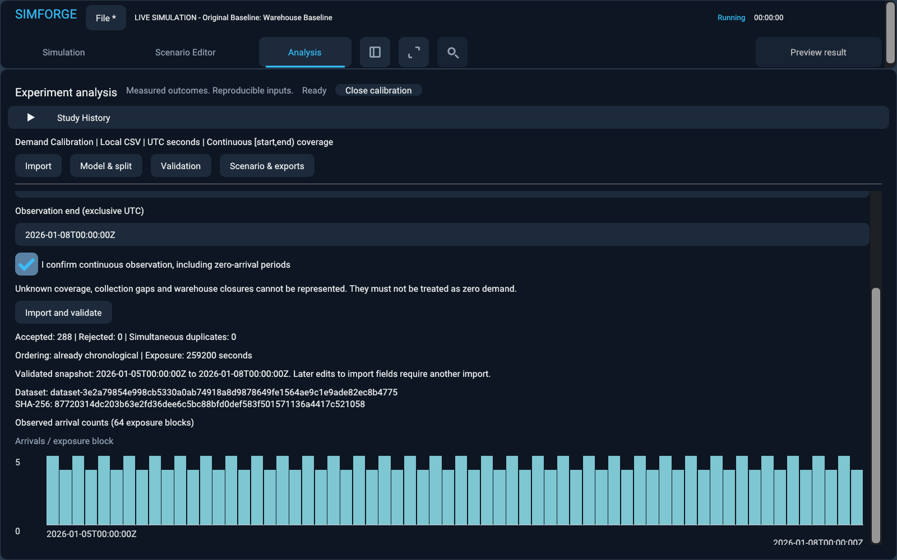

Choose an explicit chronological split in **Model & split**. Fit a constant intensity or a predefined repeating UTC daily profile. Training records estimate rates; the later holdout records only evaluate predictions. View count errors, uncertainty, the constant baseline and interval diagnostics in **Validation**. Scroll to inspect the fitted-rate, observed-versus-expected and residual charts.

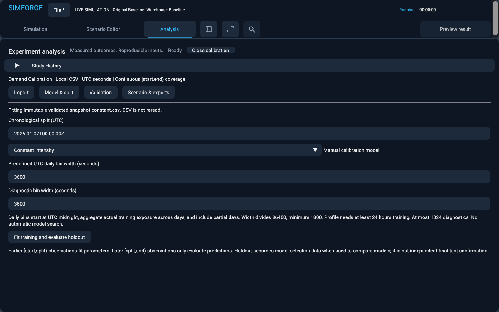
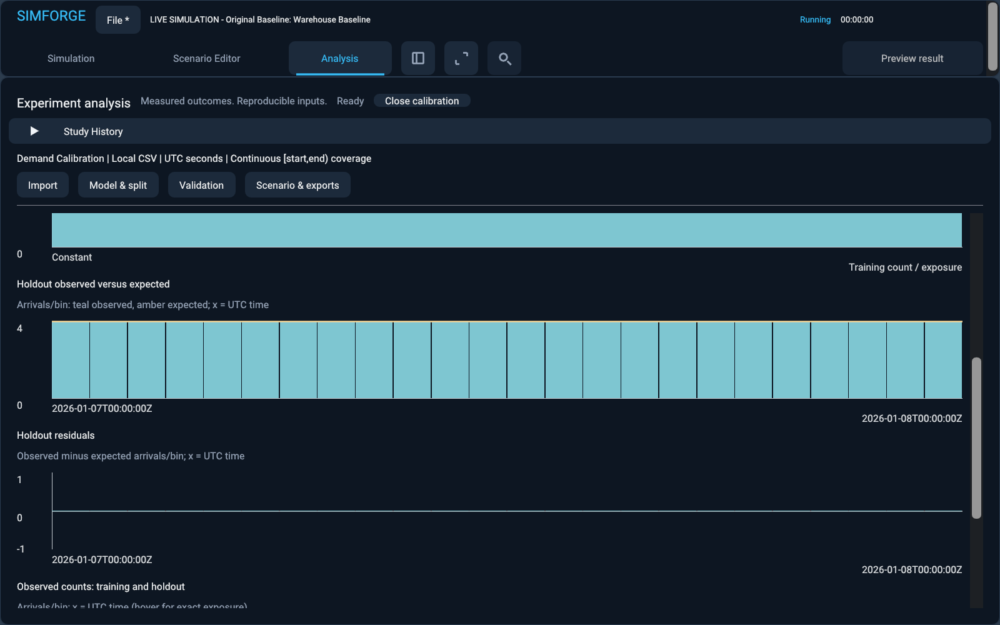
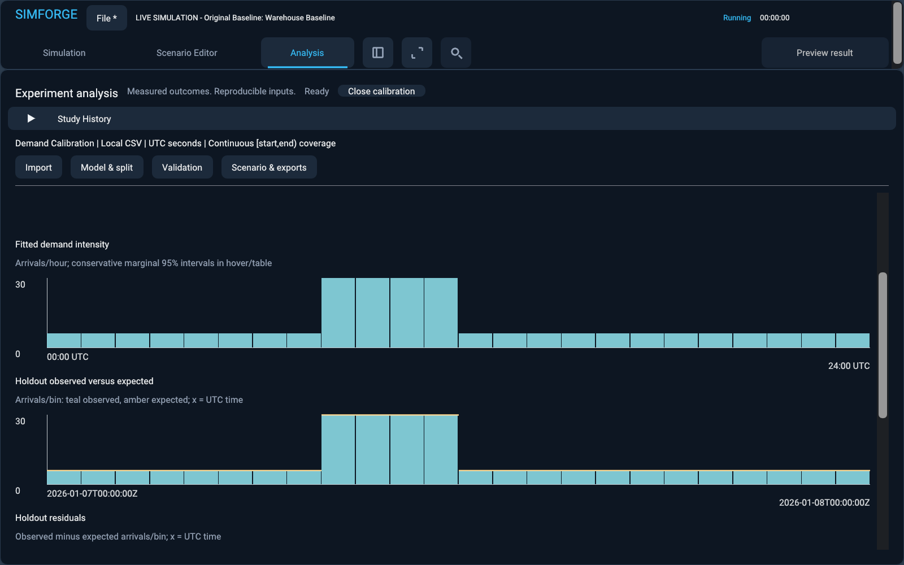

Save the calibration study, then preview a new scenario with preserved service/resource settings and an explicit seed. Creating a calibrated **periodic surrogate** requires explicit acceptance of its semantics and displayed rate rounding. It does not reproduce Poisson arrival variability; choose the seeded Poisson option described above for stochastic counts. The validated scenario uses normal simulation playback and authoritative metrics, and the evidence survives project Save/Open.

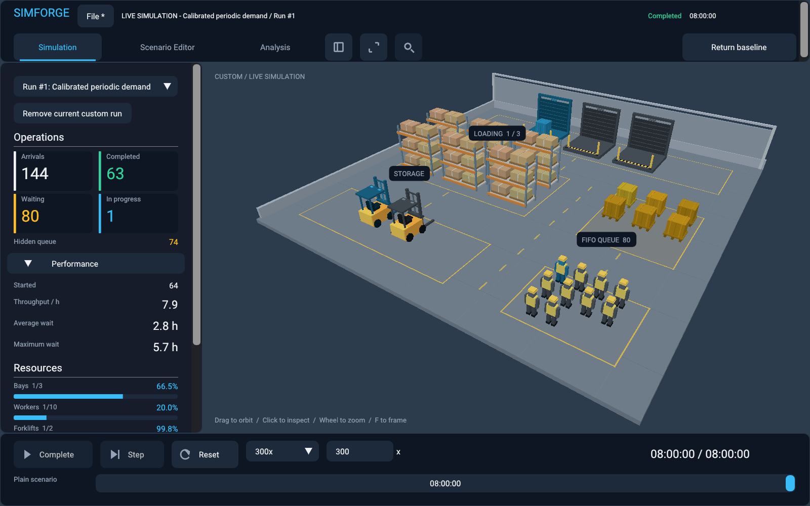

Headless example:

```powershell
build/windows-release/apps/sandbox/simforge_headless.exe --headless `
  --calibrate-demand examples/demand-calibration/morning-surge.json `
  --export-json build/demand-report.json --export-csv build/demand-report.csv
```

Read the [calibration contracts, statistical assumptions, conversion policy and examples](docs/demand-calibration.md), [validation report](docs/commit-30-validation.md), and [measured benchmarks](docs/demand-calibration-benchmarks.csv). Existing output files are never implicitly overwritten. All calibration stays local.

### Find a promising warehouse configuration and verify it on new demand conditions

1. Open `examples/warehouse-statistical-workload.json` and choose **Analysis**. Run a paired comparison, forklift sensitivity sweep, or forklift × worker interaction grid.
2. Open **Study History** to revisit completed studies. Give them titles and notes; switching restores the stored evidence without simulation reruns.
3. Select a tested capacity configuration and choose **Confirm Selected Configuration**. Review the frozen baseline, candidate and changed parameters.
4. Choose new seeds. SimForge rejects duplicates, exploratory overlap and seeds reserved by earlier attempts. Run independent confirmation; cancellation preserves history and keeps the reserved set in the audit.
5. Compare the exploratory and confirmation estimates, per-seed outcomes and nominal 95% confidence interval. An interval including zero does not establish an improvement; confirmation does not prove global optimality.
6. Play the frozen configuration using a measured seed. Save the `.simforge` project to preserve all completed studies, metadata and links. Source deletion is blocked until dependent confirmations are handled explicitly.

History retains up to 32 studies, 32 MiB per study and 192 MiB total, with explicit deletion and no silent eviction. See [study history, confirmation, headless examples and measured limits](docs/study-history-and-confirmation.md).

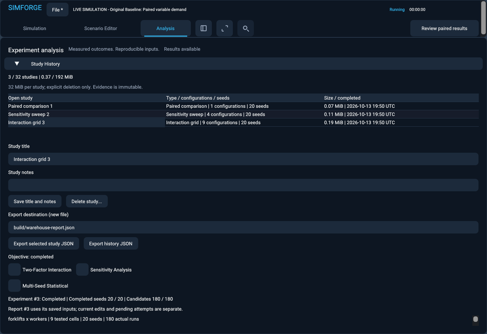
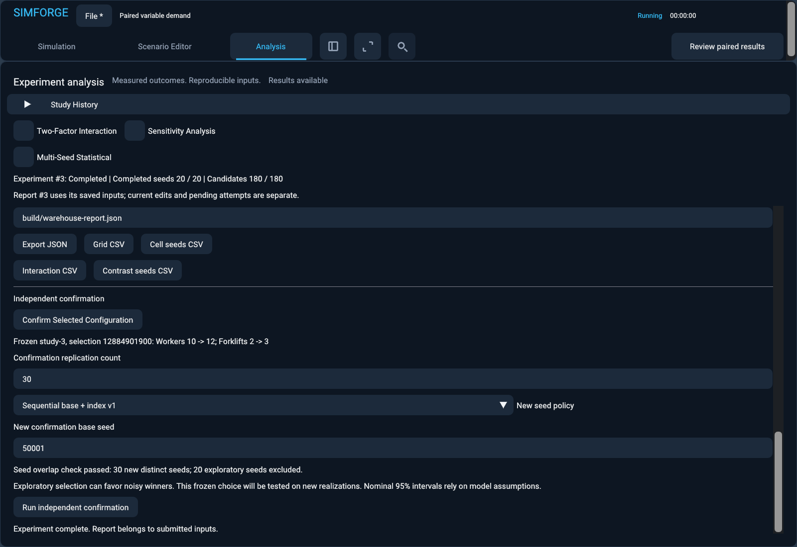
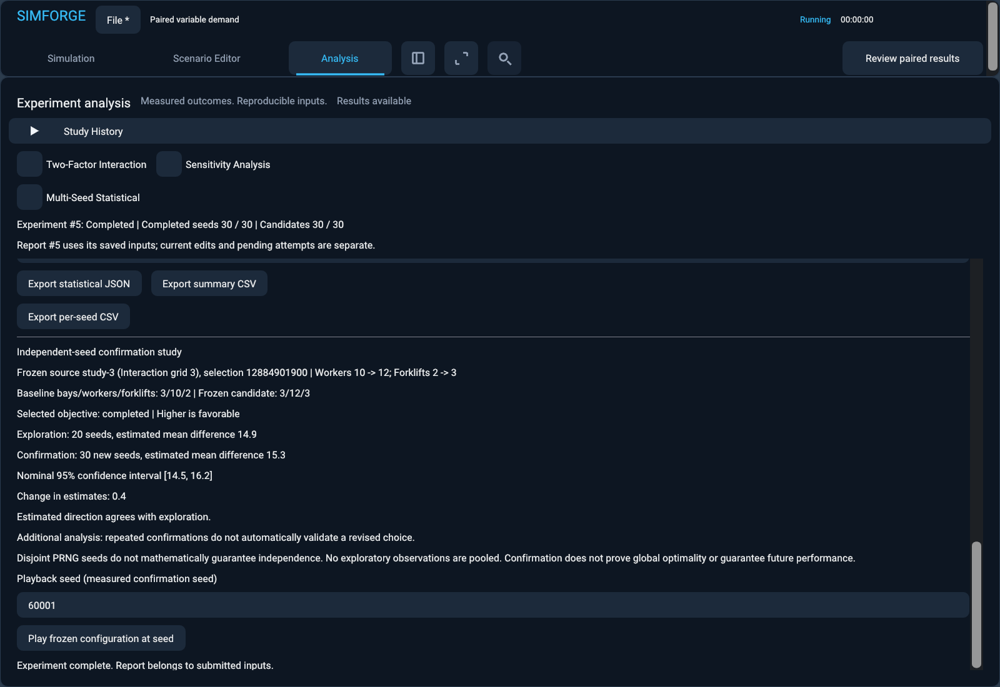

### Do more workers help when forklift capacity changes?

Open the variable-demand warehouse (`examples/warehouse-statistical-workload.json`), choose Analysis → Two-Factor Interaction, and test forklifts 1..3 against workers 1..3. Run a single seed first, then enable 20 paired seeds starting at 1001. Click outcome cells, switch to the interaction heatmap, and inspect the four matched observations for each seed before creating a candidate or explicitly seeded playback.

The curated 20-seed study measures no completion gain from workers 1→2 at one forklift, but a mean gain of 31 at two forklifts: local additive interaction +31, nominal 95% interval [30.4964,31.5036]. Other tested rectangles have zero interaction. These are model results on tested values; best-observed selection is not global optimality and grid intervals are not simultaneous. See [two-factor interaction studies](docs/two-factor-interactions.md) for the formula, heatmaps, CLI, exports, limits and measured validation.

SimForge is an AI-native simulation platform powered by a custom high-performance C++ engine.

The goal is to let users describe systems, simulate them, compare alternatives, and understand why those systems behave the way they do.

## Save and reopen a complete workspace

1. Start SimForge and choose **New Project** in the launcher (or **File ? New Project** in a warehouse workspace).
2. Open **Scenario Editor**, change the warehouse inputs and validate the draft. Add a named candidate if you want to compare it later.
3. Click **Run Simulation** to create an independent custom run. The original baseline stays preserved.
4. Press Play, adjust speed or seek to an intermediate simulated time, then pause. Move the camera as desired.
5. Run a comparison from Analysis if needed. Use **File ? Save Project**, choose a new `.simforge` file and wait for ?Project saved.? Invalid draft text can also be saved safely.
6. Close SimForge. Save/Discard/Cancel protects unsaved changes, including simulation progress.
7. Start SimForge again and choose **Open Project**, or run `simforge_sandbox.exe --project "D:\Studies\warehouse.simforge"`.
8. Select the restored custom run and press Play. Baseline and other custom runs retain their independent progress, clocks and cameras.
9. Open **Analysis** to inspect the previous report with its original submitted definitions and candidate IDs. Editing a current candidate does not relabel historical results.

**Save** updates the associated file; **Save As** creates a new file and leaves the earlier one intact. `File *` indicates unsaved work. On launch, explicitly restore or discard any offered local recovery copy. See [project format, failure safety, recovery and measurements](docs/project-persistence.md).

Save, Open and recovery now run through one bounded persistence worker. The activity panel shows the current phase, processed bytes and studies, with safe cancellation before publication. Saving captures the submitted revision; later edits/playback remain dirty. Open keeps rendering and camera navigation available while the replacement validates. See [streaming architecture, compatibility and measured performance](docs/persistence-performance.md). For renderer-free verification, run `simforge_headless.exe --headless --verify-project "study.simforge"`.

## Vision

SimForge will combine:

- a custom simulation runtime
- deterministic fixed-step execution
- real-time 3D visualization
- headless batch simulation
- scenario comparison
- performance profiling
- AI-assisted simulation creation
- evidence-based analysis of simulation results

AI will not invent simulation outcomes. It will create structured simulation definitions and interpret results generated by the engine.

## Current Status

Early development.

The fixed-step simulation clock, World/ECS, and snapshot/replay foundation are implemented:
generation-based entity handles, packed sparse-set Transform/Velocity storage,
and a movement system driven by explicit fixed ticks. Snapshots preserve full
logical lifecycle/component/clock state and support independent branches,
versioned serialization, and exact replay comparison. Core simulation has no SDL
or Vulkan dependency. Handles are local to a World; stale handles are rejected,
and exhausted generations retire rather than wrap. Restoring invalidates all old
handles through a fresh ownership token.

Versioned scenario JSON and typed input recording are implemented. Warehouse
scenarios execute a deterministic operational model with FIFO shipments,
bay/worker/forklift reservations, processing and actual queue/utilization/throughput
metrics. The ECS movement adapter remains executable independently.
Recordings preserve a known initial snapshot, ordered accepted commands, and an
expected final snapshot for exact replay verification. See
[scenario and input contracts](docs/scenarios-inputs.md) and
[performance investigation/results](docs/input-performance.md).

See [warehouse model and numerical example](docs/warehouse-simulation.md) and
[warehouse benchmark results](docs/warehouse-benchmarks.md). Schema v1 accepts
optional `processing_duration_seconds` (legacy default 600 seconds); warehouse
arrival workloads are bounded to 100K. Shipments/events are domain state rather
than forced ECS entities. Complete warehouse checkpoints support transactional
restoration, portable persistence, ordered capacity-command replay and independent
branches. See [warehouse snapshots and measured branch outcomes](docs/warehouse-snapshots.md).
Existing movement snapshots and recordings remain supported.

Warehouse workloads support deterministic demand windows, seeded discrete uniform
intervals and processing requirements, plus homogeneous/piecewise Poisson count processes. The editor, headless runner,
snapshots, recorded interventions, paired capacity comparisons and projects share
one validated workload model. See [workload schema, reproducibility, examples and
measurements](docs/workload-modeling.md).

Structured batch experiments compare complete resource configurations from one
shared checkpoint, rank actual outcomes, and test add-one bay/worker/forklift
interventions for bottleneck evidence. Results export to reproducible JSON and CSV.
See [scenario comparison contracts and actual results](docs/scenario-comparison.md)
and [comparison performance measurements](docs/comparison-benchmarks.md).

Analysis also supports explicitly configured paired multi-seed capacity experiments.
It retains every seed's outcomes, estimates raw paired mean effects, shows nominal
95% Student-t intervals separately from point rankings, and persists completed
reports without rerunning them. See [statistical experiments and the forklift
tutorial](docs/statistical-experiments.md).

The custom Vulkan renderer draws scenario-driven static warehouse scenes with
loading docks, storage racks, cargo pallets, forklifts, workers and floor markings.
A CPU-only visualization adapter maps validated resource capacities into stable
visual identities and deterministic placements, with automatic camera framing.
The original floor/grid/cube scene remains the no-argument demo.
Live warehouse playback now shows real arrivals, FIFO waiting, processing,
completions and aggregate resource activity, with independently paced rendering.
The interactive viewer adds an in-window dashboard, orbit/pan/zoom, shipment and
resource inspection, visible playback controls, and correct plain-scenario seeking.
Its refined presentation uses embedded Roboto, larger operational KPIs, consistent
state colors, collapsible panels and tighter warehouse framing. Font provenance
and the redistribution license are recorded in [assets/fonts](assets/fonts/README.md).
See the [interactive viewer guide, screenshots and validation](docs/interactive-warehouse-viewer.md).
The [scenario workspace](docs/scenario-workspace.md) now supports in-window initial
configuration editing, validated alternatives, independent or shared-checkpoint
comparisons, controlled bottleneck evidence, result previews and JSON/CSV export.
Comparisons now run on a bounded background worker with genuine progress, cooperative cancellation and preserved reports. See [asynchronous experiments](docs/async-experiments.md).
The visual workspace provides persistent **Simulation / Scenario Editor / Analysis** modes, full-width editing and results, measured KPI deltas and comparison bars, Windows report Save As, and normal-based directional lighting on reusable industrial meshes. See the [visual design guide and verified screenshots](docs/visual-design.md).
See [live visualization, timing, metrics and verified captures](docs/live-warehouse-visualization.md).
GPU resources remain separate from simulation. See [renderer architecture and setup](docs/vulkan-renderer.md)
and [warehouse visualization, verified screenshot and measurements](docs/warehouse-visualization.md).
Graphics builds require the official Vulkan SDK (headers 1.4.335 or newer), a Vulkan
1.1 runtime, and a driver supporting swapchain-maintenance1 presentation fences.
The SDK's `glslc` compiles and embeds GLSL shaders during the build; no runtime
shader paths or manual compilation are needed. The manifest enables SDL3's `vulkan`
feature and provides GLM for CPU scene/visualization math. Use an x64 Visual Studio developer
terminal with `VCPKG_ROOT` and `VULKAN_SDK` set; reopen the terminal after installing
the SDK. Configure with `-DSIMFORGE_BUILD_RENDERER=OFF` to build without the SDK.

See [World architecture and usage](docs/world-ecs.md),
[simulation timing](docs/simulation-clock.md), and
[snapshot design and schema](docs/snapshots-replay.md), and
[snapshot benchmark results](docs/snapshot-benchmark-results.md) for ownership,
reference lifetimes, determinism limits, and initial performance measurements.

```powershell
cmake --preset windows-debug
cmake --build --preset windows-debug
ctest --preset windows-debug --output-on-failure
build/windows-debug/apps/sandbox/simforge_sandbox.exe --headless --entities 10000 --ticks 600

cmake --preset windows-release
cmake --build --preset windows-release
build/windows-release/benchmarks/simforge_world_benchmark.exe
build/windows-release/benchmarks/simforge_snapshot_benchmark.exe
build/windows-release/benchmarks/simforge_input_benchmark.exe
build/windows-release/benchmarks/simforge_warehouse_benchmark.exe
build/windows-release/benchmarks/simforge_warehouse_snapshot_benchmark.exe
build/windows-release/benchmarks/simforge_comparison_benchmark.exe
build/windows-release/benchmarks/simforge_warehouse_layout_benchmark.exe
build/windows-release/benchmarks/simforge_live_warehouse_benchmark.exe
build/windows-release/benchmarks/simforge_viewer_benchmark.exe
```

Run the sandbox without arguments for the static 3D demo and graphical warehouse
launcher. Its bundled example path can be opened directly; command-line workflows
remain available:

```powershell
build/windows-debug/apps/sandbox/simforge_sandbox.exe
build/windows-debug/apps/sandbox/simforge_sandbox.exe --scenario examples/warehouse-baseline.json
build/windows-debug/apps/sandbox/simforge_sandbox.exe --scenario examples/warehouse-constrained.json
build/windows-debug/apps/sandbox/simforge_sandbox.exe --scenario examples/warehouse-higher-capacity.json
# Live playback: 300 simulated seconds per real second; Space pauses/resumes.
build/windows-release/apps/sandbox/simforge_sandbox.exe --scenario examples/warehouse-baseline.json --live --speed 300
# Opt-in visible-window test: requires GPU, display, and Khronos validation layers.
build/windows-debug/apps/sandbox/simforge_sandbox.exe --graphics-smoke 180
build/windows-debug/apps/sandbox/simforge_sandbox.exe --scenario examples/warehouse-baseline.json --graphics-smoke 180
# Optional GPU capture: parent directory must exist; output must be new.
powershell -NoProfile -ExecutionPolicy Bypass -File scripts/run-graphics-test.ps1 -Executable build/windows-debug/apps/sandbox/simforge_sandbox.exe -Mode Review -Frames 180
# Stronger headless isolation: this target links neither SDL nor Vulkan.
build/windows-release/apps/sandbox/simforge_headless.exe --headless --scenario examples/warehouse-baseline.json
```

The existing `simforge_sandbox --headless` commands also work without graphics
initialization. Headless mode reports
entity/tick counts, simulated elapsed time, separate setup/update wall durations,
and a position checksum. Fixed-step scheduling does not guarantee cross-platform
bitwise simulation determinism. Without `--live`, warehouse scenes remain static
capacity representations. Live mode displays real shipment IDs and aggregate busy
capacity slots, with truthful visible/hidden queue counts in the dashboard.

In `--live`, drag the left mouse button to orbit, click to inspect, drag the middle
button to pan, and use the wheel to zoom. **F** frames the warehouse, **R** resets
the camera, **Space** pauses/resumes, **Right** steps exactly one tick while paused,
and **Escape** clears selection. UI input fields capture typing and shortcuts.
The playback bar provides Play/Pause/Resume, Step, speed presets/custom input
(0.01-3600x; press Enter to apply), Reset and a seek slider (release to apply).
Reset restores the untouched initial runtime and pauses. Seeking pauses; backward
seeking restores the initial state and replays events. The viewer accepts plain
scenarios only; graphical recorded-command playback remains unsupported.

The minimum client size is 640x480. Header buttons toggle metrics, warehouse focus
and the inspector; panel toggles preserve the camera and selection. Sidebars scroll,
and the inspector shares the operations panel when effective width is limited.
Compact layouts use playback icons with tooltips, a separate time row and custom
speed through the speed menu. Performance (Started, throughput and wait durations)
can be expanded independently. DPI-aware typography is tested at 100-200% UI scale.
Resource IDs describe visual capacity
slots, with aggregate usage/utilization, rather than physical shipment assignments.
The fourth header button opens the scenario workspace. Physics, pathfinding and AI
remain outside this milestone.

## Graphical warehouse experiment

The Scenario Editor includes **Describe Your Warehouse**, an entirely offline
English scenario builder. Choose Create or Modify, enter a description, Interpret,
review or correct the values, then explicitly approve and Apply to Editor:

> Create a warehouse with 4 loading bays, 12 workers and 3 forklifts. Shipments
> arrive every 5 minutes and take 15 minutes to process. Run the simulation for
> 8 hours.

Modify understands conversational instructions such as `Get 3 more bays and twice
as many workers.` From the baseline, this proposes six bays and twenty workers.
`Get 3 workers` sets three; `Get 3 more workers` adds three. `Use 3 times as many
forklifts` multiplies the current count. `Make processing twice as fast` halves
processing duration. Review each matched phrase and operation, approve explicitly,
then Apply; use Run Simulation or Add as candidate and File Save/Open afterward.
Unsupported clauses, negation, ambiguity, conflicts, and
fractional final values block approval. Approved drafts use the existing Run
Simulation, comparison, and project-save workflows. No model or external API is
required. See the [tutorial, grammar, evaluation, benchmarks, and native captures](docs/natural-language-scenarios.md).

Custom warehouses are playable from **Scenario Editor → Run Simulation**. New
runs start paused at tick zero; press Play. The Operations run dropdown preserves
the baseline and up to eight custom runs with independent clocks, metrics, speeds
and cameras. Analysis offers **Simulate This Candidate** for initial comparisons;
checkpoint results remain explicitly labelled final previews. See the
[custom playback tutorial and validation](docs/custom-scenario-playback.md).

Launch the sandbox, choose **Open warehouse workspace**, and use these tabs:

1. **Edit:** name the draft `Add forklift`, change Forklifts from 2 to 3, and Validate.
2. **Add as candidate:** stores the alternative while preserving the baseline run.
3. **Candidates:** choose **Run independent scenarios from start** and maximize completions.
4. **Run comparison:** baseline finishes with 63 completed/32 waiting; the candidate
   finishes with 94 completed/0 waiting. Throughput changes from 7.875 to 11.75/hour.
5. **Results:** inspect signed differences and expand **Controlled resource probes**.
6. **View this final result:** displays actual candidate geometry/state; return to
   the preserved baseline for playback.
7. Enter a new destination path and **Export JSON** or **Export CSV**. JSON contains
   replay-verifiable inputs/results; CSV summarizes that same report.
8. **Files:** Save as new scenario to retain the validated draft separately.

For **Compare from shared checkpoint** at 7200 seconds, adding the forklift produces
87 completions and eight waiting shipments. It preserves the first two hours of
history, unlike starting with three forklifts. Checkpoint candidates may change only
capacities; initial comparisons also permit arrival/processing changes, with matching
duration and tick rate. See the [workspace guide and captures](docs/scenario-workspace.md)
for limits, measured performance and interpretation.

Use the separate renderer-disabled preset for CPU tests and isolated dependency
installation:

```powershell
cmake --preset windows-headless
cmake --build --preset windows-headless
ctest --preset windows-headless --output-on-failure
```

```powershell
build/windows-debug/apps/sandbox/simforge_sandbox.exe --headless --scenario examples/warehouse-baseline.json
build/windows-debug/apps/sandbox/simforge_sandbox.exe --headless --scenario examples/warehouse-constrained.json
build/windows-debug/apps/sandbox/simforge_sandbox.exe --headless --scenario examples/warehouse-higher-capacity.json
build/windows-debug/apps/sandbox/simforge_sandbox.exe --headless --scenario examples/warehouse-analytical.json
build/windows-debug/apps/sandbox/simforge_sandbox.exe --headless --scenario examples/warehouse-baseline.json --compare-forklifts 2,3 --checkpoint-seconds 7200 --record build/my-warehouse-inputs.json
build/windows-debug/apps/sandbox/simforge_sandbox.exe --headless --warehouse-replay build/my-warehouse-inputs.json
build/windows-debug/apps/sandbox/simforge_sandbox.exe --headless --experiment examples/warehouse-comparison.json --export-json build/my-comparison.json --export-csv build/my-comparison.csv
build/windows-debug/apps/sandbox/simforge_sandbox.exe --headless --scenario examples/movement-baseline.json --record build/my-movement-inputs.json
build/windows-debug/apps/sandbox/simforge_sandbox.exe --headless --replay build/my-movement-inputs.json
build/windows-debug/apps/sandbox/simforge_sandbox.exe --headless --replay examples/movement-inputs.json
```

Recording output must be a new file. Scenario workflows reject conflicting
`--entities`/`--ticks` overrides. JSON requires explicit simulation configuration;
unknown fields, duplicate keys, invalid numeric types, oversized input and
incompatible recordings fail before execution. Random seeds are retained but the
current movement and warehouse models have no random behavior. Warehouse metrics
describe the implemented fixed-duration model, not calibrated real-world predictions.

The warehouse comparison shares two hours of operational history, then retains two
forklifts in branch A and adds a third in branch B. The actual eight-hour results are
63 versus 87 completions and 32 versus 8 waiting shipments. Active jobs keep their
original completion times; the capacity increase occurs at the checkpoint. The CLI
verifies serialized continuation and command replay against full logical state.
The batch example additionally tests one worker and one loading bay: both retain
63 completions, while the third forklift gives 87. Controlled interventions support
forklifts as a likely bottleneck for this tested completion objective. Rankings
compare tested candidates; calibration and financial costs are not modeled.

Capture, run, restore, and replay the same movement workload:

```cpp
#include <simforge/world/world.hpp>
#include <simforge/simulation/simulation_snapshot.hpp>
#include <iostream>

simforge::world::World world;
simforge::simulation::SimulationClock clock;
const auto entity = world.create_entity();
world.emplace<simforge::world::Transform>(entity);
world.emplace<simforge::world::Velocity>(entity, simforge::world::Vec3{1, 0, 0});
const auto initial = simforge::simulation::capture_snapshot(world, clock);
simforge::simulation::replay_fixed_ticks(world, clock, 120);
const auto expected = simforge::simulation::capture_snapshot(world, clock);

const auto bytes = simforge::simulation::serialize_snapshot(initial);
simforge::simulation::restore_snapshot(world, clock,
    simforge::simulation::deserialize_snapshot(bytes));
// 'entity' is now invalid; use world.handle_at(entity.index) if a handle is needed.
simforge::simulation::replay_fixed_ticks(world, clock, 120);
const auto actual = simforge::simulation::capture_snapshot(world, clock);
if (auto mismatch = simforge::simulation::first_difference(expected, actual))
    std::cerr << *mismatch << '\n';
```

Replay assumes identical logical state, inputs, system order and supported execution
environment. Snapshot input is validated and bounded to 64 MiB / 1M slots. The
binary schema preserves finite doubles and detects accidental corruption; it does
not authenticate data. No third-party serialization dependency was added.

## Project Structure

```text
engine/       Simulation, visualization, renderer and shaders
apps/         User-facing executables
tests/        Automated tests
benchmarks/   Performance benchmarks
assets/       Redistributable viewer font and license
docs/         Architecture and design documentation
cmake/        CMake helper modules
```

## How many forklifts does this warehouse actually need?

Open `examples/warehouse-baseline.json`, select **Analysis → Sensitivity Analysis**, and sweep forklift capacity from **1 to 6** with step **1**. Run a single realization, or load the statistical workload example and choose 20 paired seeds. Inspect measured throughput, baseline effects, signed marginal gains and uncertainty, then create a candidate or explicitly seeded playable run from a tested value. The deterministic example completes **32, 63, 94, 94, 94, 94** shipments: three is the first best observed value in this tested range, with other capacities held fixed.

See [sensitivity methodology, CLI, persistence, measurements and native screenshots](docs/sensitivity-analysis.md). This workflow reports bounded one-factor evidence and practical thresholds; it does not claim global optimality or financial ROI.

## Build artifacts

Graphics reviews now use unique PNG runs under `build/test-artifacts`; successful
routine graphics tests reclaim their own diagnostics. Debug/headless presets skip
benchmarks by default while retaining full debug symbols and all tests. See
[build footprint, retention and safe cleanup](docs/build-artifact-management.md).

Preview legacy screenshot cleanup without deleting anything:

```powershell
powershell -NoProfile -ExecutionPolicy Bypass -File scripts/clean-artifacts.ps1 -Category LegacyCaptures
```

Use `-Apply` only after reviewing and explicitly approving the listed paths.
