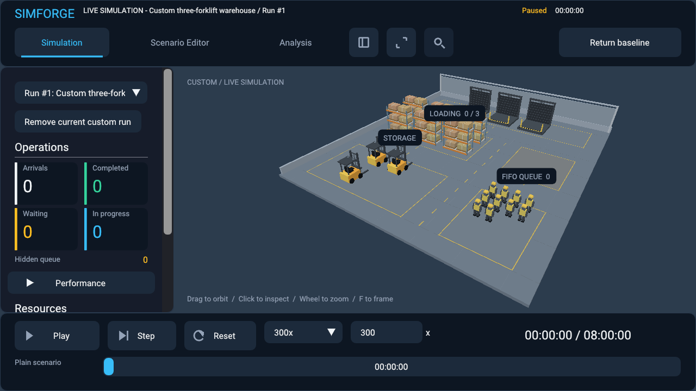
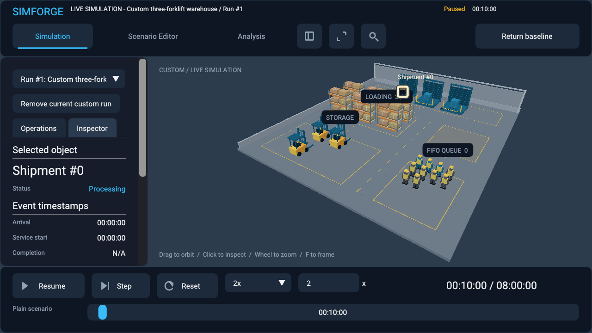
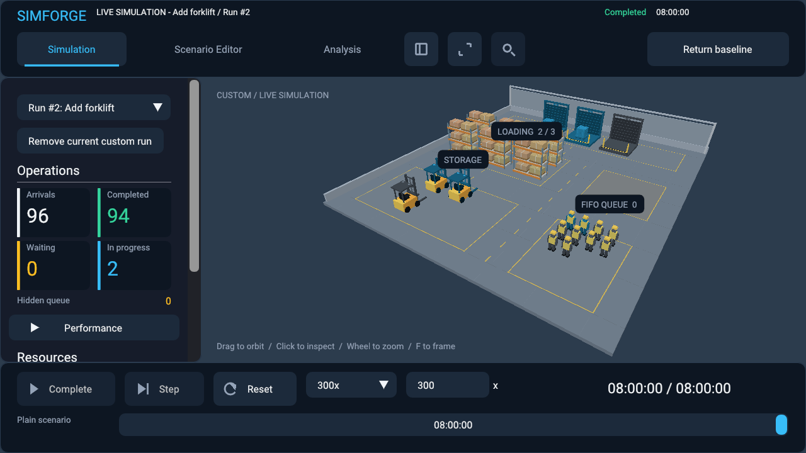
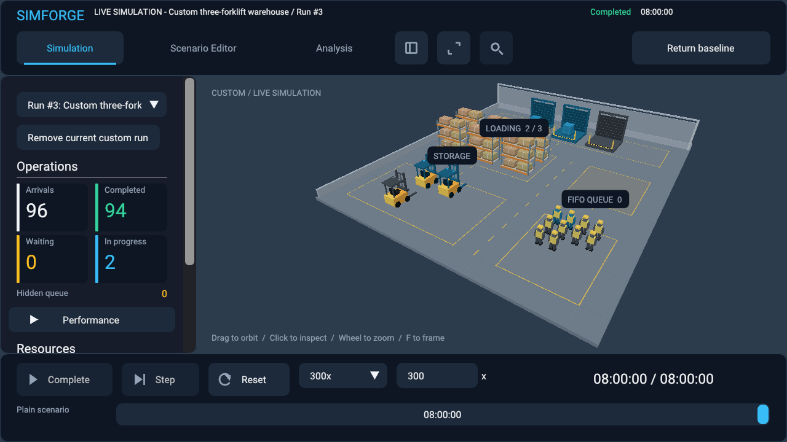

# Custom scenario playback

## Audit and root cause

Commit 19 (`8188a275d1ff07120073e5115f1621e01fa37223`) already constructed
the correct independent `ViewerController` in `run_draft()`. Its warehouse,
clock, arrivals, processing durations, observations and layout came from the
validated draft. The engine was not hardcoded to the example baseline.

The application only owned `baseline_view_` and one `alternative_view_`.
Draft playback and terminal comparison previews occupied the same alternative
slot. Another launch, preview, or return to baseline destroyed the custom run.
There was no retained-run selector or report-candidate playback action. The
editor exposed playback as “Run draft from start”, while Analysis exposed final
previews. These lifecycle and discoverability gaps prevented the requested
multi-run workflow. Activation now also clears pending editor-tab navigation
so that it cannot override the switch to Simulation.

## Ownership and isolation

The existing CPU-only `ScenarioWorkspace` is the run controller; there is no
second simulation engine or redundant manager. It owns the preserved original
baseline (run ID 0), at most **eight custom runs**, the selected live run ID,
and a separate immutable-result preview controller. Custom IDs increase and
are never reused during the workspace lifetime, including baseline replacement.
Duplicate display names are disambiguated by run number.

Each controller owns a scenario value, warehouse runtime, simulation clock,
initial snapshot, bounded observation, CPU scene, camera, speed and selection.
It borrows no editor buffers, report snapshots or mutable candidate definitions.
The Vulkan renderer remains application-owned and shared. Runs have no Vulkan
objects or shader pipelines. There are no unconditional per-frame snapshots.

Only `workspace.view()` advances in the UI loop. Inactive runs receive no wall
time or animation updates. Their tick, metrics, completed status, pause state
and speed remain intact. A previously running run resumes when selected; time
spent inactive is never caught up. Background experiments execute separately.

## Tutorial: original warehouse and three forklifts

1. Launch `simforge_sandbox.exe --scenario examples/warehouse-baseline.json --live`.
2. Pause the original baseline at a time of your choice.
3. Open **Scenario Editor**, name the draft “Three forklifts”, set Forklifts to
   `3`, and select **Validate**. All integer fields use the authoritative schema.
4. Select **Run Simulation**. Simulation opens with the new warehouse selected,
   **paused at untouched tick zero**. Press **Play**. The first scheduled arrival
   is processed by the engine, not by a renderer animation.
5. Pause, step, change speed, inspect a shipment, drag the timeline, or restart.
6. Use the dropdown above Operations to select **Original Baseline**. Its state
   is unchanged. Select the custom run again to resume its retained state.
7. Seek to the end to inspect the deterministic final result.

| Eight-hour configuration | Arrivals | Started | Completed | Waiting | Processing |
|---|---:|---:|---:|---:|---:|
| Original, two forklifts | 96 | 64 | 63 | 32 | 1 |
| Three forklifts from start | 96 | 96 | 94 | 0 | 2 |

Tests compare the complete operational snapshots and observations against
headless execution, including changed workers, bays, arrivals, processing,
horizon, tick rate and seed. The engine accepts a seed, but the existing
warehouse arrival/service model does not use random sampling.

## Candidate and file workflows

In **Candidates**, **Simulate initial configuration from start** copies the
candidate definition into a new paused run. In **Analysis**, **Simulate This
Candidate** uses the report's saved submitted definition, even if the editor or
current candidate has changed. It starts at zero and does not reuse final metrics.

Checkpoint comparisons remain preview-only in Analysis. That button is disabled
and the limitation is explained. Simulating the initial definition from Candidates
is explicitly a different timeline, not reproduction of a checkpoint intervention.

The launcher accepts a validated warehouse JSON path directly; the first loaded
scenario becomes the original baseline without first opening the example.
In Editor's **Files** tab, **Load file as playable run** adds and selects a custom
run while preserving the baseline, retained runs, draft, candidates and reports.
Save a draft as a new JSON file, load it with this action, and compare its final
state with `simforge_sandbox.exe --headless --scenario YOUR_FILE.json`.
Failed file loads leave all existing state intact. **Open scenario** is the
distinct workspace-replacement action and requires explicit confirmation, even
when the draft is clean. Active experiments must be cancelled before replacement.

## Playback, scene and camera

Play/pause, resume, single tick, speed (0.01–3600), restart and timeline seeking
all address the selected controller. Restart restores its own initial snapshot
and event schedule, clears selection and pauses; it does not affect other runs.
The timeline endpoints provide beginning/end seeks. Seeking to zero settles the
scheduled arrival at zero; Restart restores the untouched pre-arrival constructor
state. Backward seek restores the initial snapshot and deterministic event replay;
forward seek advances actual operational state. Seeking pauses and clears selection.

Playable runs are initial-scenario timelines only. There is no GUI import of
recorded commands or playable intervention branch. Final previews disable
playback/seek/restart. They never discard an intervention history to manufacture
a fresh replay.

The header identifies **LIVE SIMULATION** with baseline/custom identity or
**FINAL-STATE PREVIEW** with its report identity. Preview entry preserves the
selected live run. **Return to selected live run** restores it; selecting baseline
explicitly changes the selected run to zero.

Observations, timestamps, metrics and capacity usage come from that same runtime.
The scene displays real waiting/processing shipment records and aggregate busy
resource slots; it does not invent forklift routes or worker identities.
Live scenes support all schema-valid resource capacities, displaying the first
256 slots per resource with an explicit dashboard notice when capacity exceeds
that bound. Numerical metrics and processing eligibility include **all** capacity.
Waiting cargo is bounded to 128 visible records, processing to 256; existing
hidden-cargo counts report the remainder. The static scene demo retains its
original 256-resource limit.

Selection and pointer drag are cleared on scene changes. Shipment IDs are local
to the owning controller and are never transferred between runs. Camera pose is
retained per run; new runs frame their own bounded warehouse layout, and current
viewport dimensions are applied on selection. Switching workspace modes alone
does not reset the camera. Remove current custom run selects the preserved
baseline before releasing the controller. Baseline removal is rejected.

## Background work and shutdown

The bounded `std::jthread`, immutable experiment requests, progress, cancellation,
transactional report publication and cached final snapshots remain in place.
They receive no live-run pointers. Even report publication while inspecting an
older preview preserves that preview's owned snapshot, selection and camera;
its header retains the old report number until another view is explicitly chosen.
The new report is available independently in Analysis.

The application cancels/joins the worker through the existing shutdown path,
shuts down Vulkan normally and destroys the CPU-owned runs. PNG capture,
exclusive output paths, bounded diagnostic retention and build footprint policies
remain unchanged. Only curated PNGs belong in `docs/artifacts/`.

## Measurements

Release, MSVC 14.51, this workstation; microsecond means over 100 iterations
(tick/frame samples over 1,000). Eight-hour example with three forklifts:

| Operation | Microseconds |
|---|---:|
| Schema validation | 0.253 |
| Layout construction | 2.112 |
| Run creation plus explicit removal | 35.957 |
| Run selection | 0.071 |
| Restart and seek to eight hours | 25.113 |
| Bounded observation capture | 0.042 |
| Scene observation update | 0.377 |
| Single playback tick and scene refresh | 0.386 |
| 16 ms playback-frame input and scene update | 0.585 |

These are CPU microbenchmarks, not whole-frame GPU latency. Run
`build/windows-release/benchmarks/simforge_playable_run_benchmark.exe` to reproduce.
Creation includes removal and a paused restart; switching reuses the CPU layout
without regeneration. Machine load and scheduling affect measurements.

The Release graphical review on the NVIDIA RTX 5080 Laptop GPU measured a whole
CPU frame mean of **3.538 ms**, including GPU fence/present synchronization,
**64.805 us** UI construction and **0.761 us** dynamic update. Custom playback
retained **28/28 GPU buffer allocations**, **1/1 scene/UI pipeline generations**,
and **87 3D / 7 UI draw calls** at the custom final scene. These diagnostics
include resize/DPI/UI walkthrough frames; they are not GPU execution timings.

Runtime-owned payload: **5,544 bytes per completed example**, **49,896 bytes**
for the baseline plus eight retained examples. Seven additional runs increased
process private memory by **176,128 bytes**; total private memory was **1,208,320
bytes**, peak working set **5,455,872 bytes**. These process measurements include
CPU scenes and allocator overhead; payload measurements do not. They exclude
Vulkan and the graphical application. With eight retained 100,000-arrival runs,
per-run runtime payload was **5,312,944 bytes**, process private memory
**49,651,712 bytes**, peak working set **48,541,696 bytes**. Count bounds do not
make history storage independent of shipment count.

## Validation and limitations

Implementation files: `engine/include/simforge/workspace/scenario_workspace.hpp`
and `engine/src/workspace/scenario_workspace.cpp` own/select runs;
`engine/src/visualization/live_warehouse.cpp` bounds resource presentation;
`apps/sandbox/{dashboard,workspace_panel}.{hpp,cpp}`, `viewer.cpp` and `graphics.cpp`
provide controls, launch actions and graphical validation. New
`tests/playable_run_test.cpp` and `benchmarks/playable_run_benchmark.cpp` are
registered in their CMake files. Existing workspace, visual-design, async and
live-warehouse tests reflect scene-selection and bounded-capacity behavior.
README and the scenario-workspace, interactive-viewer, warehouse-visualization
and async-experiment guides link these workflows. Four curated PNGs are listed below.

CPU tests cover creation, validation, draft independence, IDs/limit, clocks,
switching, restart/removal, playback, deterministic replay, scene/selection,
initial candidates, checkpoint restrictions, async isolation, immutable snapshots,
file definitions and complete headless equivalence. Opt-in graphics walkthroughs
launch both the baseline and a custom file, use SDL-injected ImGui actions for
draft/candidate launch and the run dropdown, operate playback/picking, run a
comparison while orbiting a custom scene, load a saved JSON, resize/minimize/restore
and close with validation enabled.

Validation on October 9, 2026: **Debug 272/272**, **Release 272/272**,
**renderer-disabled 245/245**. After strengthening retained-run removal and
submitted-candidate mutation assertions, all 17 playable-run tests were rerun
successfully in every build. Graphics require zero Vulkan validation errors and
warnings; the captured Review run reported **0/0**, with clean shutdown and
renderer reinitialization. Successful test artifacts were reclaimed through the
existing retention utility; Review artifacts remained in its bounded directory.
Both native graphics walkthroughs were also rerun after the final selector-label
adjustment and explicit custom speed/timeline mouse and keyboard checks.

The graphical walkthrough used actual native SDL/Vulkan windows and injected
SDL input on ImGui launch/play/pause/step/picking/run-selection widgets. The
following PNG framebuffers were visually inspected, including run labels,
resource indicators, shipment inspector timestamps and the final 94/0 result.
Walkthrough automation provided the mouse/keyboard input; PNG review was performed
separately.

Runs are retained in memory only, not persisted across application close.
Seeking replays from the initial snapshot and may cost more for large scenarios;
there is no new checkpoint cache. Checkpoint intervention playback is not exposed.
Large capacity scenes are explicitly bounded representations. A useful next
milestone is persisted run sessions with an intervention-aware replay timeline.
