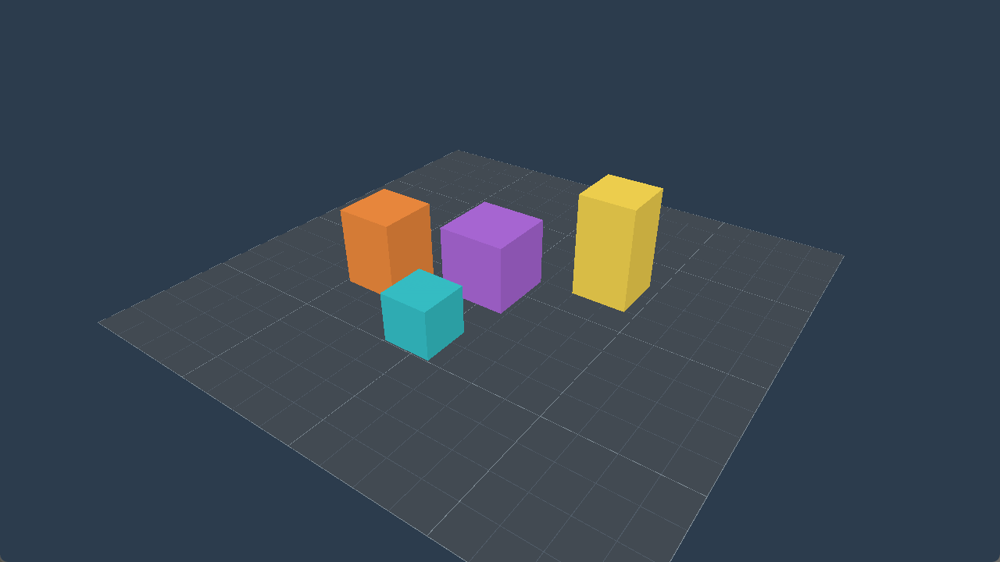

# First 3D viewport

The graphics sandbox renders a static technical scene: a 16-by-16 floor, a
one-unit grid and four orange/teal/yellow/violet cubes with different heights.
Cube face shades are baked vertex colors, not a lighting system. The camera is
elevated at `(10,11,14)` looking at `(0,0.2,0)`, with a 45-degree vertical FOV.
Each world unit represents one meter for this demonstration only; this does
not add spatial geometry or calibration to the warehouse model.



This PNG is an actual DPI-aware capture of the sandbox's client area, not a mockup.
The scene was also verified using GPU readback. There are no controls, warehouse
meshes, shadows, textures, transparency, instancing, scene graph, asset database,
compute passes or render graph.

## Data and module boundary

`simforge_render_scene` contains pure CPU camera/transform math, geometry and
frame validation. It links only GLM headers; the engine and analysis targets do
not link it. `simforge_renderer` owns all Vulkan assets and consumes
`const RenderFrameData&`. The sandbox builds the scene without a World or warehouse.

RenderFrameData owns a Camera and `std::vector<RenderObject>`. Each object contains
a MeshId, RenderTransform and linear RGB tint. IDs are stable `Cube=1`, `Floor=2`,
`Grid=3`, never Vulkan handles. Copies own independent data; there are no dangling
spans. Inputs remain constant during a call, which records their values into
commands/push constants and retains no caller references afterward, including
while the GPU executes. An empty object vector clears color/depth. Unknown IDs,
nonfinite values, colors outside `[0,1]`, nonpositive scales and unrepresentable
matrices are rejected. Mirrored/zero scales are unsupported. Invalid client data
is checked before GPU acquisition and does not poison the renderer.

GPU resources and visualization data never enter simulation snapshots. Warehouse
semantics, deterministic tick scheduling, recording and replay remain unchanged.

## Math and camera conventions

- Right-handed coordinates, world up `+Y`; camera-local forward is `-Z`.
- Column vectors and column-major packets; clip position is `P * V * M * p`.
- Model is `T * Rz * Ry * Rx * S`: scale, Euler X/Y/Z rotations, translation.
  All angles are radians.
- GLM `lookAtRH` and `perspectiveRH_ZO` explicitly select handedness and Vulkan
  depth `[0,1]`, independently of GLM default depth macros.
- Projection negates its Y diagonal, using a positive-height Vulkan viewport
  with framebuffer origin top-left. Outward CCW geometry uses
  `VK_FRONT_FACE_COUNTER_CLOCKWISE` and back-face culling.
- Camera validates finite vectors, a nondegenerate target/up basis,
  `0 < vertical_fov < pi`, positive aspect/near and `far > near`.
- Camera construction uses double intermediates and checks float GPU matrices.
  Renderer derives aspect from current framebuffer extent using a camera copy;
  it never mutates the frame. Zero/minimized extents skip drawing before division.

Tests check eye-to-origin, forward/up axes, near/far clip mapping, perspective
scale, Y/winding, resized aspect, invalid data and noncommuting transform order.

## Shader build and graphics pipeline

GLSL sources are `engine/shaders/scene.vert` and `scene.frag`. The SDK compiler
discovered as `Vulkan::glslc` builds with `--target-env=vulkan1.1 -O`. CMake tracks
source and embedding-script dependencies; errors stop the build.
`cmake/EmbedSpirv.cmake` checks the SPIR-V header/word count and emits numeric
uint32 words into generated private headers. Debug and Release executables embed
the shaders: no runtime asset paths, copying or manual recompilation is needed.
Generated SPIR-V and headers remain build artifacts.

Shader tests compile identical input twice, compare binary/header hashes, check
word encoding and require invalid GLSL/SPIR-V to fail. Updating the source timestamp
also triggered recompilation with identical SPIR-V. This guarantee is scoped to
identical inputs/settings/compiler version; another SDK may emit different valid
binaries. See the [shaderc manual](https://github.com/google/shaderc/blob/main/glslc/README.asciidoc).

One classic render pass has color/depth attachments. The pipeline uses a triangle
list, 24-byte position/color vertex stride, filled back-face-culled triangles,
one sample, opaque RGBA output, `LESS` depth testing/writing and dynamic viewport/
scissor. There are no descriptor sets. An 80-byte vertex push packet holds
column-major MVP and RGBA tint, below Vulkan's guaranteed 128-byte minimum.
Explicit packet packing avoids GLM alignment assumptions.

Colors are linear. sRGB attachments encode automatically; 8-bit UNORM fallback
uses a fragment specialization constant for explicit encoding, and the background
clear is encoded consistently. HDR/wide-gamut color management is deferred.

Pipeline compatibility keys color/depth formats. Extent-only recreation retains
pipeline, shaders, layout and mesh buffers; format changes rebuild the pipeline
against the replacement render pass. No per-frame compilation, pipeline creation,
mesh allocation or device-idle wait is added.

## Geometry and memory

| Mesh | Vertices | Indices | Convention |
|---|---:|---:|---|
| Cube | 24 | 36 | Unit cube centered at origin, outward shaded faces |
| Floor | 4 | 6 | Unit XZ rectangle, normal +Y |
| Grid | 136 | 204 | 34 thin triangle strips, unit spacing, major lines every four |

Grid sits at `Y=0.008` to avoid coplanar depth conflicts. Generation checks finite
sizes, representable strip widths and a bounded 1..256 half-cell count. Tests cover
index bounds, winding, counts, extents and invalid sizes.

All meshes pack into **one vertex buffer and one uint32 index buffer**: 164 stored
vertices, 246 indices, totaling 4,920 bytes of upload data (allocations may include
device alignment). Mesh ranges/base-vertex offsets reuse
geometry. Six scene draws reference 236 mesh vertices and submit 354 indices
(118 triangles); these do not claim exact hardware shader invocation/cache counts.

Host-visible memory suits this small static dataset. Coherent memory is preferred;
otherwise uploads flush the mapped allocation with `VK_WHOLE_SIZE`, respecting
noncoherent alignment. Queue submission follows upload. The Vertex ABI asserts
IEEE-754 float32, offsets 0/12 and size 24; index width and push packet offsets/size
are checked too. This is a defined GPU packet, not portable raw World serialization.

Each buffer owns its buffer/allocation/mapping; failed construction releases acquired
resources. Mapping becomes active only after success. Normal rendering allocates
two buffers per renderer lifetime, not per object/frame. Cleanup drains work and
frees command buffers/swapchain children, then pipeline/layout/shaders/buffers before
the device. There is no memory allocator framework.

## Depth and resize

Device selection checks optimal-tiling depth attachment support: D32_SFLOAT, then
D32_SFLOAT_S8_UINT, then D24_UNORM_S8_UINT. Each swapchain generation owns one
depth image/memory/view and matching framebuffers at actual pixel extent. Shared
depth is safe with one serialized frame. Depth clears to 1, discards old content
and uses depth-stencil attachment layout; dependencies cover early/late tests and
prior depth writes. Submission fences protect reuse. See
[Khronos depth guidance](https://docs.vulkan.org/tutorial/latest/07_Depth_buffering.html).

Resize drains device work and present fences before replacing size-dependent
resources. Zero/minimized windows do not recreate depth/swapchain repeatedly.
Per-image presentation semaphores/fences and the native-window lease remain in use.
Stencil-bearing formats are used for depth only; stencil is unused.

## Image verification and commands

```powershell
cmake --preset windows-debug
cmake --build --preset windows-debug
ctest --preset windows-debug --output-on-failure
build/windows-debug/apps/sandbox/simforge_sandbox.exe
build/windows-debug/apps/sandbox/simforge_sandbox.exe --graphics-smoke 180
powershell -NoProfile -ExecutionPolicy Bypass -File scripts/run-graphics-test.ps1 -Executable build/windows-debug/apps/sandbox/simforge_sandbox.exe -Mode Review -Frames 180

cmake --preset windows-release
cmake --build --preset windows-release
ctest --test-dir build/windows-release --output-on-failure
build/windows-release/apps/sandbox/simforge_sandbox.exe --graphics-smoke 180
# Optional visible CTest is disabled by default:
cmake --preset windows-debug -DSIMFORGE_GRAPHICS_TESTS=ON
ctest --preset windows-debug -L graphics --output-on-failure
```

Smoke enables validation, synchronization validation and readback. Only capture
requests surface `TRANSFER_SRC` and one mapped buffer per swapchain generation.
It requires RGBA/BGRA8 nonlinear sRGB; normal rendering does not. After drawing,
color transitions from present to transfer source, copies, then returns to present.
Transfer-to-host visibility, submission completion and noncoherent invalidation
protect reads. CapturedFrame owns top-down RGBA8 without GPU handles. Optional
P6 PPM output must be new, with an existing parent directory.

Smoke checks meaningful non-background coverage and four cube colors, then draws
a small near teal cube **before** a larger far orange cube. The center must remain
teal. Reversed draw order must produce identical pixels, proving depth rather
than painter's order. Empty scene must clear all pixels. Four verification/
restoration frames follow the requested count. Resize, minimize/restore, close,
resource counts, pipeline reuse, reinitialization and wrapper-first native-window
release are checked. Allocation failure/device loss are audited, not fault-injected.

## Intel compatibility investigation

Actual enumeration exposes NVIDIA and Intel. Intel Graphics driver 101.8331
(API 1.4.328) supports graphics/presentation queues and the SDL Win32 swapchain.
Both `VK_KHR_swapchain_maintenance1` and `VK_EXT_swapchain_maintenance1` are absent:
this is missing completion support, not missing presentation. Neither present-wait
variant was advertised by this Intel device. Instance surface support includes
both maintenance variants; device selection checks KHR and EXT independently.

A standards-compliant **steady-state** fallback uses per-image render-finished
semaphores and acquire-fence/semaphore waits proving prior present released them.
Deferred retirement can extend that scheme during recreation. Unextended Vulkan
has no complete guaranteed final-presentation shutdown wait; replacing present
fences with device/queue idle weakens the lifetime guarantee. See
[Khronos semaphore/shutdown guidance](https://docs.vulkan.org/guide/latest/swapchain_semaphore_reuse.html).
Present-wait APIs with their ID features offer extra mechanisms where supported,
but out-of-date/error paths require separate proofs. The original API disallows
retired swapchains and may return early on out-of-date; see
[present wait](https://docs.vulkan.org/refpages/latest/refpages/source/vkWaitForPresentKHR.html)
and [present wait2](https://docs.vulkan.org/refpages/latest/refpages/source/vkWaitForPresent2KHR.html).

A later compatibility milestone should feature-check alternative completion paths
and test normal, resize/out-of-date, final shutdown and surface loss on Intel.
This commit retains maintenance1 and the tested NVIDIA path. It does not disable
validation, change graphics modes, update drivers or claim Intel support.

## Observed validation and baseline

On 2026-10-08: SDK/loader 1.4.363, glslc shaderc 2026.4, GLM 1.0.3; NVIDIA GeForce
RTX 5080 Laptop GPU, API 1.4.351, graphics/present family 0; B8G8R8A8_SRGB/FIFO,
three images and D32_SFLOAT. Debug/Release passed **112/112** ordinary tests;
renderer-disabled passed **93/93** without Vulkan discovery. Dedicated headless
remains SDL/Vulkan-free; warehouse, comparison, export, movement, snapshots and
recording/replay regressions pass.

Both 180-frame smoke paths reported zero validation warnings/errors through
destruction/reinitialization. Release readback contained 306,002 non-background
pixels and 11,986/9,244/15,708/14,043 orange/teal/yellow/violet pixels at 1280x720;
depth tests passed. Resize produced four depth generations, one pipeline and six
buffer allocations (two static, four diagnostic). Normal rendering retains two
buffers. An extended Debug smoke requested 1,800 frames, presented 1,804 including
the probes/restoration, and passed with zero validation messages. The opt-in
graphics CTest passed from its build directory, verifying embedded shader availability
outside the source working directory. Normal Debug and Release desktop scenes were
captured/observed; native close exited 0 in both. Debug reported zero validation
messages; ordinary Release defaults to validation off, while Release smoke explicitly
enables it. These are automated GPU/desktop checks, not human testing.

One Release smoke measured 3.85 ms mean CPU render/submit/present wall time,
0.74 ms asset initialization and 13.71 ms pipeline creation. A normal Debug desktop
run measured 4.02 ms mean host render/present time. These include FIFO waits,
validation/recreation costs where exercised and cache effects; there are no GPU
timestamp measurements or raw throughput claims.

## Limits and warehouse recommendation

Only NVIDIA was live-tested. Split queues, stencil depth and UNORM fallback were
covered through policy/math where possible, not forced live. Capture support is
narrower than ordinary rendering. Camera controls, HDR, anti-aliasing, staging to
device-local mesh buffers, batching and large-scene tuning are deferred.

This document records the Commit #12 baseline. Commit #13 adds a CPU-only warehouse
adapter with stable visual identities, shared industrial meshes and resize-aware
automatic framing. Its current results are in [warehouse-visualization.md](warehouse-visualization.md).
The no-argument cube demo remains available. Live operational interpolation and
instance buffers remain deferred; scheduling, metrics, ticks and snapshots are unchanged.
