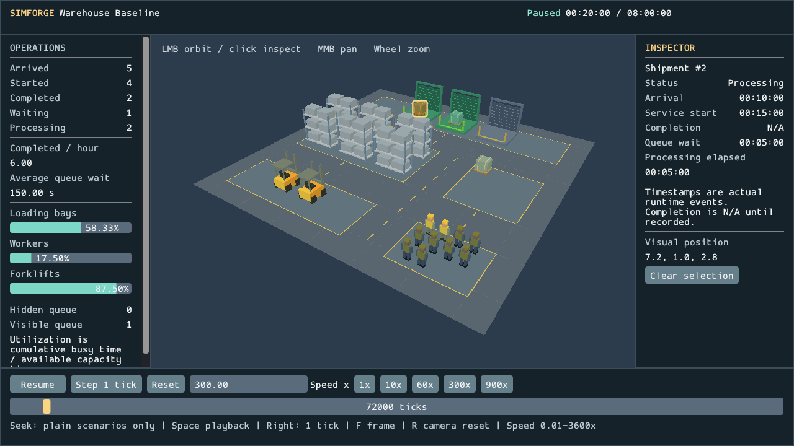

# Interactive Warehouse Viewer

Commit #15 adds an operational dashboard and interaction to `--live`. Static
warehouse rendering, the floor/grid/cube demo and existing headless workflows remain
supported. Scheduling, metrics, warehouse snapshots and recording schemas are unchanged.

```powershell
build/windows-release/apps/sandbox/simforge_sandbox.exe --scenario examples/warehouse-baseline.json --live --speed 300
```

## Interface and controls

The navy header shows scenario, Live/Paused/Horizon reached, simulated HH:MM:SS and
configured duration. The left sidebar contains Arrived/Started/Completed/Waiting/
Processing, completed shipments per hour, average wait in seconds, cumulative
bay/worker/forklift utilization bars and explicit visible/hidden queue counts.
Undefined metrics display N/A, including utilization and throughput at tick zero.
All values come from the current authoritative warehouse observation.

The central scene uses the space remaining beside the panels. The bottom bar exposes
Play/Pause/Resume, Step 1 tick, Reset, speed presets 1/10/60/300/900x, an Enter-applied
custom speed (0.01-3600x), and a tick timeline. At the horizon Play/Step are disabled;
seek or Reset to continue. A right inspector appears only on selection.

| Input over viewport | Action |
| --- | --- |
| Left click / left drag | Nearest object selection / orbit after a 5 logical-pixel threshold |
| Middle drag | View-relative pan, scaled by camera distance and viewport height |
| Wheel | Exponential zoom, clamped to scene-dependent limits |
| F / R | Frame current warehouse / restore initial overview at current aspect |
| Space | Pause or resume |
| Right arrow | Exactly one logical tick while paused; not the next shipment event |
| Escape | Deselect |

Green marks busy loading zones and processing cargo; bright vehicle/person tints
contrast with muted idle slots. The FIFO queue head uses amber and other waiting
cargo uses a cooler tint. Selection adds an amber object tint and bounding outline;
no geometry or shader is created for it. Brief vertical settling remains presentation
only and never predicts physical travel.

640x480 is the minimum logical client size. At 1280x720, 1600x900 and 1920x1080,
fixed panels reserve the actual scene viewport; the camera fits that rectangle,
including inspector width. Below 1000 pixels the inspector and full metrics share
scrollable tabs, and speed presets wrap onto their own row. Long labels stack above
values instead of overlapping. Font/UI sizes are logical units; SDL reports drawable
scale. Pointer coordinates stay logical until conversion to the rounded drawable
rectangle. No docking workspace is introduced.

## Ownership and input

```text
SDL3 events -> ImGui SDL backend + plain InputEvent values
                                |
                     ViewerController (CPU only)
                     camera / selection / playback
                                |
WarehouseSimulation -> bounded observation -> LiveWarehouseScene -> RenderFrameData
                                |                                   |
                    read-only dashboard/inspector             custom Vulkan scene
                                |                                   |
                          ImGui draw data ----------------> same render pass
```

`simforge_viewer` links CPU visualization/domain targets and GLM only. It owns the
runtime, pristine checkpoint, observation, camera and stable selection. Only
WarehouseSimulation owns the authoritative SimulationClock. Frame durations are
inputs to that runtime; animation uses real time independently. Invalid speeds,
negative durations, invalid rectangles, nonfinite camera inputs and invalid seeks
are rejected. No second viewer clock or domain dependency on UI is introduced.

`apps/sandbox/dashboard.*` reads const state and emits typed commands. The application
applies commands before advancing/building the next frame; discontinuous controls
discard that frame's old wall duration. All events reach ImGui. After NewFrame,
WantCaptureMouse/WantCaptureKeyboard/WantTextInput gate controller actions. Panels
cannot pick or move the camera, scrolling cannot zoom through panels, and typing
blocks playback shortcuts. Releases/focus loss always cancel drags; leaving the
viewport cancels a drag to prevent jumps on reentry. Keyboard actions precede
dashboard construction, keeping scene and metrics on the same operational state.
Window close still uses the platform loop.

## Camera, picking and inspector

The Y-up orbit camera wraps yaw, clamps pitch to 0.17-1.35 radians, uses scene-radius
zoom/pan bounds and keeps its eye above the floor. Default framing fits all warehouse
bounds with the existing perspective margin. Aspect changes reframe an untouched
overview; manual navigation preserves pose while updating projection. Camera motion
never advances or reinitializes operations.

Picking inverts the actual RH zero-to-one Vulkan camera matrix. Logical pointer,
viewport offset and per-axis framebuffer scale produce NDC coordinates; projection
already flips Y. Near/far points form a normalized finite ray. Slab ray/AABB tests
choose the nearest clipped hit; exact distance ties use `(category,id)` ordering
independent of vector order. Bounds are visual approximations, not physics. Dock
bounds cover the rear door to avoid selecting its empty loading volume through cargo.

Shipment keys are real runtime IDs; resource keys are one-based visual capacity-slot
ordinals; rack keys are layout ordinals. Matching observable keys retain selection
across ticks. Disappeared objects, seek, Reset and scenario replacement clear it.
Selection does not alter ECS ownership.

Shipment inspection shows actual arrival/start/completion fields, queue wait and
elapsed processing where defined. Unknown timestamps remain N/A. Active jobs do not
have fabricated future completion times. Completed shipments leave the bounded live
observation and selection clears. Resource inspection shows busy/idle display state,
aggregate capacity/usage and cumulative utilization, with an explicit explanation
that the slot is a deterministic capacity representation, without physical resource
identity or a recorded shipment assignment.

## Playback and seeking

Startup runs at CLI speed. Pause discards subsequent wall inputs. Step executes one
logical tick while paused, capped at the horizon. Speed alters pacing only. Reset
restores the pristine constructor snapshot, clears transitions/selection and pauses
while retaining speed/camera. Arrival zero is pending there; Step/Play settles it.

The timeline retains its preview while dragging and commits on release, then pauses.
Forward seek executes all events through the target. Backward seek restores the
pristine checkpoint and executes forward, preserving runtime event ordering. Seek
establishes a tick boundary, clears old fractional wall phase, snaps animations and
clears selection. Seek zero settles real arrival zero, unlike untouched Reset.
Seek horizon preserves unfinished work exactly.

**Only plain, unmodified ScenarioDefinition inputs are supported.** The viewer has
no recording/snapshot-loading or capacity-command interaction API. Existing CLI
validation rejects live replay/comparison/recording combinations. Recorded capacity
interventions remain available through headless replay; the viewer cannot silently
omit them because it cannot load those timelines. Future recorded playback must apply
accepted commands in recorded order before enabling seek. No checkpoint cache is
needed for these measured workloads.

Equivalent logical ticks and accepted inputs preserve exact integer operational
state across camera/UI interaction and render pacing. Tests compare complete
snapshots, including queues/events/metrics. Camera floats and rasterization are
presentation; fixed steps alone do not guarantee fully deterministic simulation
results across hardware or implementations.

## Dear ImGui and Vulkan lifecycle

The existing pinned vcpkg baseline installs Dear ImGui 1.92.9b with compiled SDL3
and Vulkan backend features. Installed headers, configuration and target were
inspected before integration. See the [pinned feature manifest](https://raw.githubusercontent.com/microsoft/vcpkg/2750401336fb7c95f6619657a46a7e798661341c/ports/imgui/vcpkg.json)
and [upstream Vulkan backend](https://github.com/ocornut/imgui/blob/v1.92.9b/backends/imgui_impl_vulkan.h).
The optional project `viewer` feature is selected before CMake project configuration
only with SIMFORGE_BUILD_RENDERER=ON. Renderer-disabled builds do not install ImGui
or its Vulkan dependency set. The headless preset isolates its vcpkg install directory.

Renderer owns the ImGui context, SDL/Vulkan backends, descriptor pool, embedded default
scalable font and backend buffers/textures. UI draws after the custom scene in the
same compatible color/depth render pass, before readback. Scene viewport/scissor
use its reserved drawable area. Existing acquire/submission/per-image presentation
fences remain authoritative; prior submission completes before UI texture/buffer
updates. Minimized frames build no UI or invalid viewport. Resize drains graphics
and pending presentations, recreates swapchain/depth and retains compatible pipelines.
Color-format or image-count changes reinitialize the drained GPU UI backend while
retaining context/SDL state. Ordinary interaction rebuilds no pipeline or static mesh.

Shutdown drains GPU work before destroying UI GPU resources, SDL backend and context,
then command pool, swapchain, scene, device and platform lease. Reinit creates fresh
UI resources. Scene/UI draw counters are separate. Tests verify zero validation or
synchronization messages through resize, minimize/restore, shutdown and reinit.

## Validation and images

Windows/MSVC x64 builds on 2026-10-08 passed:

| Configuration | Result |
| --- | --- |
| Debug, graphics tests ON | 172/172: original 151 plus 21 CPU viewer cases |
| Release, graphics tests ON | 172/172: 167 ordinary plus five opt-in graphics cases |
| Renderer OFF | 147/147: original 126 plus 21 CPU viewer cases |

New CPU cases cover camera limits/reset/aspect/invalids, ray round trips/offsets/DPI,
nearest hit/ties/empty space, stable selection/replacement, input capture/focus loss,
play/pause/speed/one tick/reset, zero/horizon/invalid/forward/backward seek, truthful
inspection, undefined values/overflow counts, and final equivalence across frame rates
and randomized seeks. They run without SDL/Vulkan; `dumpbin /dependents` confirms
that on isolated headless and renderer-disabled viewer test executables. Existing
snapshots/replay, branch/batch comparison and JSON/CSV export tests remain green,
along with static warehouse and cube/depth/resize graphics smoke.

Extended live smoke injects SDL events through normal polling/backend routing:
Pause/Resume/Step/Reset buttons, forward/backward timeline release, input-field Space
capture, orbit, middle pan, zoom, shipment click and focus-loss cancellation.
Readback verifies dashboard text, real viewport geometry, changed camera pixels,
and selected-object tint with identical camera/UI. Inspector IDs/undefined completion
are checked. Full final state matches headless. All five window sizes, minimize/
restore, pipeline reuse, shutdown and reinit pass. Native CloseMainWindow on a
normally running Release viewer delivered the request and exited with code 0.

Hardware mouse/keyboard automation was not verified; interaction tests inject SDL
events as permitted. Actual Vulkan validation used NVIDIA RTX 5080 Laptop GPU API
1.4.351, SDK/loader 1.4.363, BGRA8 sRGB/FIFO and maintenance1 presentation fences.
Intel Graphics remains rejected for missing those fences. Other GPUs/OSes/split
queues and actual high-DPI monitors remain unverified; CPU tests cover DPI math,
including nonuniform scaling.

These are visually inspected GPU readbacks, losslessly converted from PPM:

| Image | Actual baseline state |
| --- | --- |
| [Overview](artifacts/interactive-warehouse-overview.png) | Untouched tick 0; undefined throughput/utilization N/A |
| [Shipment inspector / paused](artifacts/interactive-warehouse-selected.png) | 20 min; shipment 2, arrival 10 min/start 15 min/processing elapsed 5 min; completion N/A |
| [Queue buildup](artifacts/interactive-warehouse-queue-buildup.png) | 2 h; 25 arrived, 17 started, 15 completed, 8 waiting, 2 processing; six waiting shown, two hidden |
| [Final results](artifacts/interactive-warehouse-final.png) | 8 h; 96 arrived, 64 started, 63 completed, 32 waiting, one processing; 26 waiting hidden |
| [Small window](artifacts/interactive-warehouse-size-640.png) | 640x480; scrollable panels, wrapped presets/hints |



## Measurements and reproduction

Release CPU means over 2,000 calls, including API/allocation costs. Both states are
settled at 7,200 simulated seconds. Large changes only capacities to 128 bays/256
workers/64 forklifts and arrival interval to one second.

| Case | Scene draws / selectables | Camera + matrix | Ray + pick | Paused animation + presentation values |
| --- | --- | --- | --- | --- |
| Baseline | 83 / 29 | 0.089 us | 0.476 us | 0.146 us |
| Large | 1,090 / 896 | 0.092 us | 10.402 us | 3.640 us |

The existing live benchmark measured bounded extraction / dynamic target construction
/ animation and selectable update at 0.137/0.892/0.111 us for 80 objects and
1.115/10.176/2.408 us for 703 objects. Current picking bounds add CPU work to the old
animation path (previous large animation alone: 0.319 us); it remains a few microseconds
without GPU mesh allocation or layout rebuild.

Actual Release 600-frame live smoke runs (656 submissions including probes,
validation enabled, resize/seek included, mostly settled at horizon) measured:

| Case at horizon | 3D / UI draws | UI build | Dynamic/animation | Record/submit/present | Total CPU frame incl. poll/commands/UI/fence waits |
| --- | --- | --- | --- | --- | --- |
| Baseline, 82 objects | 82 / 7 | 38.166 us | 0.805 us | 3.720 ms | 4.069 ms |
| Large, 1,089 objects | 1,089 / 7 | 36.636 us | 5.973 us | 3.700 ms | 4.151 ms |

Both retained one scene and one UI pipeline with zero warnings/errors. A normally
advancing baseline (native close after 3 s, validation disabled) averaged UI build
34.423 us, dynamic update 4.797 us and total CPU frame 4.143 ms. FIFO/fence waits are
included. These are CPU measurements, not GPU timers or a GPU-speedup claim; prior
runs were approximately 4.16 ms.

```powershell
cmake --preset windows-debug -DSIMFORGE_GRAPHICS_TESTS=ON
cmake --build --preset windows-debug
ctest --preset windows-debug --output-on-failure
cmake --preset windows-release -DSIMFORGE_GRAPHICS_TESTS=ON
cmake --build --preset windows-release
ctest --test-dir build/windows-release --output-on-failure
cmake --preset windows-headless
cmake --build --preset windows-headless
ctest --preset windows-headless --output-on-failure
build/windows-release/benchmarks/simforge_viewer_benchmark.exe
build/windows-release/benchmarks/simforge_live_warehouse_benchmark.exe
# Optional explicit fixture output, which must be new:
build/windows-release/benchmarks/simforge_viewer_benchmark.exe . --write-large-scenario build/viewer-large-new.json
build/windows-release/apps/sandbox/simforge_sandbox.exe --scenario build/viewer-large-new.json --live --graphics-smoke 600
# Optional new PPM output plus diagnostic siblings:
build/windows-release/apps/sandbox/simforge_sandbox.exe --scenario examples/warehouse-baseline.json --live --graphics-smoke 600 --graphics-capture build/viewer-new.ppm
```

Live capture siblings use `-overview`, `-queue`, `-selected`, `-paused`,
`-queue-buildup`, `-final` and `-size-WIDTH`. Normal playback does not inject events,
seek automatically or perform readback. Graphics tests remain opt-in; set
SIMFORGE_GRAPHICS_TESTS=OFF for CPU-only CTest.
Primary and sibling capture filenames must all be new; collision rejection occurs
before SDL/Vulkan initialization and is covered by the graphical input-validation test.

## Remaining work

Recorded intervention timelines/checkpoint caching, completed-shipment history UI,
individual physical assignments, scenario editing, transport/pathfinding and GPU
profiling are absent. AABB picking is deliberately approximate; spatial indexing
is unnecessary at the measured scale. Fonts use ImGui's embedded default.
Camera bounds prevent flips/floor penetration; mesh collision avoidance is not modeled.
Recommend discussing command-aware recorded playback and explicit comparison/scenario
workflows for Commit #16, with measurements guiding checkpoint/picking optimization.
None of that future milestone is implemented here.

## Files changed

Added:

- `engine/include/simforge/viewer/viewer.hpp`, `engine/src/viewer/viewer.cpp`: CPU controller, camera, picking and inspection.
- `apps/sandbox/dashboard.hpp`, `apps/sandbox/dashboard.cpp`, `apps/sandbox/viewer.hpp`, `apps/sandbox/viewer.cpp`: graphical dashboard, input routing and live smoke.
- `tests/viewer_test.cpp`, `benchmarks/viewer_benchmark.cpp`.
- `docs/interactive-warehouse-viewer.md` and the five `docs/artifacts/interactive-warehouse-*.png` images linked above.

Modified:

- `CMakeLists.txt`, `CMakePresets.json`, `vcpkg.json`, `README.md`.
- `engine/CMakeLists.txt`, `apps/sandbox/CMakeLists.txt`, `benchmarks/CMakeLists.txt`, `tests/CMakeLists.txt`.
- `engine/include/simforge/platform/window.hpp`, `engine/src/platform/window.cpp`: event callback.
- `engine/include/simforge/renderer/render_frame_data.hpp`, `engine/src/renderer/render_frame_data.cpp`: drawable viewport values/validation.
- `engine/include/simforge/renderer/renderer.hpp`, `engine/src/renderer/renderer.cpp`: owned UI/backend lifecycle and counters.
- `engine/src/renderer/vulkan_scene.cpp`, `engine/src/renderer/vulkan_swapchain.hpp`, `engine/src/renderer/vulkan_swapchain.cpp`: reserved viewport and UI recording.
- `engine/include/simforge/visualization/live_warehouse.hpp`, `engine/src/visualization/live_warehouse.cpp`: bounds/IDs, highlight and busy/idle contrast.
- `apps/sandbox/graphics.cpp`, `apps/sandbox/main.cpp`: live viewer dispatch and help text.
- `tests/renderer_lifecycle_test.cpp`, `tests/graphical_scenario_test.cmake`: API guards and capture collision regression.
- `docs/live-warehouse-visualization.md`: historical milestone notice/current viewer link.

The earlier README cleanup removing the empty assets directory entry is preserved.
No warehouse, clock, ECS, scheduling, snapshot or recording implementation changed.
