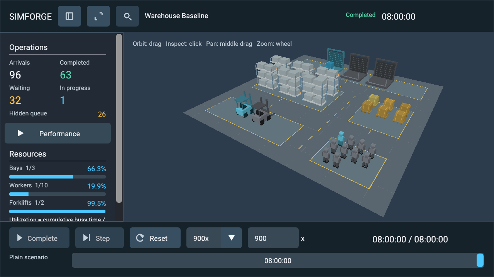

# Interactive Warehouse Viewer

**Current presentation:** Commit #18 adds Simulation, Scenario Editor and Analysis modes, full-width workspace pages, directional lighting and Windows report Save As. See [visual design](visual-design.md) for current controls, screenshots and validation. Historical measurements below describe the milestone that introduced each feature.

Commit #17 adds the [scenario editing/comparison workspace](scenario-workspace.md).
The guidance and performance below record the Commit #16 presentation milestone;
the workspace guide contains current 219-test results, editing/comparison semantics
and additional captures. The fourth header icon opens the workspace, and a normal
no-argument launch now includes a warehouse file-entry panel over the static demo.

Commit #16 refines the existing live dashboard, typography, framing and operational
contrast. The static warehouse and floor/grid/cube demos remain supported. Warehouse
rules, clock authority, metrics, snapshots, recording/replay and exports are unchanged.

```powershell
build/windows-release/apps/sandbox/simforge_sandbox.exe --scenario examples/warehouse-baseline.json --live --speed 300
```

## Layout and design

The navy header contains the scenario name, Running/Paused/Completed status and
simulated time. Three icon buttons toggle operational metrics, warehouse focus and
selected-object inspection. Long scenario names shorten at a UTF-8 boundary with a
full-name tooltip. The scene uses the actual space remaining between panels and the
playback bar, rather than the whole window's aspect ratio.

The slate operations panel groups four large KPIs: Arrivals, Completed, Waiting and
In progress. Hidden queue count remains explicit. Expand **Performance** for Started,
completed shipments per simulated hour, average queue wait and maximum queue wait.
Wait durations use seconds/minutes/hours with one decimal place. Resource rows show
active usage/capacity and cumulative bay/worker/forklift utilization with compact bars.
Undefined observations display N/A; all numbers come from authoritative observations.
Performance starts expanded when vertical space permits; its user's choice persists.

`simforge/viewer/presentation.hpp` centralizes typography, padding, spacing, control
height, corners and UI colors. `visualization/visual_palette.hpp` gives the scene the
same operational color meanings. Backgrounds are restrained navy/slate, primary text
soft white and secondary text light gray. Waiting is amber, processing/busy blue,
completed feedback green, idle resources gray, selection gold and errors red.

Roboto Regular is embedded at build time, with body/control text 16, labels 14,
headings 18 and KPI values 24 logical pixels before display scaling. The unmodified
font, pinned source, hash and Apache 2.0 license are in
[assets/fonts](../assets/fonts/README.md). No Windows system font is copied and no
runtime asset lookup is required. One font source supports the different sizes.

### Responsive layout and DPI

640x480 is the minimum logical client size. Layout is a pure CPU calculation using
logical surface size, UI scale, framebuffer scale, panel preferences and selection.
UI scale is derived from SDL's display scale divided by drawable/logical density,
bounded to 1-2. It is independent of pointer-to-framebuffer conversion: logical mouse
coordinates convert with per-axis framebuffer scale into the rounded scene rectangle.

| Window | Presentation |
| --- | --- |
| 640x480 | Compact scene view; panels can be opened and scrolled. Icon playback controls, speed menu, separate time row and timeline remain accessible. |
| 1024x768 | Compact when effective width is limited by DPI; inspector shares the sidebar through tabs. |
| 1280x720 | Primary target: operational KPIs, resource rows, scene and playback; Performance can be expanded and scrolled. Inspector uses tabs at limited width. |
| 1600x900 | More scene space; an independent inspector when effective width permits. |
| 1920x1080 | Larger scene and expanded Performance; separate inspector at the tested native 150% scale. |

Compact mode is selected below 850 effective logical pixels in width, or below 650
pixels in client height. Metrics are initially hidden there unless the user explicitly
opens them. When selecting at limited width, the inspector uses the operations panel's
space; tabs retain access to both. Wider layouts reserve a separate right inspector.
Collapsing panels updates viewport/picking regions and preserves camera pose and
selection. Warehouse focus hides both panels and restores their preferences on exit.
No docking framework or persistent workspace database is introduced.

Large controls, readable text, recognizable vector icons, tooltips and labels improve
accessibility. State names and counts accompany color, so color is not the sole cue.
Compact buttons use tooltips/hotkeys; Play/Step/Reset have at least 36 logical-pixel
height. Full screen-reader accessibility and comprehensive keyboard-only navigation
are not implemented.

## Controls, camera and selection

| Input over viewport | Action |
| --- | --- |
| Left click / left drag | Nearest object selection / orbit after a 5 logical-pixel threshold |
| Middle drag | View-relative pan scaled by camera distance and viewport height |
| Wheel | Exponential zoom within scene-dependent limits |
| F / R | Frame current warehouse / restore initial overview at current aspect |
| Space | Pause/resume |
| Right arrow | One logical tick while paused |
| Escape | Clear selection |

The elevated three-quarter camera now fits all bounds with a 1.04 margin instead of
1.12, using the reserved viewport. Static demo framing keeps its previous margin.
Near/far limits remain valid for both baseline and large scenes. An untouched camera
refits on aspect changes; a manually moved camera preserves pose on window resize.
Panel toggles preserve pose even before manual navigation. F explicitly reframes
when a preserved view needs adjustment. No per-frame camera reset occurs.

Picking uses the actual RH zero-to-one Vulkan projection and rounded drawable
viewport. A finite near/far ray intersects approximate visual AABBs, choosing the
nearest hit with `(category,id)` ties independent of vector order. Bay bounds cover
the rear door instead of its empty loading volume. Shipment keys are real runtime
IDs; resource keys are one-based capacity-slot ordinals and racks are layout ordinals.
Valid keys persist across ticks. Disappeared objects, seek, Reset and replacement
clear selection. A gold material tint plus dark-backed gold outline and ID caption
help locate the selected mesh without another GPU pass.

Waiting cargo stays FIFO and amber, with a brighter queue head. Processing cargo and
busy slots are blue; idle slots are gray. Completed shipments leave processing slots;
their totals/status use green in the UI. A per-object material flag retains baked
vertex luminance while replacing the old hue, so multiplying an existing yellow
material cannot turn a requested blue activity tint green. Static materials keep
their previous behavior. Meshes, draw counts, placements and operational rules remain
unchanged. Brief settling is presentation only and never predicts physical transport.

The scrollable inspector displays type/ID, actual shipment status, arrival/service
start/completion HH:MM:SS, elapsed queue wait and processing, and visual position.
Unknown timestamps are N/A; active jobs do not claim a future completion time.
Resource inspection shows usage/capacity, cumulative utilization and an explicit
capacity-slot disclaimer: individual physical identity and shipment assignments
are not simulated. Hide the inspector to retain selection, or Clear selection to
dismiss it completely.

## Playback and application feedback

Play/Pause/Resume, one-tick Step, Reset, speed and the timeline remain visible.
Speed presets are 1/10/60/300/900x; custom values accept 0.01-3600x. The normal layout
has an Enter-applied custom input; compact mode offers **Custom speed...** in the
speed menu. Invalid values show a red explanation and retain the last accepted speed.
Current time and configured duration remain prominent, including compact mode.

Startup runs at CLI speed. Pause discards subsequent wall inputs; Step is available
only while paused before the horizon. At the horizon the header says Completed and
Play/Step are disabled with explanations. Completion means the scenario horizon was
reached; unfinished waiting/processing work is retained exactly.

Reset restores the pristine constructor snapshot, clears transitions/selection and
pauses, retaining speed/camera. Arrival zero remains pending until Step/Play. Timeline
dragging displays **Seek preview** and commits on release. Forward seek executes all
events through the target; backward seek restores the pristine checkpoint and runs
forward. Both establish a tick boundary, clear old wall phase, snap animations, clear
selection and pause. Seek zero settles arrival zero, unlike untouched Reset.
Reset/seek show concise completion feedback after synchronous work; there is no
fabricated loading percentage or asynchronous progress. Initial scenario validation
and loading occur synchronously before graphics initialization; failures report to
the CLI. Loading/Resetting/Error labels are defined for presentation, but startup is
not represented as an asynchronous in-window workflow.

**Graphical playback accepts only plain, unmodified scenarios.** It cannot load a
recording or omit recorded interventions. Capacity-command playback remains available
headlessly. Future recorded seeking must apply accepted commands in recorded order.
Equivalent logical ticks and accepted inputs preserve exact operational state in the
supported execution environment; UI/camera tests compare complete snapshots. Camera
floats and rasterization are presentation. Fixed-step timing alone does not guarantee
bitwise simulation determinism across hardware or implementations.

## Ownership, input and Vulkan resources

```text
WarehouseSimulation -> observation -> LiveWarehouseScene -> RenderFrameData
                                |                              |
                      CPU ViewerController              custom Vulkan scene
                                |                              |
SDL events -> ImGui + controller -> dashboard draw data -> same render pass
```

`simforge_viewer` links CPU visualization/domain targets and GLM only; pure layout,
formatting, camera and picking tests require no SDL, Vulkan or ImGui. Only the
warehouse runtime owns SimulationClock. The dashboard reads const observations and
emits typed commands; the application applies commands before advancing/building the
next frame and discards stale wall duration for discontinuous controls. No mutable
domain references or GPU handles enter snapshots. Engine/platform/rendering boundaries
and headless dependency isolation remain intact.

All SDL events reach the ImGui backend. After NewFrame, WantCaptureMouse and
WantCaptureKeyboard/WantTextInput gate controller actions. Current viewport bounds
are set before processing input, including resize and panel changes. Panel clicks
cannot pick or orbit; panel scroll cannot zoom the scene; text input captures playback
shortcuts. Release/focus loss cancels drags; leaving the viewport prevents reentry
jumps. Native close follows the existing platform loop.

Renderer owns ImGui context/backends, descriptor pool, font atlas and buffers.
Immutable embedded font bytes outlive the context (`FontDataOwnedByAtlas=false`).
Dear ImGui 1.92.9b caches requested font sizes/glyphs and uploads updates through its
texture-capable Vulkan backend; there is no per-frame atlas Clear/Build. The previous
submission fence is waited before NewFrame and font/buffer writes. Style sizes are
rebuilt only when UI scale changes. See [upstream font/DPI guidance](https://github.com/ocornut/imgui/blob/v1.92.9b/docs/FONTS.md).

UI draws after the custom scene in the same compatible pass before diagnostic
readback. One scene/UI pipeline persists across compatible resize. Existing
acquisition, submission and per-image maintenance1 presentation fences retain their
ownership. Minimized frames skip UI; resize drains work/presentations. Shutdown drains
GPU work before freeing UI/context, swapchain/scene/device and the platform lease.
Counters expose font texture creation/update requests independently of scene/UI draws.

## Validation and inspected screenshots

Windows/MSVC x64 validation on 2026-10-08:

| Configuration | Result |
| --- | --- |
| Debug, graphics tests ON | 185/185, including five opt-in GPU cases |
| Release, graphics tests ON | 185/185, including five opt-in GPU cases |
| Renderer OFF Debug | 160/160 CPU tests |

Thirteen new CPU presentation cases cover supported resolutions/scales, panel
collapse/focus/inspector bounds, positive viewport extents, minimum/nonoverlapping
controls, independent framebuffer/DPI mapping, framing/clipping, manual camera
preservation, F/R, capture/picking, formatting, status/error semantics, FIFO colors
and whole-snapshot regression. The 21 existing viewer cases and all prior clock,
world, snapshots/replay, comparison and JSON/CSV export tests remain green.
The final baseline is 96 arrived, 64 started, 63 completed, 32 waiting, one processing.
`dumpbin /dependents` confirms no SDL/Vulkan import in isolated headless and
renderer-disabled presentation-test executables.

Extended Debug/Release graphics smoke uses real Vulkan readbacks and injected SDL
events through normal routing: playback buttons, timeline releases, keyboard capture,
orbit/pan/zoom, shipment picking, inspector, focus loss, collapses, all five requested
sizes, minimize/restore, 100/125/150/200% UI scales, pipeline reuse and clean shutdown/
reinitialization. Real selected-mesh tint is additionally checked in an isolated close
view because large-scene overview cargo may be occluded or subpixel. Full final
snapshots match headless runs. Native CloseMainWindow on a normally running Release
viewer exited with code 0; GetDpiForWindow reported 144 DPI (150%).

GPU: NVIDIA RTX 5080 Laptop, API 1.4.351; SDK/loader 1.4.363, BGRA8 sRGB, FIFO.
Validation and synchronization validation reported zero warnings/errors through
tested graphics lifecycles. Intel Graphics remains unsupported on this driver because
maintenance1 present fences are absent. Other GPUs, OSes and split queues are not
live-tested. 150% is the actual native desktop scale; other UI scales are diagnostic
overrides, with framebuffer combinations tested on CPU. No claim is made for physical
100/125/200% monitors. Hardware mouse/keyboard automation is not verified.

These screenshots are actual baseline Vulkan captures, visually inspected and
losslessly converted from PPM to PNG; injected hover help is moved out of the way.
Earlier Commit #15 captures remain in `artifacts/interactive-warehouse-*.png`.

| Capture | State / purpose |
| --- | --- |
| [Overview](artifacts/refined-warehouse-overview.png) | Untouched tick zero; undefined utilization N/A |
| [Queue buildup](artifacts/refined-warehouse-queue-buildup.png) | 2 h: 25 arrivals, 15 completed, eight waiting, two processing; two waiting hidden |
| [Shipment inspector](artifacts/refined-warehouse-selected.png) | Paused at 20 min; shipment 2 arrival 10 min/start 15 min; completion N/A |
| [Completed horizon](artifacts/refined-warehouse-final.png) | 8 h: 96 arrivals, 63 completed, 32 waiting, one processing; 26 waiting hidden |
| [Compact 640](artifacts/refined-warehouse-size-640.png) | Essential playback, separate time row and scene |
| [1024](artifacts/refined-warehouse-size-1024.png), [1600](artifacts/refined-warehouse-size-1600.png), [1920](artifacts/refined-warehouse-size-1920.png) | Responsive desktop layout; large view exposes Performance |
| [Warehouse focus](artifacts/refined-warehouse-focus.png) | Reclaimed scene width with camera pose retained |
| [100%](artifacts/refined-warehouse-dpi-100.png), [125%](artifacts/refined-warehouse-dpi-125.png), [200%](artifacts/refined-warehouse-dpi-200.png) | Diagnostic UI scales at 1280x720; panel scrolling at high scale |



## Before/after measurements

Release on the same machine, baseline versus a generated large fixture with 128 bays,
256 workers, 64 forklifts and one-second arrivals. Graphics runs request 600 steady
frames with validation enabled; the before run has 656 total submissions, after 716
because additional collapse/DPI/selection checks submit frames. Means include this
diagnostic prelude, resize and seek, and are mostly settled at the horizon. Both finish
at 1280x720 with metrics visible and Performance collapsed. Larger font/UI contents
and viewport areas differ, so these are practical comparisons, not controlled GPU
throughput measurements. Units are CPU wall time and include synchronization waits.

| Case | UI build before/after | Dynamic before/after | Record/submit/present before/after | Total frame before/after |
| --- | --- | --- | --- | --- |
| Baseline | 40.929 / 52.684 us | 0.752 / 0.806 us | 3.722 / 3.533 ms | 4.074 / 3.917 ms |
| Large | 35.422 / 57.545 us | 5.679 / 7.108 us | 3.691 / 3.652 ms | 4.127 / 4.129 ms |

UI construction increases about 12-22 us, with no material total-frame regression
observed in these runs. FIFO/fence waits dominate; this is not a GPU-speedup claim.
Normal advancing Release playback with validation disabled and native close after
about three seconds averaged UI 38.633 us, dynamic 4.293 us and total 4.142 ms.

| CPU benchmark (2,000 calls at 2 h) | Objects/selectables | Ray+pick before/after | Animation+frame values before/after |
| --- | --- | --- | --- |
| Baseline | 83 / 29 | 0.537 / 0.473 us | 0.165 / 0.181 us |
| Large | 1,090 / 896 | 10.550 / 10.240 us | 3.542 / 4.402 us |

Camera+matrix after measured 0.090/0.089 us for baseline/large. Separate bounded
observation extraction/dynamic target construction/frame update after measured
0.130/0.882/0.127 us (80 objects), and 0.884/9.549/2.976 us (703 objects).
Measurements vary with scheduling and allocation; no spatial-index optimization is
justified by the measured picking cost.

At the horizon, both before and after have 82/1,089 scene draws and seven UI draws.
After has 2,090/2,178 UI vertices. Static/dynamic objects are 60/22 and 450/639;
the same eight built-in meshes and two geometry buffers remain. Layout generation
stays one, scene/UI pipelines stay 1/1. After requests one font texture creation and
22/20 updates during the font-size/glyph/DPI diagnostic prelude; no additional
texture creation occurs in the 600 warmed frames. Earlier diagnostics did not expose
font upload counters, so an exact before upload count is unavailable. No per-frame
mesh/pipeline allocation or static-layout rebuild was introduced.

### Reproduction

Use an x64 Visual Studio developer terminal with VCPKG_ROOT/VULKAN_SDK set:

```powershell
cmake --preset windows-debug -DSIMFORGE_GRAPHICS_TESTS=ON
cmake --build --preset windows-debug
ctest --preset windows-debug --output-on-failure
cmake --preset windows-release -DSIMFORGE_GRAPHICS_TESTS=ON
cmake --build --preset windows-release
ctest --test-dir build/windows-release --output-on-failure
cmake --preset windows-headless
cmake --build --preset windows-headless
ctest --preset windows-headless --output-on-failure
build/windows-release/benchmarks/simforge_viewer_benchmark.exe
build/windows-release/benchmarks/simforge_live_warehouse_benchmark.exe
# Fixture and capture outputs must be new; parent directories must exist.
build/windows-release/benchmarks/simforge_viewer_benchmark.exe . --write-large-scenario build/viewer-large-new.json
build/windows-release/apps/sandbox/simforge_sandbox.exe --scenario build/viewer-large-new.json --live --graphics-smoke 600
powershell -NoProfile -ExecutionPolicy Bypass -File scripts/run-graphics-test.ps1 -Executable build/windows-release/apps/sandbox/simforge_sandbox.exe -Mode Review -Frames 600 -Scenario examples/warehouse-baseline.json -Live
```

Graphics tests require a display, supported GPU/runtime and validation layers;
set SIMFORGE_GRAPHICS_TESTS=OFF for ordinary CPU CTest. Run live GPU tests serially.
Capture siblings include overview/queue/selected/paused/queue-buildup/final,
collapsed/focus/inspector-collapsed, size-WIDTH and dpi-PERCENT. Collision checks reject
existing primary/sibling outputs before SDL/Vulkan initialization. Normal playback
performs no injected events, automatic seeks or readback.

## Files and remaining work

Added: CPU `viewer/presentation.hpp/.cpp`, `visualization/visual_palette.hpp`,
`tests/viewer_presentation_test.cpp`, `cmake/EmbedFont.cmake`, three font/license files
in `assets/fonts`, and 12 `docs/artifacts/refined-warehouse-*.png` captures.
Modified: sandbox dashboard/header/viewer, viewer camera/controller, render-frame
values/framing, renderer counters/font initialization, scene tint push constants and
vertex shader, live visualization colors, engine/test CMake, existing viewer palette
test, this guide, README and Vulkan guide. No simulation, clock, ECS, event scheduling,
snapshot, replay or export implementation changed; no new package dependency was added.

Large layouts can make individual cargo tiny/occluded in overview; zoom and the ID
outline help, but no new visibility pass is implemented. At small sizes/high scale,
sidebars deliberately scroll and not all metrics appear simultaneously. Camera mesh
collision avoidance, AI, physical assignments/pathfinding,
completed-shipment history, graphical recorded-command playback and GPU profiling
remain absent. Other hardware/OS and wider character-set accessibility need testing.

For Commit #17, consider keyboard/accessibility improvements and a scoped design for
command-aware recorded playback or comparison views. Those require separate
authorization; none is implemented in this milestone.
