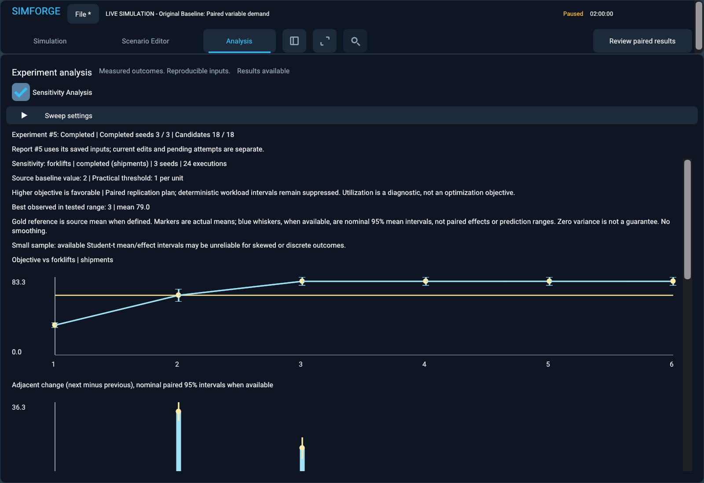

# Automated sensitivity analysis and bottleneck exploration

> Publication curation: additional captures cited in this engineering record remain in Commit #33. See [screenshot history and recovery](screenshot-gallery.md#historical-captures).

Commit #26 adds bounded one-factor-at-a-time (OFAT) studies to the existing Analysis workspace. Each tested configuration comes from the authoritative warehouse simulation. This is an operational response study under fixed other inputs, not a global optimizer or a financial ROI model.

## Tutorial: How many forklifts does this warehouse actually need?

1. Load `examples/warehouse-baseline.json`, then open **Analysis** and enable **Sensitivity Analysis**. No editor candidates are needed.
2. Choose **Forklift capacity**, minimum **1**, maximum **6**, step **1**, **Completed shipments** objective and practical improvement threshold **1** shipment per added forklift.
3. Leave paired multi-seed mode off. **Run Sweep** evaluates the loaded source scenario and all distinct tested values at the source seed. Settings collapse to keep progress and cancellation visible.
4. Inspect the objective curve, source reference, signed adjacent effects and tested configuration table. Values 1..6 produce **32, 63, 94, 94, 94, 94** completed shipments. The source is two forklifts, not the lowest sweep value. Gains are **+31, +31, 0, 0, 0** shipments per adjacent unit.
5. Three forklifts is the lowest best observed tested value for this objective. Additional forklifts from three through six gave no measured completion benefit with three bays and ten workers held fixed. This does not establish that additions can never help under other demand, service, horizons or capacities.
6. Select a tested value and an actual measured seed. **Add as Candidate** creates a separately identified, validated candidate under the supplied unique name. **Simulate Configuration** creates an independent custom run, visibly named with parameter, value and seed. Returning to the original baseline restores the preserved live baseline. Analytical runs never mutate its clock, state or camera.
7. Use separate new filenames for JSON, summary CSV, per-seed CSV and marginal CSV. Save the `.simforge` project to retain the completed report, settings, candidates and playable runs.

For stochastic evidence, load `warehouse-statistical-workload.json`, reopen Sweep settings, enable paired multi-seed mode, choose 20 replications and base seed 1001, and repeat. Seeds 1001..1020 yield mean completions **31.8, 62.8, 77.7, 77.7, 77.7, 77.7**. Increasing two to three forklifts changes mean completions by **+14.9**, nominal paired 95% interval **[13.9902131565, 15.8097868435]**. Adjacent gains above three are zero in this sample. The best observed value is three; it is not a universally optimal configuration.

## Architecture audit and ownership

The preimplementation audit confirmed:

- `scenario::validate` owns scenario bounds; workload helpers own seeded arrivals and per-shipment processing samples. Simulation configuration uses exact whole-second duration fields and an integral tick rate.
- `WarehouseSimulation::run(ExecutionControl*)` evaluates an immutable definition through the established event engine, checks cancellation inside event loops and returns authoritative `WarehouseMetrics`.
- Existing statistical `replication_seeds`, `metric_value` and `summarize_pairs` implement deterministic seeds, metric semantics, centered paired variance and nominal Student-t intervals. Sensitivity reuses these functions unchanged. Existing comparison add-one resource probes supply the same intervention semantics.
- Workspace candidates and independent `ViewerController` runs already have bounded, separate identities and ownership. New selected-point APIs reuse those rules without writing editor drafts.
- `ExperimentExecution` already publishes a completed owned `Comparison` from one `std::jthread`, synchronizes cancellation/publication and retains unsuccessful-attempt diagnostics. Its wrapper gains an optional typed sensitivity request/report, rather than another execution service or thread pool.
- Project loading already builds a temporary workspace, checks envelope integrity, validates content and commits transactionally. The new report kind uses that path.
- Analysis uses Dear ImGui draw lists and existing display helpers; both new charts need no additional dependency. Headless analysis links no renderer or Vulkan.

`analysis/sensitivity.hpp` defines `SensitivityRequest`, `SensitivityReplication`, `SensitivityPoint` and `SensitivityReport`. The request owns the complete source definition, source ID (zero denotes the loaded baseline), experiment ID, typed parameter, explicit tested values, metric objective, seed plan, threshold and request schema version. Generator/method versions and confidence are carried by the existing replication plan. The source definition preserves name, horizon, tick rate and workload provenance. The runtime assigns the experiment ID before starting the worker.

Point IDs are `uint64(value)+1` inside an experiment. Identity is the experiment/parameter/point tuple, independent of editable candidate names. Completion canonicalizes ascending parameter order. Explicit input order never changes the measured report. Raw rows use the canonical value order and resolved seed order. Aggregate-only report publication does not switch the active scene.

## Parameters and validation

| Parameter | Exact field | Compatibility and bounds |
|---|---|---|
| Forklift capacity | `forklifts` | Whole integer, including zero; aggregate bay + worker + forklift capacity at most 100,000 |
| Worker capacity | `workers` | Same authoritative aggregate resource bounds |
| Loading-bay capacity | `loading_bays` | Same authoritative aggregate resource bounds |
| Arrival interval | `shipment_interval_seconds` | Constant arrivals only; exact integer seconds 1..604,800 |
| Processing duration | `processing_duration_seconds` | Constant processing only; exact integer seconds 1..604,800 |

Changing a duration never implicitly replaces a uniform distribution or a time profile. A constant arrival sweep can retain an independently stochastic processing distribution, and a constant processing sweep can retain stochastic arrivals. Such studies deliberately vary workload/service rather than claiming resource-capacity optimization. Resource studies retain the complete original workload under each matched seed.

The GUI supports min/max/step and explicit comma/space-separated values. A range requires a positive integer step, ordered endpoints and an exactly reachable maximum. Resolved values are explicit in the executed request. Empty/duplicate lists, more than 50 points, noninteger/nonrepresentable times, uint32 parsing overflow, invalid scenarios or incompatible modes are rejected. Every transformed configuration passes the existing validator; the source remains unchanged. Seed is not an operational sweep parameter.

Replications use the existing 1..100 limit. Single mode requires exactly one seed; the GUI uses the loaded source seed. GUI multi mode uses a sequential base seed plus index. Typed requests and headless specifications additionally accept an explicit distinct seed list, including full uint64 seeds; overflow and duplicate seeds are rejected by the existing plan validator.

The conservative work bound is `seed_count * (4 * source_arrival_bound + sum(point_arrival_bounds)) <= 20,000,000`, accounting for original baseline and up to three controlled probes. Source-equivalent points and reused probes can make actual work smaller. Per-scenario limits still apply, including at most 100,000 arrivals and 10 million ticks. No unrestricted Cartesian products or uncontrolled concurrency are introduced.

## Baseline anchoring and efficient execution

Each resolved seed runs the original source once. A point equal to the source value reuses the exact immutable source measurement. If the source value is outside the requested set, it remains a separate reference and is not silently added to the sweep or replaced by the lowest point.

Then each distinct nonbaseline tested value runs once. The three original-source add-one resource probes also reuse a matching sweep point when available. Otherwise they run independently at the same seed; probes are unavailable at the aggregate capacity bound. Counts record actual full-horizon simulations. No snapshot is retained per point or seed. Seed and point transitions and existing inner event loops all check cancellation.

Resource changes do not enter the independent arrival/processing random stream domains. Tests compare every shipment's arrival tick and sampled processing duration across capacities, in addition to independently reconstructing complete outcomes. Configuration count and iteration order cannot perturb random samples.

## Metric meanings, paired differences and intervals

The five objective metrics reuse Commit #25:

| Metric | Units | Favorable direction |
|---|---|---|
| Completed shipments | shipments | Higher |
| Remaining waiting shipments | shipments | Lower |
| Throughput | completed shipments/hour over the entire horizon | Higher |
| Average started queue wait | seconds, only shipments that started | Lower |
| Maximum started queue wait | seconds, only shipments that started | Lower |

Per-seed data additionally preserve arrivals, starts, in-progress shipments, cumulative wait/processing/occupancy, processing means and capacity utilization. Utilization is cumulative occupied resource time divided by available capacity time; it is diagnostic, not automatically favorable when higher. Zero capacity makes its utilization undefined rather than zero. Started-wait quantities exclude shipments still waiting at the horizon, so capacity changes can change the population being averaged.

Absolute source and point means use all configured seeds for that configuration, independently of whether the other configuration defines the metric. Source means reuse the existing summary function on self-pairs. Tested-point mean intervals reuse its centered variance and t kernel on X minus numerical zero; zero is a mathematical centering constant, not a simulated warehouse baseline. These intervals describe uncertainty in the mean, not a prediction range for individual seeds. No complete-case selection is performed: any undefined outcome suppresses that configuration's mean. Thus a tested configuration's mean wait can remain defined when the source has zero forklifts and no started shipments, while its source-relative effect correctly remains undefined. Ranking and the objective chart use these absolute means; baseline and adjacent evidence continue to use only valid complete paired samples.

Replications receive equal weight: these are means of run-level metric values, not shipment-pooled averages. Summary CSV `n` and `defined` columns describe paired-effect coverage; a non-null absolute mean uses every configured seed independently of baseline coverage.

For metric `M`, a baseline effect is `M(point, seed) - M(original_source, seed)`. Its sign is never reversed for lower-is-better quantities. Positive/negative/zero counts, favorable fraction, sample size and diagnostic are preserved. Relative percentages are changes in means and are undefined when the reference mean is zero; no relative-effect CI is claimed.

Adjacent effects are calculated directly as `M(next, seed) - M(previous, seed)` before aggregation. They reuse `summarize_pairs`, including paired covariance. They are not differences between independent sample means or subtraction of separate CI endpoints. Adjacent raw mean effect divided by `next_value - previous_value` gives effect per parameter unit, correctly handling irregular steps.

Single mode has one realization and no CI. For multi mode with a varying external stochastic component and at least three complete pairs, the existing method uses `mean(D) +/- t(0.975,n-1)*sd(D)/sqrt(n)`, centered compensated means and a second centered variance pass. The existing [NIST Student-t table](https://www.itl.nist.gov/div898/handbook/eda/section3/eda3672.htm) supplies three-decimal critical values; this retains Commit #25's precision and assumptions. Fewer than three pairs suppress intervals, n<20 gets a small-sample caution, zero observed variance gets a degenerate interval with an explicit non-guarantee warning, and deterministic/equal-bound workloads suppress stochastic intervals. Missing any pair suppresses the aggregate and interval instead of selecting complete cases.

Intervals are nominal per metric and comparison, with no simultaneous familywise adjustment. Selecting the best observed point introduces selection bias. Distinct reproducible pseudo-random seeds do not calibrate this FIFO model to real operations. Small, skewed or discrete samples may violate the paired-t approximation. These caveats apply to baseline and adjacent comparisons and controlled probes.

## Ranking, diminishing returns and bottleneck evidence

Best observed means the defined tested point with the favorable mean objective. Exact ties choose the lowest tested value deterministically. The original source is identified separately even if outside the range. Undefined objectives have no best point. A point estimate is not proof of superiority; a best tested point can be worse than the original source, and its signed baseline delta remains visible.

The threshold is explicitly supplied and retained as **favorable objective units per one parameter unit**, default 1. It is a practical decision criterion, not proof. Adjacent effects remain signed. Negative favorable-normalized mean gain reports observed worsening; gains above threshold report a measured improvement exceeding the threshold. Mean gain at or below threshold is called small only when deterministic or the favorable upper paired bound also does not exceed the threshold. Otherwise it is inconclusive. Equality belongs to the small-improvement boundary. Undefined metrics get no diminishing-return conclusion. Reversals and fluctuations remain in the raw points and charts without smoothing or monotonicity assumptions.

Controlled +1 bay/worker/forklift effects use the original source's matched-seed outcomes and the same summaries. The UI states measured changes using the report's actual values. One-factor evidence holds the other inputs fixed; it cannot establish all multi-resource interactions or a globally dominant constraint. There is no fabricated financial return or claim that unused capacity is always unnecessary.

## Analysis, selection and playback

The existing Analysis mode offers an explicit Sensitivity Analysis toggle and collapsible settings. The objective chart shows all actual measured means and eligible nominal 95% absolute-mean CI whiskers, joined by straight segments without fitting or smoothing; its gold horizontal reference is the original source mean. The marginal chart shows signed adjacent deltas and nominal paired CI whiskers where defined. Its x-coordinate is the next/upper adjacent value. Absolute-mean whiskers are calculated from point outcomes themselves, not by shifting paired baseline-effect intervals. Their numeric bounds are available in selected-point inspection, JSON and summary CSV. Baseline CIs remain visible numerically in the tested configurations table; per-seed inspection and CSV expose the raw observations. At dense point counts labels are thinned, while points and hover values remain intact.

Selection provides the tested value, paired counts/direction/diagnostic, measured textual explanation, actual playback seed and unique candidate name. Queued candidate/playback actions own the full originating request identity and are rejected if report publication or project changes make that identity stale. Candidate creation checks existing limits and names and does not overwrite candidates. Playback checks that the selected seed belongs to the report, reconstructs that exact configuration through the established viewer, and labels it `Sweep <parameter> <value> seed <seed>`. It is one realization, not an aggregate warehouse. Reconstruction occurs only on explicit request; full per-replication snapshots are not retained.

The existing worker's progress reports current tested value, seed identity/index, completed points/total, phase and logical ticks. Baseline/probe/aggregation phases are not falsely counted as completed points. Settings collapse on start so cancellation is accessible; users can reopen them for future requests while the current job retains owned inputs. Cancellation/failure cannot publish a partial completed report and preserves the last successful report. Shutdown requests cancellation and joins the existing worker.

## Headless specification and exports

Schema 3 adds `mode: "sensitivity"` to `--experiment` without changing schema 1 comparisons or schema 2 statistical experiments. See the six `warehouse-sensitivity-*.json` specifications. Scenario paths are local relative JSON paths confined to the specification directory, including resolved-path checks. The specification contains source path, parameter, either `range` or `values`, objective, single/multi policy, replication plan and threshold. Canonical requests own the fully resolved source and value list.

```powershell
build/windows-release/apps/sandbox/simforge_headless.exe --headless `
  --experiment examples/warehouse-sensitivity-stochastic.json `
  --export-json build/forklift-sweep.json `
  --export-csv build/forklift-summary.csv `
  --export-seeds build/forklift-seeds.csv `
  --export-marginal build/forklift-marginal.csv
```

Outputs must be separate new files. Existing files are never overwritten; the established exclusive-create helper cleans its own partial output on failure. General argument/output preflight retains legacy exit code 1. Invalid-argument sensitivity validation uses 2, unsupported mode 3, size-limit/execution/export exceptions 4, and controlled cancellation 5. No CLI cancel flag is added.

JSON report v1 includes complete request, `warehouse-workload-v1` engine provenance, plan generator/method/confidence metadata, resolved per-seed rows, source and tested metrics, point IDs, baseline summaries, direct adjacent summaries, signed per-unit effects, threshold interpretation, probe summaries, best observed point, actual execution count and limitations. Timing/event instrumentation is for benchmarks and is omitted from canonical JSON so GUI/headless values agree. Summary CSV, seed CSV and marginal CSV have separate compatible row schemas. Missing values are empty CSV cells/JSON null, not fabricated zero values; numeric CSV formatting uses roundtrip double precision.

Parsing validates raw count conservation, horizon, actual seeded arrival count, utilization denominators, processing support and derived ratios using the shared Commit #25 validator. It checks source-equivalent measurements, probe reuse and execution counts, then recalculates all summaries and compares complete canonical content. It does not rerun experiments on load. Inputs cannot use mutable editor state to reinterpret historical results.

## Project persistence and retention policy

Project envelope version 1 remains compatible with old projects. New content requires explicit `sensitivity_v1` feature negotiation, and completed evidence uses the `sensitivity` report kind. Existing statistical reports still use `statistics_v1`. Raw setup strings, selected point/seed, objective and parameter are independently saved, including invalid unfinished edits. Existing CRC32 and transactional loading remain in place; valid-envelope corrupt sensitivity content is rejected without altering the active workspace.

The existing workspace retains **one latest successful analysis report**, regardless of analysis type. A successful sweep replaces that slot, just as another comparison does. Pending work, cancellation and failure preserve it. Candidates, baseline state, independent playable runs, recovery and other project data are separately retained. Loading restores raw evidence and recalculates derived summaries only; the worker remains idle. No stale analytical average preview is persisted.

## Curated measured examples

| Example | Actual observation |
|---|---|
| A: deterministic forklifts 1..6 | Completed 32,63,94,94,94,94; marginal +31,+31,0,0,0; first best observed point 3 |
| B: workers 6,8,10,12,14, other capacities fixed | Completed 63 at every point; adding this nonlimiting resource gives no completion benefit |
| C: arrival intervals 180,240,300,360 s | Arrivals 160,120,96,80; waiting 96,56,32,16; completed 63 throughout; mean started waits 8370,6510,4650,2790 s |
| D: stochastic forklifts 1..6, 20 matched seeds | Mean completed 31.8,62.8,77.7,77.7,77.7,77.7; source 2 to 3 delta +14.9, nominal CI [13.9902,15.8098] |
| E: workers 10..15 | All points completed 63; best observed tie policy does not fabricate a benefit from extra capacity |

The separate processing example covers constant service 300,600,900,1200 seconds. Example C is workload sensitivity: unchanged completion capacity can coexist with substantial changes in demand and congestion. These are actual engine results, not the illustrative numbers in the milestone specification. Native lifecycle screenshots use three seeds for a quick complete walkthrough; example D uses 20.

## Tests, performance and native review

The new automated coverage adds 23 CPU test cases, six example CLI cases, one CLI contract and one native integration test. Independent paired fixtures use baseline 100,200,300 and differences 2,4,6, expecting delta 4, SD 2, SE 1.154700538 and nominal CI [-0.9686764166,8.9686764166]. Adjacent fixtures use directly paired differences and an irregular step of two. Coverage includes validation/overflow/work limits, all five single-field transformations, external stream equality, baseline outside the set, baseline/probe reuse, permutation invariance, missing/zero references, threshold/inconclusive behavior, async publication, cancellation/failure preservation, exports, exact seeded playback, report/settings restoration and valid-envelope corrupt-content transaction safety.

The same fixture checks the distinct absolute-mean interval for outcomes 102,204,306: mean 204, sample SD 102 and nominal bounds [-49.4024972489,457.4024972489]. Unbounded t intervals may extend beyond physical count support at small n; they are not clipped into a different undocumented method. A zero-forklift source fixture proves that defined tested mean waits survive an undefined source wait without fabricating a paired delta. Native checks additionally reject an incompatible arrival-mode menu choice and a stale selected-point gesture after report replacement.

The native test exercises actual workflow/run/point/candidate/playback/save controls, single then paired sweeps, real event-loop progress, warehouse navigation, cancellation, an ungated background study, canonical GUI/headless equality, seeded playable metrics, resize/minimize/restore, safe shutdown and fresh-process reopening. Some setup values and export calls are configured by the harness; this is a scripted native walkthrough, not a claimed unscripted manual session.

Performance uses the Release benchmark `simforge_sensitivity_benchmark`, one bounded worker, seeded uniform arrivals 1..3 seconds and processing 1..8 seconds, 16 bays/16 workers/two source forklifts, and sweep values 1..N. Exact event counts are instrumented by `WarehouseSimulation::processed_events`, including baseline, tested points and probes. The near-limit case uses 50 points, 100 seeds and a 3600-second horizon, under the same validated 20-million conservative-arrival budget. Raw timings and sizes are retained in [sensitivity-benchmarks.csv](sensitivity-benchmarks.csv). Baseline-run savings compare counts against evaluating a new baseline for every point/seed; no unmeasured naive CPU speedup is claimed. Process peak working set is cumulative across benchmark cases and includes transient simulation/serialization state. Project byte counts are actual complete serialized projects.

The quiet final Release benchmark measured:

| Points x seeds | Horizon s | Actual runs | Source baseline runs | Baseline runs saved vs per-point baseline | Events | Sync ms | Aggregation ms | Submit ms | Async ms |
|---|---:|---:|---:|---:|---:|---:|---:|---:|---:|
| 6 x 1 | 10,000 | 8 | 1 | 5 | 75,856 | 4.022 | 0.053 | 0.060 | 4.513 |
| 6 x 20 | 10,000 | 160 | 20 | 100 | 1,509,514 | 75.456 | 0.294 | 0.053 | 87.159 |
| 20 x 50 | 10,000 | 1,100 | 50 | 950 | 10,773,053 | 557.410 | 1.292 | 0.057 | 604.040 |
| 50 x 100 | 3,600 | 5,200 | 100 | 4,900 | 18,557,082 | 887.273 | 4.433 | 0.072 | 1,213.027 |

| Points x seeds | Canonical JSON bytes | Complete project bytes | Report serialization ms | Process peak bytes |
|---|---:|---:|---:|---:|
| 6 x 1 | 44,199 | 47,232 | 1.259 | 6,787,072 |
| 6 x 20 | 149,568 | 152,602 | 9.869 | 8,155,136 |
| 20 x 50 | 741,741 | 744,775 | 57.148 | 16,023,552 |
| 50 x 100 | 3,067,712 | 3,070,742 | 135.866 | 43,651,072 |

At the largest size, measured aggregate throughput was **20.91 million processed events/second**, with aggregation **0.50%** of synchronous elapsed time. Peak working set was **41.63 MiB** for the benchmark process, cumulative across cases. Project serialization measures the complete project and includes its independently owned live baseline; it does not retain 5,000 full simulation snapshots. JSON validation/serialization regenerates expected seeded arrival counts to audit raw metrics, so serialization is separate meaningful work, not just a byte copy.

Five ungated cancellations after actual event-loop progress measured **0.0263 / 0.0314 / 0.1116 ms** minimum/median/maximum. This is a measurement on this machine, not a promise during bounded preflight, aggregation or serialization. Existing event-loop stop checks occur every 256 events.

Final native review on NVIDIA GeForce RTX 5080 Laptop GPU, Vulkan API 1.4.351/loader 1.4.363, FIFO presentation and synchronization validation measured **20 ungated active-worker frames averaging 4.112 ms**. The complete 311-frame walkthrough averaged **3.76727 ms** total CPU frame time, **116.005 microseconds** UI build and **3.26604 ms** record/submit/present. The two-chart CPU build mean was **6.68101 microseconds** for the six-point native study. Fresh-process reopening averaged **4.03405 ms** over 183 frames, with **106.947 microseconds** UI build. These include presentation synchronization and are not GPU timestamp measurements. The saved native project was **73,813 bytes**. Both processes reported **zero Vulkan validation errors/warnings**.

Six curated documentation PNGs occupy **1,237,670 bytes**. Review directories remain capped at three owned runs, routine successes reclaim their artifacts, and Debug symbols are retained. One initial native attempt exposed cancellation scrolled below expanded settings; the layout was corrected and all subsequent native walkthroughs passed. No graphics test timeout or validation requirement was weakened.

Final complete suites passed:

| Configuration | Passed | Elapsed |
|---|---:|---:|
| Windows Debug | 451/451 | 210.05 s |
| Windows Release | 451/451 | 157.17 s |
| Renderer-disabled Debug | 417/417 | 60.39 s |

The original 420 renderer/387 headless tests remain present, including baseline metrics, scenario validation, deterministic workloads, snapshots/replay/interventions, single and paired comparisons, async behavior, independent playback, project persistence/recovery, language coverage and CLI exports. The frozen language holdout SHA256 remains `EB1A53C55FFF3020E35535AB5ED59E9A38A24C3829D7A9964FBC7BBD596AAB82`. Builds completed without compiler warnings, and the headless executable imports no SDL3 or Vulkan DLL.

One preceding full Debug attempt hit the existing live-view test's 40-second timeout; its independent rerun passed in 18.36 seconds and the subsequent complete 451-test Debug suite passed. Timeout diagnostics were retained under the existing owned failure cap. Neither the timeout nor validation criteria were relaxed. Native layout review also corrected selection scrolling so candidate/playback actions remain visible after interval details expand.

## Native screenshots

These are actual bounded framebuffer captures, inspected for readable setup, truthful point/seed/tick progress, source reference, unsmoothed means, signed marginal uncertainty, selection and explicitly seeded independent playback. Six fixed documentation PNGs are retained; temporary tests reuse the existing owned artifact cleanup and three-run review cap.

**Sweep setup** (archived capture: `sensitivity-setup.png`)

**Real event-loop progress with prior evidence retained** (archived capture: `sensitivity-progress.png`)



**Signed adjacent effects and uncertainty** (archived capture: `sensitivity-marginal.png`)

**Selected measured configuration and explicit playback seed** (archived capture: `sensitivity-selected.png`)

**Independent custom playback for three forklifts, seed 1001** (archived capture: `sensitivity-playback.png`)

## Limitations and next milestone

Fresh starts only; seed-specific historical checkpoint sweeps are deferred. Operational duration fields are exact whole seconds, and only compatible constant fields are sweepable. GUI replications use sequential seeds; explicit plans are available through typed/headless requests. CIs are fixed at nominal 95%, retain the existing three-decimal t table and have no simultaneous adjustment. Utilization is inspection-only. No full snapshots are retained per point/seed, no costs or interactions are inferred, and large work is rejected rather than silently reduced. The report slot follows the documented latest-success policy.

A suitable next milestone is explicitly bounded two-factor interaction studies with appropriate uncertainty and report retention, building on this OFAT evidence. No next milestone, global optimizer, hosted service or publication has been started.

## Changed-file map

- `analysis/sensitivity.hpp`, `sensitivity.cpp`, `sensitivity_json.cpp`: request/report types, exact range validation and transformation, bounded baseline/probe reuse, shared paired aggregation, canonical persistence and JSON/three CSV schemas.
- `statistical_json_shared.hpp`, `statistical_json.cpp`: internal reusable existing plan/metric/summary codecs and raw metric validation; statistical algorithms unchanged.
- Workspace headers and execution/project implementations: optional sensitivity request/report, one-worker progress/publication, tested-point ownership and playback, exports, feature negotiation and raw settings persistence.
- Sandbox sensitivity panel, workspace/project/viewer integration, main and CMake: setup/charts/selection, native test hooks and renderer-independent schema 3 CLI.
- Sensitivity CPU/CLI tests and CMake, graphics script, six specifications, benchmark/CMake, README, this guide, measurement CSV and six inspected screenshots.
