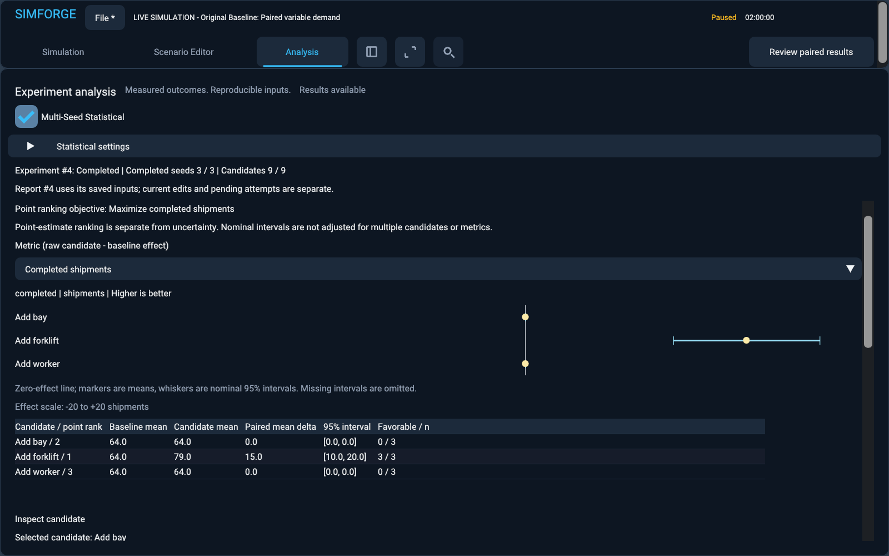

# Paired multi-seed statistical experiments

> Publication curation: additional captures cited in this engineering record remain in Commit #33. See [screenshot history and recovery](screenshot-gallery.md#historical-captures).

Commit #25 adds an explicit statistical experiment mode alongside the original single-seed comparisons. It answers questions about variation across reproducible model realizations, rather than elevating one favorable seed into a general claim. The warehouse engine and version-1 workload sampler remain authoritative. No AI model produces results.

## Tutorial: does adding a forklift consistently improve throughput?

1. Open `examples/warehouse-statistical-workload.json` with `--live`, or load it through the existing scenario/project workflow. Its eight-hour warehouse has three bays, ten workers and two forklifts; arrivals are discrete uniform 240..480 seconds and processing 600..1200 seconds.
2. In Scenario Editor, name an alternative **Add forklift**, change forklifts to three, validate and add the candidate. The preserved baseline and live run keep their own state.
3. Open Analysis and select **Multi-Seed Statistical**. Set **20** paired replications, sequential policy, base seed **1001**, fresh-start comparison, and **Maximize completed shipments**. Confidence level is fixed at 95% in this method version.
4. Start the experiment. The settings collapse to make room for genuine seed/candidate/tick progress and Cancel. Camera navigation and existing live runs remain independent.
5. Inspect the completed-shipment or throughput effect, interval, per-seed observations and point rank. Switch the selected metric/candidate to examine other outcomes. Positive completed/throughput effects favor the candidate; negative wait/remaining-queue effects favor it.
6. Export the complete JSON, summary CSV and per-seed CSV to separate new filenames. Save the project. Reopening restores the completed evidence without executing the study again.

For seeds 1001..1020, the supplied forklift experiment measured a mean **+14.9 completed shipments**, with nominal 95% paired-t interval **[13.9902, 15.8098]**. Its corresponding hourly throughput effect is the shipment effect divided by eight. This interval favors adding a forklift for this workload, horizon and objective under the method's assumptions. It does not guarantee future improvement, establish superiority across all metrics, or calibrate this model to a real warehouse.

The short-horizon example deliberately illustrates a less tidy answer. With variable service 1..100 seconds, arrivals 2..8 seconds, one versus two forklifts and a 60-second horizon, average started queue wait improved on 10 seeds, worsened on 7, and tied on 3. Mean raw difference was **-0.427417 seconds**, with interval **[-3.58254, 2.72771]**. Evidence is inconclusive. Starting additional shipments can change the population entering the average; still-waiting shipments remain censored.

## Architecture and execution limits

`analysis/statistical_experiment.hpp` defines a validated `ReplicationPlan`, immutable `StatisticalRequest`, compact `ReplicationOutcome`, `PairedSummary`, and `StatisticalReport`. Requests retain baseline and candidate definitions, stable candidate IDs, objective, seed policy, generator/method versions, confidence and horizon. Workspace `ExperimentRequest` carries an optional replication plan, and `Comparison` carries an optional statistical report. Absence of that option preserves the original path and schemas.

Each replication calls the existing comparison orchestrator with an explicit fresh-start policy. It executes the baseline once, every candidate, and the same three add-one bay/worker/forklift probes. Matching candidate/probe resource configurations reuse the already measured candidate result. Baselines are not recomputed for each pair. Operational delta helpers, probe logic and event execution are reused. Statistical aggregation adds a separate mean-objective ranking; it does not reinterpret the single-run ranking.

The fresh-start policy installs resource capacities before the first arrival. This matters for zero-capacity alternatives: a settled checkpoint at tick zero may already hold a reservation that prevents a resource cut. Statistical fresh runs construct the authoritative engine from the submitted initial configuration; they do not masquerade as a historical tick-zero intervention.

Statistical requests accept 1..100 replications and 1..20 candidates. The conservative work budget is

`replications * (candidates + 4) * worst_case_arrivals_per_seed <= 20,000,000`.

The extra four account for a baseline and three possible probes, even when a probe reuses a candidate. All existing scenario tick, horizon, resource, distribution and 100K-arrival limits remain. Preflight rejects excess work before launching. There is one owned background worker, executing seeds sequentially; no unbounded parallelism or per-seed full snapshot cache is introduced.

## Seeds and common-random-number pairing

`sequential_v1` produces `base_seed + i` for zero-based replication index `i`, in order, with unsigned overflow rejected before addition. For base 1001 and count three, seeds are exactly 1001,1002,1003. No random_device, wall clock or ambient RNG participates. `explicit` accepts an ordered list with exactly `count` distinct uint64 seeds; no base seed may coexist with that list. Duplicate seeds, unknown policies/versions, zero/excess counts and unsupported confidence levels are rejected.

The replication plan overrides the original seed in every submitted baseline/candidate for execution; those original definitions remain in provenance. Within each seed, candidates may change resource capacities only. Validation normalizes names/resources and the execution seed, then checks the canonical remaining definitions for exact equality. Changing workload bounds, demand windows, fixed timing, tick rate or horizon makes the paired experiment ineligible. Equal numeric seeds alone are not a justification for pairing unrelated workloads.

The existing counter-keyed generator separately indexes arrival delays and per-shipment processing requirements by seed, domain and shipment ID. Waiting, dispatch, candidate capacities and probes do not consume another random stream or resample service. Actual simulation tests check arrival ticks and stored requirements for every baseline/candidate shipment and probe metrics across seeds. Candidate evaluation order cannot change the resulting canonical report values.

Distinct seeds are treated as independent pseudo-random model realizations for inference; this is an assumption, not a mathematical certification of independence or real-world representativeness. Constant/profile workloads with fixed service, and uniform modes with equal bounds on both random dimensions, produce deterministic workloads. Their repeat results are retained but stochastic intervals are suppressed. Zero observed variance for a metric under a genuinely variable workload is separately reported as a degenerate model interval, not a guarantee.

## Fresh starts and checkpoints

Statistical mode supports **fresh starts only**. Baseline input is the loaded initial definition, not the live viewer's current capacities, time or command history. Historical checkpoint snapshots belong to their original seed and trajectory. Reusing one across different seeds would corrupt paired causality. The UI explains the restriction, and the request validator rejects checkpoint statistical requests.

Single-seed fresh and shared-checkpoint studies, historical capacity interventions, probes, previews and custom scenario playback remain available. This milestone does not replay one seed's recorded intervention history under arbitrary other seeds. Correct per-seed reconstruction with feasibility checks is deferred.

## Estimands, missing data and signs

Supported metrics are completed shipments, final waiting shipments, throughput per hour, average started queue wait in seconds and maximum started queue wait in seconds. For each metric and pair, `D_i = candidate_i - baseline_i` without reversing signs for lower-is-better metrics. Improvement direction is a separate property.

The estimand is the mean **per-replication metric** and the mean of matched per-seed differences. Average wait aggregates per-run started-shipment averages; it is not a pooled average over all started shipments across all seeds. Throughput uses the common fixed horizon. Queue-wait averages omit still-waiting shipments, so a favorable average may hide unfinished work or a changing measured population.

Each summary records requested/defined pair counts, baseline/candidate means, paired mean difference, sample standard deviation, standard error, interval, observed min/max, median, positive/negative/zero counts and favorable-seed fraction. Favorable fraction is a descriptive sample proportion, not a probability of future superiority.

If any pair lacks a required metric, that metric's aggregate means and interval are unavailable. Valid-pair counts/signs and all raw observations remain visible; there is no silent complete-case subset analysis. No-started-shipment wait metrics remain null, not zero. Nonfinite values, subtraction overflow and variance overflow are rejected. Counts are bounded by scenario limits; raw report ratios and resource utilization must agree with cumulative measurements.

Accumulation centers values around an observed anchor with compensated summation. Variance is accumulated in a second centered pass over the actual paired differences. The median uses sorted differences and an overflow-safe half-sum for an even count. Analytical fixtures include large baseline values with small differences to catch cancellation errors.

## Confidence interval method

Method version 1 uses the paired-difference interval

`mean(D) +/- t_(0.975,n-1) * s(D) / sqrt(n)`

with sample variance denominator `n-1`. This follows the paired design described in [NIST's paired-observation analysis](https://www.itl.nist.gov/div898/handbook/prc/section3/prc311.htm). Critical values come from the [NIST Student-t table](https://www.itl.nist.gov/div898/handbook/eda/section3/eda3672.htm), using its published three-decimal 0.975 column, every integer degree of freedom 1..99, without interpolation. Examples are 4.303 for df=2, 2.262 for df=9 and 2.093 for df=19. Coefficient rounding contributes at most approximately 0.0005 standard errors to the half-width. The method metadata records this precision. Persisted numeric precision supports exact replay comparison; it is not a claim of additional inferential accuracy.

Only 95% confidence is supported. Other levels are rejected rather than mapped to an unvalidated multiplier. There is no normal 1.96 shortcut for small samples, bootstrap or heavyweight statistics dependency.

| Data | Behavior |
|---|---|
| One pair | Raw/mean effect, no SD/SE/interval |
| Two pairs | Sample SD/SE and descriptive summary, no interval |
| Three or more complete stochastic pairs | Nominal paired-t interval; explicit small-sample caution below 20 |
| Zero observed variance | Zero-width model interval at the observed mean; explicit non-guarantee diagnostic |
| Undefined metric in any pair | Aggregate/interval unavailable; raw data and defined-pair counts retained |
| Deterministic workload | Descriptive repeats; no stochastic uncertainty interval |

The approximation assumes the mean paired difference is adequately represented by the t model. Discreteness, skew and unrepresentative seeds can undermine coverage, especially at small n. A displayed interval is not a 95% probability that this particular fixed effect lies inside it, a universal confidence guarantee, or evidence of equivalence when it includes zero.

## Percentages, ranks and uncertainty

The descriptive relative change is `100 * (candidate_mean - baseline_mean) / baseline_mean`. It is a change in means, not the average of per-seed percentages. Zero baseline means produce an unavailable percentage. Nonfinite percentages are omitted. Absolute paired-effect intervals are never relabeled as percentage intervals; no relative-effect interval is implemented.

Point ranks use estimated candidate means for the submitted objective, higher for completed shipments and lower for average wait/final waiting. Ties retain the resource-addition, absolute-change and name conventions. Undefined paired objective summaries are ineligible. The report labels the ranking objective even when the chart shows another metric.

Uncertainty is evaluated on the paired-effect interval, not overlapping baseline/candidate marginal intervals. An interval including zero is inconclusive. An interval separated from zero is described as favoring one configuration under the assumptions, never guaranteed superiority. No superiority across all metrics follows from one objective.

All candidate/metric intervals are nominal individual 95% intervals. There is no familywise or multiplicity adjustment. Choosing the largest observed mean gain adds selection bias. Ranks are an exploration aid, not unbiased proof of the globally best configuration.

## Desktop results and live isolation

Analysis exposes replication count, sequential/explicit policy, base seed/list, objective and comparison mode. Raw settings are validated before starting. Settings collapse after submission and can be reopened. Completed progress becomes compact so results remain usable at desktop sizes. Smaller windows use scrolling tables and editor controls.

The effect chart has a zero reference, raw mean markers, nominal interval whiskers, metric units, effect scale and sample count. Tables show baseline/candidate means, paired effect, interval and consistency. Candidate and metric selection expose all per-seed values, including unfavorable outcomes and outliers, in replication order. Probe summaries show the same paired method for add-one interventions.

The header action becomes **Review paired results**. Aggregate reports cannot open a final-state preview or “Simulate This Result”; those APIs reject it explicitly. Existing standalone scenario/candidate runs still work. There is no authoritative average warehouse, and no hidden per-seed snapshot retention. A previously selected historical preview is not attached to a statistical project report.

## Async progress, cancellation and publication

The existing `ExperimentExecution` jthread/mutex state machine owns the immutable request and result. Progress includes current/completed/total seeds, completed candidate evaluations over the entire sequence, candidates per seed, phase, submitted configuration, elapsed time and actual current run tick/horizon. Baseline/probe computation is identified by phase; candidate counts do not pretend to count every event or probe. No wall-time completion percentage is invented.

Cancellation checks occur between seeds and through existing simulation event-loop controls. Publication and cancellation retain the original synchronized terminal-outcome rule. A cancelled or failed attempt never publishes an incomplete statistical ranking and leaves the previous successful report intact. Shutdown joins the one worker. No running request automatically resumes after project loading.

The native lifecycle test temporarily gates genuine nonzero candidate-tick progress for deterministic cancellation/navigation assertions. A separate **ungated** heavy statistical run measures frame work while the worker actually simulates. Latency benchmarks likewise insert no artificial worker pause.

## Reproducible JSON and CSV

Statistical report version 1 is distinct from the existing report schemas. It contains completed status, engine contract `warehouse-workload-v1`, structured method name/version/confidence/table precision, immutable submitted request, resolved seed sequence, compact per-seed full operational metrics for baseline/candidates/probes, raw paired differences, summaries, point ranks, actual simulation execution count and limitations.

The request's numeric experiment ID is local to its execution service; headless studies use zero unless the API supplies an identity. `experiment_identity` is a deterministic FNV-1a-64 hexadecimal fingerprint of the canonical immutable request excluding that local ID. It aids cross-file provenance, is not a cryptographic signature and does not replace the complete definitions. Candidate IDs accompany names. Historical reports retain submitted inputs even after candidates are edited, renamed or removed.

Parsing validates versions, budgets, raw metric conservation/support/ratios, seed order, probe availability/reuse, simulation counts, method/fingerprint metadata and every derived summary against the raw observations. Loading does not execute a statistical experiment. `replay_statistical_report` explicitly reruns the embedded immutable request and compares canonical values when replay verification is requested.

Summary CSV has one candidate/metric row with n, means, absolute paired effects, SD/SE, interval, observed range/median/sign counts, favorable fraction, descriptive percentage, point rank and diagnostic. Per-seed CSV has one candidate/seed/metric row with baseline, candidate and raw delta. Both carry experiment fingerprint/local ID and candidate ID/name plus units. Undefined values are empty cells; negative values are retained. JSON includes probe raw data and every input needed to reproduce the study. Numeric conversion is locale-independent at double round-trip precision; names are CSV-escaped.

Exports use the existing exclusive file creation and partial-write cleanup behavior; choose new filenames. No existing file is overwritten.

## Headless experiments

The existing `--headless --experiment` command accepts an additional version-2 statistical file:

```json
{
  "schema_version": 2,
  "mode": "paired_statistical",
  "scenario": "warehouse-statistical-workload.json",
  "objective": "maximize_completed",
  "candidates": [{"name":"Add forklift","loading_bays":3,"workers":10,"forklifts":3}],
  "replications": {
    "count":20,"policy":"sequential_v1","base_seed":1001,
    "generator_version":1,"method_version":1,"confidence":0.95
  }
}
```

For explicit seeds, replace policy/base_seed with `"policy":"explicit","seeds":[1001,1002,1003]` and set count three. Scenario paths retain the existing local relative JSON and directory-confinement rules. No checkpoint option is accepted in a statistical file.

```powershell
simforge_headless.exe --headless --experiment examples/warehouse-statistical-forklift.json `
  --export-json NEW-report.json --export-csv NEW-summary.csv --export-seeds NEW-per-seed.csv
```

Version-1 single-seed commands and exports remain unchanged. Return codes are 0 success, 2 recognized statistical-request validation failure, 3 unsupported statistical mode, 4 statistical execution/input-I/O/export failure, and 5 cooperative `ExecutionCancelled` where a controlled runner supplies cancellation. General command syntax/legacy failures retain code 1. The synchronous CLI supplies no cancellation option; desktop cancellation and the CPU API control are supported.

Curated executable cases are [forklift](../examples/warehouse-statistical-forklift.json), [several candidates](../examples/warehouse-statistical-candidates.json), [same-capacity zero effect](../examples/warehouse-statistical-no-effect.json), and [inconsistent average-wait effect](../examples/warehouse-statistical-inconsistent.json). The last uses [short-horizon variable service](../examples/warehouse-statistical-short-horizon.json). Metrics above come from these actual engine runs.

## Project compatibility and validation

Project envelope version 1 and existing engine identifier remain. A mandatory `statistics_v1` feature marks statistical reports or extended statistical UI settings. `workload_v1` remains independently present when required. Old version-1 projects and single-seed reports retain their original layouts/features. Older applications reject unsupported new features rather than dropping statistical data.

Projects store the completed compact report and raw statistical controls/selection state. Invalid raw count/seed text can be saved without becoming a runnable plan. Every summary is checked against saved raw pairs on reopening; malformed statistical data fails before replacing the current workspace. Existing checksum, atomic file replacement, recovery and independent runtime/camera state remain. Statistical reports contain no final snapshots. Preview requests are not reconstructed from aggregate means.

Twenty CPU test entries cover known analytical arrays and published critical values; n=1/2/3/100; zero/constant/negative/mixed differences; large values, missing metrics, zero denominators and nonfinite/overflow rejection; sequential and explicit seed policies; duplicate/version/confidence/workload/budget rejection; actual baseline/candidate arrival and per-ID requirement pairing; probes; order-independent replay; constant and equal-bound uniform modes; zero-capacity alternatives; rank direction; JSON/CSV provenance; sync/async equality; historical edits; preserved live state; no fake preview; saved raw settings; transactional project rejection; candidate-loop and between-seed cancellation; and injected aggregation failure preserving the prior successful report.

The native SDL/Vulkan test exercises real mode/count/seed controls, worker progress, 3D navigation, cancellation preservation, completion, candidate/metric controls, raw tables, all three exports, save/reopen, small/large resize and minimize/restore. The reopened process checks exact exported values and an idle worker, without rerunning the study. Existing graphics, language, workload, snapshot, project/recovery and async tests remain enabled. Final totals, measured performance and curated captures follow below.

## Scope and recommended next milestone

The method is limited to fresh-start paired capacity comparisons, 95% table-based t intervals, five operational metrics, at most 100 seeds/20 candidates and the bounded work budget. It does not add bootstrap, multiple confidence levels, familywise correction, calibrated demand estimation, distributed/GPU execution, optimization or AI inference. Finite-seed intervals and point ranks are not guarantees.

The next useful milestone is **per-seed checkpoint reconstruction and intervention studies**, with explicit historical-command feasibility and matched trajectories. Multi-comparison-aware selection or robust intervals can follow after that semantics is established. Neither is automatically started here.

## Final regression results

Windows x64/MSVC, 2026-10-10. All three presets were configured/built and their complete suites executed. Final builds produced no compiler warnings.

| Configuration | Passed | Failed | Complete suite elapsed |
|---|---:|---:|---:|
| Debug with renderer/native graphics | 420 | 0 | 197.36 s |
| Release with renderer/native graphics | 420 | 0 | 145.72 s |
| Debug, renderer disabled | 387 | 0 | 59.08 s |

Both graphics suites include all 13 native tests. An earlier Debug static Vulkan smoke timed out at its unchanged 40-second limit; its immediate repeat passed in 4.29 seconds, and the subsequent complete Debug suite passed. No timeout or validation requirement was weakened. Screenshot inspection led to clearer setup labels and literal candidate-name rendering; the affected native case was rerun after those UI fixes. A stronger analytical fixture with baseline `[100,200,300]`, candidate `[102,204,306]`, and known paired differences `[2,4,6]` was also rerun in all configurations. It distinguishes paired variance from incorrectly combining marginal variances.

The CLI contract test checks success, invalid-request, unsupported-mode and execution/export-failure codes; huge schema-number rejection without narrowing conversion; all raw CSV/JSON observations and provenance; and bounded owned-temporary cleanup. Windows PowerShell decimal conversion is compared within 1e-9; the C++ canonical report/replay tests compare actual saved values exactly. Existing warehouse baseline metrics, workload RNG/snapshot/replay, async, projects/recovery, custom playback and all 3,609 language-coverage cases remain green. The frozen holdout SHA-256 remains `eb1a53c55fff3020e35535ab5ed59e9a38a24c3829d7a9964fbc7bbd596aab82`, with its unchanged 24/28 exact positives and 20/20 rejections.

The final native review and fresh reopened process each report **zero Vulkan validation errors and warnings**, with synchronization validation enabled. Actual runtime, camera and complete raw/derived report values are preserved. No average snapshot is created. Validation was performed on Windows x64; another platform and a thread sanitizer were not independently exercised.

## Measured performance and memory

Run `build/windows-release/benchmarks/simforge_statistical_benchmark.exe`; [raw measurements](statistical-benchmarks.csv) are committed. Release/MSVC, 60 Hz, horizon 10,000 seconds, seed sequence 1001+i, discrete uniform arrival intervals 1..3 seconds and processing 1..8 seconds. Baseline capacities are 16 bays / 16 workers / 2 forklifts; candidates use 3..22 forklifts. Conservative arrivals are 10,000 per seed, realized averages approximately 5,000. These local observations are not hardware-independent guarantees.

Synchronous simulation and aggregation times are medians of three; async, submission, serialization and memory figures are single observations. The final benchmark ran without concurrent test suites. Per-row baseline realized arrivals total 15,027, 99,955 and 249,941 respectively; each matched candidate receives the same seed's schedule. Full-horizon execution counts exclude the tiny tick-zero preflight and include non-reused probes.

| Seeds × candidates | Full executions | Baseline executions | Baselines saved versus per-pair reruns | Sync (ms) | Aggregation (ms) | Async (ms) | Submit (ms) |
|---|---:|---:|---:|---:|---:|---:|---:|
| 3 × 3 | 18 | 3 | 6 | 9.144 | 0.055 | 10.213 | 0.178 |
| 20 × 10 | 260 | 20 | 180 | 126.358 | 0.257 | 150.301 | 0.278 |
| 50 × 20 | 1,150 | 50 | 950 | 558.581 | 0.592 | 591.366 | 0.516 |

The full execution counts include two unmatched add-one probes per seed; the forklift probe reuses a candidate. Baseline-reuse savings count avoided evaluations, not a claimed measured CPU speedup against a separately benchmarked naive runner. The largest case averages 11.17 ms per paired replication (one baseline, 20 candidates and two non-reused probes), or approximately 89.5 paired replications/second and 2,059 full-horizon executions/second. Event throughput was not directly instrumented here. Aggregation accounts for about 0.11% of synchronous wall time in that case.

| Seeds × candidates | Report payload estimate (bytes) | Report JSON (bytes) | Complete project (bytes) | Project serialization (ms) | Cumulative process peak working set (bytes) |
|---|---:|---:|---:|---:|---:|
| 3 × 3 | 19,705 | 33,605 | 37,947 | 1.686 | 6,582,272 |
| 20 × 10 | 107,018 | 219,855 | 227,295 | 8.546 | 8,957,952 |
| 50 × 20 | 391,558 | 853,855 | 865,735 | 30.911 | 16,359,424 |

Payload estimates include raw observation/summary containers, diagnostic text and an input-size estimate; they exclude allocator overhead. Process peak (15.60 MiB at the largest case) includes transient engine state, parsed JSON, serialization and worker results and is cumulative across cases, not per-report memory. No complete per-seed shipment snapshots are retained. Project sizes are actual serialized complete project sizes; this benchmark measures serialization, not disk write latency. A saved native graphical study with three seeds, three candidates and preserved live state was 37,849 bytes.

Five actual in-progress, ungated candidate cancellations at 20 seeds × three candidates and a 100K-arrival budget per seed measured **0.044 / 0.059 / 0.143 ms** minimum/median/maximum. This does not promise that latency during bounded non-cancellable preflight/aggregation/serialization work. Existing worker progress checks occur every 256 events.

Native review on NVIDIA GeForce RTX 5080 Laptop GPU, Vulkan API 1.4.351/loader 1.4.363, FIFO present and synchronization validation: **20 ungated frames during real CPU statistical work averaged 4.137 ms** including submission/presentation. Across the entire 312-frame walkthrough, total main-thread frame mean was 3.865 ms, UI build 108.5 microseconds and record/submit/present 3.341 ms. The reopened 185-frame process averaged 4.008 ms total and 79.7 microseconds UI build. These are CPU frame measurements on a GPU-backed viewer, not isolated GPU timestamp timings. Curated PNG retention remains five fixed documentation files; temporary successful test runs are reclaimed and the existing review retention cap remains three runs. Debug symbols are retained and new tools disable incremental linking.

## Inspected native captures

These are real framebuffer captures, not generated mockups. The native walkthrough uses three seeds for quick lifecycle checks; the tutorial/headless examples use 20. Setup labels, progress identity, effect signs/intervals, per-seed rows and restored report were inspected. The tests provide scripted native interaction; no additional unscripted manual session is claimed.

**Statistical configuration with labeled count, policy, seed and mode** (archived capture: `statistical-setup.png`)

**Real seed/candidate/tick progress with the previous report preserved** (archived capture: `statistical-progress.png`)



**Raw seed-level average-wait differences** (archived capture: `statistical-per-seed.png`)

**Restored completed report without a running worker or average snapshot** (archived capture: `statistical-restored.png`)

## Changed-file map

- `analysis/statistical_experiment.hpp`, `paired_statistics.cpp`, `statistical_experiment.cpp`, `statistical_json.cpp`: requests/seeds, stable paired summaries, t table, bounded shared execution, canonical provenance and exports.
- `scenario_comparison.hpp`, `comparison.cpp`: explicit fresh-capacity policy in the existing orchestrator; legacy checkpoint path remains the default.
- Workspace request/report/service/project headers and implementations: optional statistical mode, one-worker progress/cancellation, aggregate-only APIs, historical report preservation and project feature negotiation.
- Sandbox `statistical_panel`, `workspace_panel`, `dashboard`, `project_panel`, `viewer`, `main` and CMake: controls, chart/raw inspection, native interaction, settings restoration, headless extension and export options.
- Six statistical example files, statistical CPU/CLI tests, tests CMake and graphics script: paired, several-candidate, zero-effect and inconsistent-effect cases, numerical/provenance/lifecycle coverage and native save/reopen checks.
- Statistical benchmark and benchmark CMake, README, comparison guide, this guide, measurement CSV and five curated PNGs.
