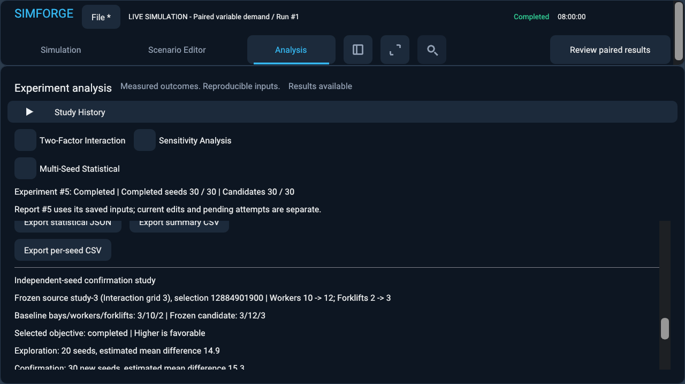

# Persistent study history and independent confirmation

SimForge retains completed analytical evidence in a bounded local project. Explore a configuration, freeze one tested choice, and compare that choice with its original baseline on new demand realizations. Confirmation reports remain separate from exploration.

## Architecture and lifecycle

`ScenarioWorkspace` owns a collection of `StudyRecord` values. Each record holds a project-scoped stable `study-N` identifier, editable title and notes, completion time in UTC epoch seconds, a study tag, optional presentation state, seed reservations, and `shared_ptr<const Comparison>` evidence. IDs use a persisted monotonic counter, never collection positions; deletion, reordering and renaming cannot change or reuse them. Project identity supplies the namespace when exchanging records between projects.

The existing `Comparison` remains the common typed report model. Its mutually exclusive single-seed, paired-statistical, sensitivity and interaction representations retain their own validated inputs and results. A confirmation tag adds a typed `ConfirmationRequest` to the existing paired-statistical representation. This reuses the simulation, aggregation, progress and rendering paths. It does not create a second simulation engine.

Completion passes through simulation, aggregation, bounded report serialization, integrity/provenance parsing, and retention checks before publication. Ownership transfers into immutable shared evidence. Selecting a study changes only the selected pointer and presentation state; it does not rerun simulations or copy report observations. Editor changes and candidate changes affect later submissions. Renaming and notes never change evidence.

The default titles are readable study types followed by their sequence number. The history list shows type, tested configurations, seeds, charged size, completion date and the selected objective. Open a record to recover its existing type-specific result view. Configuration IDs, measured seeds, metrics and rectangle endpoints restore independently for each record. Invalid selections fall back to an available result; project files contain no ImGui pointers or UI row indices.

## Retention and deletion

| Bound | Value | Rationale |
|---|---:|---|
| Retained studies | 32 | A useful local history without unlimited accumulation |
| Evidence per study | 32 MiB | Almost three times the preceding milestone's approximately 11.35 MB large-grid project |
| Total history charge | 192 MiB | Leaves 64 MiB within the existing project budget for workspace/viewer state |
| Stored per-seed outcomes per study | 10,100 | Existing maximum of 100 grid cells plus baseline across 100 seeds |
| Replications | 1–100 | Existing statistical engine bound |
| Overall project | 256 MiB | Existing project limit; viewer state is also charged |
| Confirmation attempts per source | 32 | At most 3,200 reserved seeds per source |

History charge includes canonical evidence bytes and conservative metadata/reservation allowances. It is a storage budget, not an estimate of process memory. Actual Save/Open must also satisfy the overall project limit. Individual evidence retains the existing 4 million JSON-event and depth-32 parsing guards. Projects allow 36 million JSON events: 32 × 10,100 outcomes × approximately 100 events, plus summary/viewer overhead. This prevents the previous single-report parser guard from rejecting valid histories.

There is no eviction or implicit overwrite. If retention fails, the last selected study and existing history stay intact. The new completed result remains pending in memory. Study History lists each retained study's size; explicitly delete evidence, then choose **Retain pending result**. Use **Export pending evidence JSON** to preserve its reproducible report outside history, including a report too large for one retained record. Discarding a pending result requires confirmation. New experiments and project Save/recovery require resolving it first. Pending evidence is not a completed project record and does not survive termination; the application marks the workspace dirty so normal discard/close handling can explain it.

Permanent deletion requires explicit confirmation. Deleting an exploratory source is blocked while retained or pending confirmations refer to it. Delete its dependent confirmations explicitly first. No cascade deletion occurs. Deleting a confirmation leaves its source's seed reservation ledger intact. Deletion is blocked during an active experiment so an in-flight source cannot disappear.

## Project v2, migration and recovery

Project format **2** stores one canonical `study_history` collection, the selected stable ID, next ID counter, and each record's metadata, evidence, presentation state and reservations. The former `report` field is null in v2; there is no duplicated current report. Every report embeds its submitted scenario definitions, request schema, generator/method versions and raw results. Engine identity remains `warehouse-2-analysis-1` because simulation behavior did not change.

Format 1 continues to load. Its single retained report becomes deterministic ID `study-1`, with a legacy title and the saved provenance time; the next ID is 2. Reopening the same legacy project repeats the same migration. Migration does not invent seeds or source snapshots. Reports that cannot establish fresh paired-capacity semantics cannot be confirmed. Unsupported future versions fail before replacing the current workspace.

Envelope CRC32, payload size, report-specific raw/aggregate checks, unique IDs, history bounds, lineage, frozen inputs, seed lists and reservations are validated in a replacement workspace. Only a fully valid replacement joins the old worker and replaces the live project. CRC32 detects accidental corruption; it is not a cryptographic signature. Loading reconstructs saved state without executing experiments.

The existing atomic primary save and local recovery slot are unchanged. Recovery carries multiple reports, unsaved titles/notes, deletion and cancelled-attempt reservations. An in-flight request is never restored as a completed report, and reopening never starts a worker. Clean shutdown still joins the bounded worker and observes the normal dirty-project flow.

## Eligibility and freezing

**Confirm Selected Configuration** accepts a tested candidate from a paired comparison, a resource-capacity sensitivity point, a resource × resource interaction cell, or a reproducible fresh-start single-seed comparison. It freezes the exact original baseline and selected definition, source study/type/request identity, original title/completion snapshot, selected metric, changed inputs, exploratory estimate and complete ordered seed list. The source configuration comes from retained evidence, never the mutable editor.

Only loading bays, workers and forklifts may differ operationally. Horizon, tick rate, workload distribution and generator must match. Workload-factor sweeps and grids are rejected. Shared-checkpoint confirmation is deferred. A single-seed source with unmatched baseline/selected-candidate seeds is rejected. All seeds used by any other candidate in that source study are also excluded from confirmation. Deterministic-only workloads disable independent stochastic confirmation; repeated identical constant workloads do not create uncertainty.

Changing the selected study or editor after freezing cannot alter the submitted candidate. The worker owns a value copy of the request. Confirmation outcomes never choose another candidate or revise the frozen definition.

## Seeds and paired workloads

Choose a base seed and count with the existing versioned `sequential_v1` sequence (base + index, with checked overflow), or an ordered explicit seed list. Duplicate seeds and overlap with the complete exploratory seed set are errors. SimForge never silently offsets, replaces or reorders a requested seed. The actual derived list, algorithm, generator and method versions are saved and exported.

At submission, the source records the entire proposed seed set. Later attempts linked to that source must be disjoint from every reserved set, including cancelled, failed or deleted confirmations. Reservations persist in Save/Open and recovery. There are at most 32 attempts per source. Attempt 1 is labelled the first untouched attempt; later attempts are explicitly additional analyses, including after a cancellation. Deleting the source after handling its dependants removes that source's audit context; a separate recreated project is not protected by a global seed registry.

The paired engine generates external arrivals and per-shipment processing requirements once for each seed and compares fresh baseline/candidate runs under that workload. Capacity changes do not change exogenous random streams. Integration tests compare every arrival tick and required processing duration with independent direct simulations. No exploratory outcome enters confirmation aggregation.

Disjoint PRNG seeds separate reproducible model realizations. They do **not** mathematically guarantee statistical independence; independence and representative demand are modeling assumptions.

## Statistical interpretation

All raw effects are **candidate minus baseline**. Favorable direction is shown separately for lower-is-better metrics. The existing centered paired-difference kernel and NIST three-decimal Student-t reference table produce nominal 95% intervals with n−1 degrees of freedom. Existing small-sample rules remain: one or two seeds give descriptive summaries without an interval. Undefined metrics remain unavailable/null/blank, never zero. Zero variance with at least three stochastic pairs gives a zero-width interval, which can include zero.

The report provides baseline/candidate means, paired mean difference, SD/SE, favorable/unfavorable/tied counts, measured per-seed outcomes and diagnostic caveats. It compares the exploratory estimate with the confirmation estimate and their difference, states whether directions agree, and explicitly says when the confirmation interval includes zero.

Exploratory selection can favor noisy winners. A choice frozen before inspecting reserved outcomes can receive a less selection-biased estimate, subject to the assumptions. Confirmation does not prove global optimality, guarantee future performance, eliminate model misspecification, or mean there is a 95% probability the candidate is better. Choosing the best of multiple confirmation results reintroduces selection effects. Exploration and confirmation intervals are never pooled into one prespecified sample.

## Async execution and playback

Confirmation uses the existing one-worker execution service and stop-token cancellation. Progress reports current seed and replication, baseline/candidate phase, tick/horizon and completed paired observations. Test gates exist only in opt-in diagnostics; production has no artificial delay. Cancellation or failure produces no completed confirmation and preserves source and previous successful reports. Shutdown joins the worker.

Select a measured confirmation seed to create a playable run of the frozen candidate. Playback is one actual seeded scenario, not an artificial average snapshot. Existing statistical/sensitivity/grid playback rules remain unchanged.

## JSON, CSV and headless execution

**Export selected study JSON** exports its stable ID, editable metadata and authoritative typed evidence. Type-specific result JSON exports remain available. **Export history JSON** adds stable IDs, metadata, engine/generator identity, reservation ledgers and typed canonical evidence for every record. The `.simforge` project remains the supported way to reopen an entire workspace; standalone JSON import into history is deferred.

Confirmation JSON contains frozen definitions, source identity, exploratory and confirmation seeds, explicit disjointness validation, derivation, objective, changed parameters, attempt number, method versions, actual paired observations, aggregates and caveats. Summary and per-seed CSV add `study_id`, `source_study_id` and `selection_id` before the existing paired fields. Workspace exports populate the retained study ID. A standalone headless report has no retained destination study, so its CSV study ID is blank; its source and tested candidate identities remain explicit.

Schema-5 experiment files embed frozen definitions and provenance. Both GUI and CLI call `validate_confirmation_request` and `run_statistical_experiment`:

```powershell
build/windows-release/apps/sandbox/simforge_headless.exe --headless `
  --experiment examples/warehouse-confirmation-forklift.json `
  --export-json build/confirmation.json `
  --export-csv build/confirmation-summary.csv `
  --export-seeds build/confirmation-seeds.csv
```

Output filenames must be new. The headless caller supplies the exploratory identity/list and is responsible for reserving seeds across separate invocations; standalone CLI requests have no project reservation ledger. Source estimates supplied in headless requests are provenance, not newly recomputed exploration. Full project import/manipulation through the CLI is deferred.

## Four curated workflows

1. **Comparison history:** open `warehouse-statistical-workload.json`, create separate capacity alternatives, run two paired studies, rename them and switch without rerunning. The forklift confirmation example carries a frozen capacity comparison with 20 exploratory seeds and 30 new seeds.
2. **Sensitivity confirmation:** run a forklift sweep on stochastic demand, select a tested capacity, freeze it and confirm with a disjoint seed plan. `warehouse-confirmation-sensitivity.json` captures this workflow.
3. **Two-factor confirmation:** run forklifts × workers, select an actual cell and confirm its full configuration against the original source. `warehouse-confirmation-interaction.json` captures the selected cell; it does not substitute marginal factors.
4. **Inconclusive confirmation:** `warehouse-confirmation-inconclusive.json` tests unchanged capacities under stochastic demand. Actual paired effects are zero and the interval includes zero. The UI/CLI says the estimate is uncertain, without claiming confirmed improvement.

The examples' exploratory estimates were generated by real source simulations. The benchmark's explicit `--examples DIRECTORY` mode regenerates these fixtures; normal benchmark execution does not modify examples.

## Benchmarks and limitations

Measured Release results are in [study-history-benchmarks.csv](study-history-benchmarks.csv) and [study-history-near-limit.csv](study-history-near-limit.csv). These are measured on this Windows workspace, not claims of cross-machine performance. Previous [interaction-benchmarks.csv](interaction-benchmarks.csv) is retained; workloads and history counts differ, so no regression/improvement claim follows from comparing their peaks directly.

Initial measurements: ten moderate paired reports occupied about 0.62 MiB; two 100-cell × 100-seed grids occupied about 19.2 MiB and took approximately 1.28 s to save and 1.94 s to load. Near the history budget, 20 large grids formed a roughly 191.9 MiB project. Save, load and recovery took approximately 12.74 s, 18.26 s and 12.86 s. Peak working set reached approximately 1.74 GiB during JSON processing. The next large insertion failed without eviction. Switching shared evidence was below the benchmark CSV's 0.0001 ms display precision; deletion of a large record took approximately 0.71 ms in that run.

Twenty- and hundred-seed confirmations took approximately 15.1 ms and 58.6 ms for the deliberately short benchmark scenario; these values do not predict an eight-hour workload's runtime. Submission was below 0.4 ms; measured cancellation was below 0.1 ms in those runs. The final native Debug review measured 38 frames beginning during the ungated confirmation worker, averaging 4.09 ms CPU time including presentation. The complete workflow averaged 6.42 ms and the reopened workflow 4.10 ms; these are CPU frame timings, not GPU timers. Vulkan validation reported zero errors and warnings in both processes. Benchmark peak memory is a cumulative process high-water mark; later rows can inherit an earlier peak.

Large JSON histories can use substantially more memory than their serialized size and can pause Save/Open/recovery. There is no compression or database subsystem. Report insertion validates canonical evidence and can allocate temporary parsed representations; switching shares ownership. A future milestone can measure streaming persistence or a smaller memory budget before changing the format. Cross-project seed reservation, arbitrary workload coupling, cloud sync and optimization are outside this milestone.



