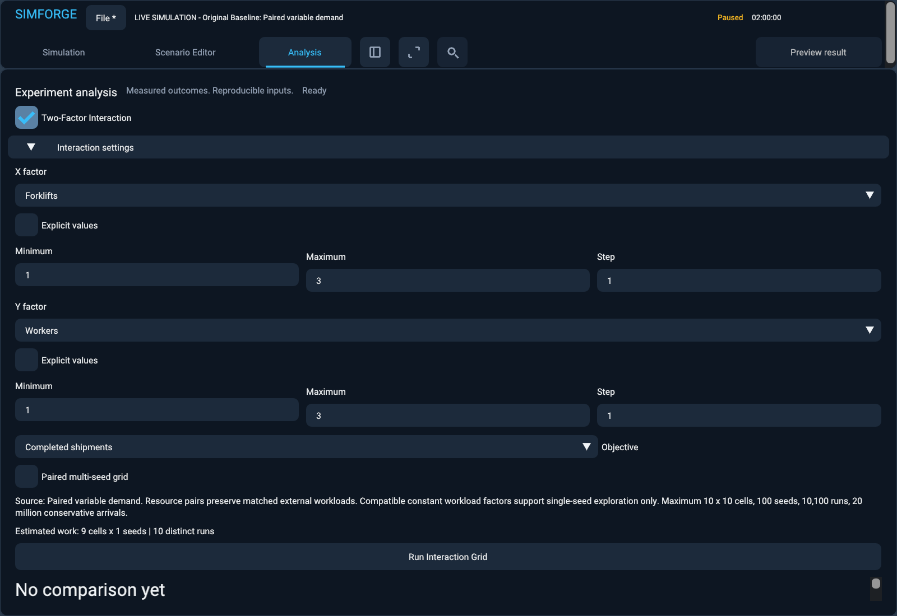
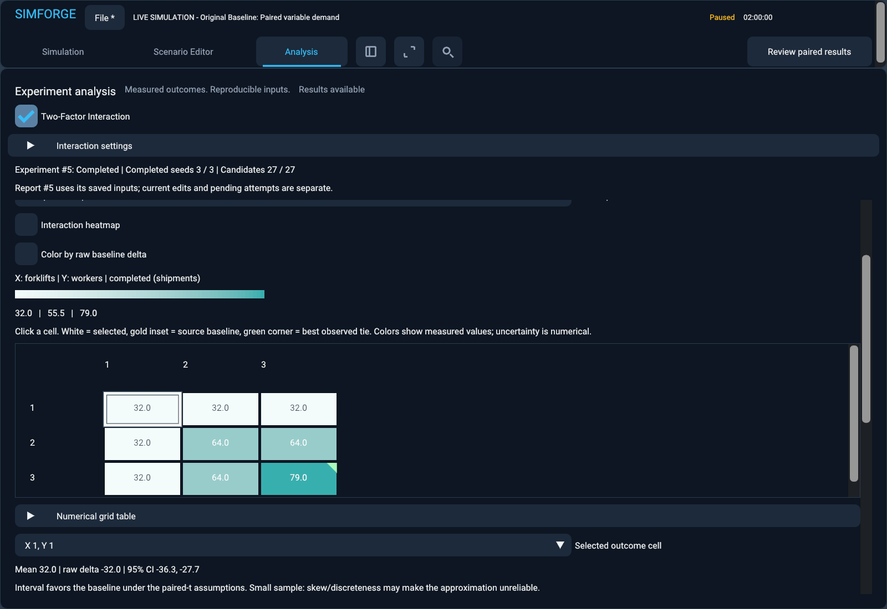
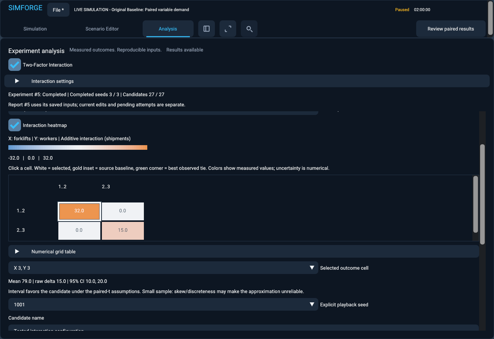
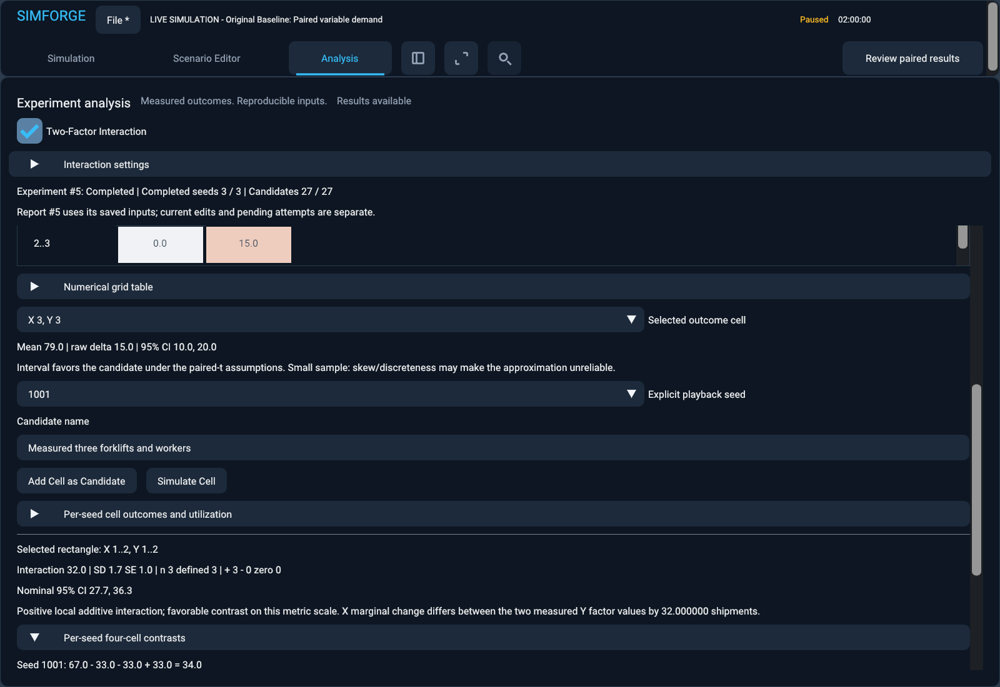
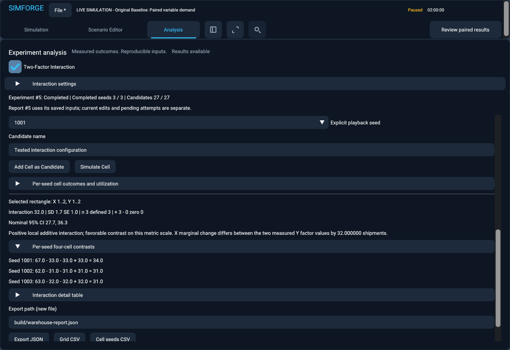
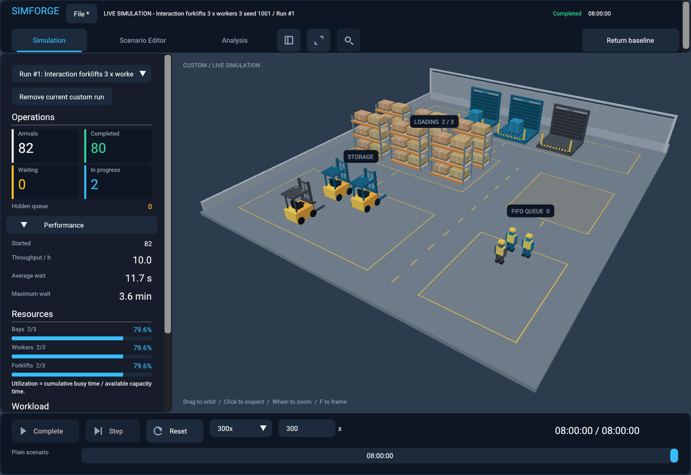

# Two-factor interaction studies

SimForge measures a bounded joint response to two operational inputs. A one-factor sweep holds the other inputs fixed; this study tests a Cartesian product and measures whether one factor's local effect changes with the other. This is a controlled simulation experiment, not a global optimizer.

## Requests, bounds and execution

`InteractionRequest` owns the complete validated warehouse definition, source identity, experiment identity, two factor identifiers, explicit tested values, objective, replication plan and execution limits. The worker receives a value copy; editor changes cannot alter a submitted job. Canonical request v1 records original source factor values, objective direction, fresh-start mode, engine/schema provenance, generator version, statistical method/version, nominal confidence and report version. There are no seed factors or historical checkpoint grids.

Resource pairs are forklifts/workers, forklifts/loading bays and workers/loading bays, in either axis order. Constant arrival intervals or constant processing durations can also be paired with a resource. Workload factors are **single-seed exploratory only**, require the source's corresponding constant mode and never convert stochastic/profiled modes or discard other workload configuration. A pair of two workload factors is rejected. Resource-resource studies provide the strongest pairing guarantees.

All factor values are exact unsigned whole numbers; durations use whole seconds. Either explicit lists or minimum/maximum/positive-step ranges are accepted. A range's maximum must be exactly reachable. Scenario validation rejects nonrepresentable inputs and invalid transformed configurations, including total resource limits. Empty axes, duplicate factors/values/seeds, invalid generator/method/confidence, sequential seed overflow and unsupported workload coupling are rejected.

The hard limits are 10 values per axis, 100 cells, 100 seeds, 10,100 distinct executions including any external baseline, and 20 million conservative arrival executions. Request limits can reduce these ceilings, never raise them. Checked products and sums cover cells, replications and arrival work. These limits bound simulation work; the near-limit benchmark below documents this machine's behavior, not a runtime guarantee for every valid scenario.

Axes are canonical ascending value order. Storage, progress, tables, heatmaps, exports and playback all use `index = y_index * x_count + x_index`. Table sorting changes presentation only. Cell identity packs the two actual uint32 values; the surrounding full request supplies experiment identity, ordered factors and source provenance. Queued actions compare that complete request and the workspace API checks experiment identity again.

`parameter_transform.hpp` shares typed parameter access between one-factor and two-factor studies. Both grid fields are applied before final scenario validation, so a valid joint resource transfer is accepted even when an intermediate one-field scenario would exceed the resource bound. `evaluation.hpp` is the shared compact engine evaluation service for sensitivity and interaction studies. It constructs the authoritative warehouse simulator, runs with the existing execution control and retains metrics/event counts. No second thread system, alternative simulator or per-cell simulation history is introduced. Statistical comparison algorithms remain unchanged.

## Original baseline and pairing

Every seed evaluates the original source once. If the exact original X/Y values occur in the grid, that cell reuses the source metrics. Otherwise the original source remains an external reference. Distinct executions equal `seeds * (cells + (baseline_in_grid ? 0 : 1))`; no extra bottleneck probes are run. Unique validated axis values make every transformed cell distinct. The source definition is untouched; a cell changes only the two requested fields and the explicitly selected replication seed.

Resource-resource cells retain identical arrival schedules and per-shipment processing requirements within a seed, because workload configuration and the engine's independent indexed RNG streams stay fixed. Negative results and all seed outcomes remain in the report. Workload-factor studies change demand/service by design; sharing a seed identifier does not mean identical external workloads.

Single-seed mode reports one actual realization and has no uncertainty intervals. Different seeds do not create independent stochastic observations for a constant, profiled-only or equal-bound workload. Multi-seed resource grids retain baseline/cell metrics, means, signed paired differences, sample SD/SE, favorable/unfavorable/tied counts and eligible nominal intervals. **Raw difference always means tested minus original source**. Lower-is-better direction is separate.

## Four-cell additive interaction

For every adjacent rectangle, including irregular step lengths:

```text
I_seed = Outcome_seed(x1,y1) - Outcome_seed(x1,y0)
       - Outcome_seed(x0,y1) + Outcome_seed(x0,y0)
```

The implementation calculates a difference of the two within-seed X marginal changes, `(Y11 - Y01) - (Y10 - Y00)`, then aggregates the complete contrast vector. It never subtracts independent confidence bounds or relies only on marginal means. Rectangle metadata identifies all four original cell indices and the actual X/Y ranges. No per-unit normalization is claimed: differently sized irregular rectangles describe different step changes.

Positive means a higher joint outcome than the additive local comparison; negative means a lower outcome; zero means no observed additive interaction in that rectangle. A positive contrast favors completed/throughput metrics, while a negative contrast favors waiting/wait metrics. These statements apply to the selected metric scale and model. They do not establish real-world causality or guarantee the same conclusion on log/percentage scales.

The existing compensated centered sample kernel and validated three-decimal Student-t critical table are reused. For stochastic multi-seed resource studies with at least three complete observations:

```text
mean(I) +/- t_0.975(n-1) * sample_sd(I) / sqrt(n)
```

Every cell's source delta similarly aggregates its per-seed paired differences. Rectangle summaries use numerical zero as the reference to the existing paired-statistics kernel; this zero is not a warehouse baseline. Sample SD/SE are available at n >= 2. Fewer than three seeds, single-seed mode and deterministic workloads suppress confidence intervals. Zero observed variance yields a degenerate eligible interval with a non-guarantee diagnostic.

Missing any one of the four required observations produces an undefined seed contrast. Any missing seed contrast suppresses the full aggregate and interval instead of selecting complete cases. Defined counts remain visible. Missing values export as JSON null or empty CSV fields, never invented zeros. Nonfinite inputs or arithmetic overflow are rejected.

Intervals including zero yield inconclusive interaction evidence. Small samples can be unreliable for skewed/discrete responses. Nominal 95% intervals do not provide simultaneous 95% coverage across a grid. Selecting the largest observed response introduces selection bias. Best observed means the best defined mean among submitted cells, **with all exact ties retained**; it does not imply superiority to the external original baseline or globally optimal capacity. Utilization is inspection-only, and there is no cost or ROI objective. Started wait metrics exclude shipments still waiting and can compare different populations.

## Analysis workspace and playback

Open Analysis and enable **Two-Factor Interaction**. Choose the two factors, bounded lists/ranges, objective and single/paired seed policy. Estimated cell/seed and distinct-run work appears before submission. Setup collapses on start to keep progress and cancellation accessible; all submitted inputs remain owned by the worker.

The outcome heatmap has X horizontally and Y vertically. Select a measured metric or raw baseline delta. Absolute quantities use a sequential teal scale; signed deltas and the interaction view use a symmetric blue/neutral/orange scale centered on zero, with numeric legend ticks and metric units. Gray means undefined. White borders mark selection, a gold inset marks the exact source cell and green corners mark best-observed ties for the submitted objective, including when the displayed metric changes. These markings and colors are descriptive, not significance tests. Dense grids scroll horizontally and cell labels are omitted when they cannot fit; hover details and numerical tables retain the values.

Switch **Interaction heatmap** to select an actual adjacent rectangle. Labels show the real lower/upper values. Detail panels report mean, SD, SE, counts, interval and measured local explanation; the per-seed panel shows all four stored observations and their contrast. Numerical cell and rectangle tables sort independently of stored identities. Cell inspection shows source/cell outcomes, deltas and utilization for every seed, including unfavorable ones.

Choose an explicit available playback seed (default the first submitted seed), then add the exact cell as a uniquely named candidate or launch **Simulate Cell**. Candidate and custom-run limits are enforced; existing objects are never overwritten. Candidate notes retain experiment/cell, factors, values and seed. The viewer identity includes both factor values and the selected seed. A custom run reconstructs one physical realization on demand; there is no aggregate or average warehouse snapshot.

The existing single `jthread` publishes phase, X/Y values, completed cell-seed evaluations, current/total seeds and actual run tick/event progress. Cancellation works between cells/seeds and inside the event loop. Partial or failed work never replaces the previous successful report. Shutdown requests cancellation and joins the same worker. Graphics/UI work remains on the owning thread.

## Headless and export schemas

CLI specification schema 4 uses `mode: "interaction"`. Prior schemas 1/2/3 remain unchanged. Source paths must resolve inside the specification directory. See the four `warehouse-interaction-*.json` examples. The request accepts `x_values` or `x_range`, `y_values` or `y_range`, objective, multi-seed flag, replication plan and optional reduced limits.

```powershell
build/windows-release/apps/sandbox/simforge_headless.exe --headless `
  --experiment examples/warehouse-interaction-forklifts-workers.json `
  --export-json build/interaction.json `
  --export-csv build/grid.csv `
  --export-seeds build/cell-seeds.csv `
  --export-interactions build/interactions.csv `
  --export-interaction-seeds build/contrast-seeds.csv
```

All outputs must be distinct new files. Existing files are protected by the exclusive-create output helper. Preflight errors retain legacy exit code 1; request validation is 2, unsupported mode 3, bounded-work/execution/export exceptions 4 and controlled cancellation 5.

JSON report v1 contains the complete resolved request, baseline observations/means, y-major per-seed cell metrics and paired differences, per-cell summaries, every rectangle's four cell identities, all per-seed four values/contrasts, aggregate statistics, ties, actual execution count and limitations. Timing/event instrumentation is excluded from canonical JSON, so equivalent GUI/headless requests have identical numerical report content.

CSV variants are grid summary (`experiment_id,cell_id,x_index,y_index,x,y,metric,...`), seed cells (same identity plus `seed,baseline,tested,delta`), interaction summary (`experiment_id,x_index,y_index,x0,x1,y0,y1,metric,...`) and seed contrasts (rectangle identity plus `seed,value00,value10,value01,value11,contrast`). Summary rows include sample/defined counts, SD/SE, eligible interval bounds and sign/favorable counts. Double formatting retains roundtrip precision. Exports validate authoritative metrics and execution identities before writing.

Parsing checks seeded arrivals, conservation, horizons, utilization denominators and processing support using the existing raw metric validator. It recomputes all summaries, deltas, contrasts, source reuse and provenance and requires exact canonical agreement. Project loading does not rerun experiments.

## Persistence and recovery

The existing `.simforge` envelope remains version 1, with explicit `interaction_v1` feature negotiation and `interaction` report kind. Legacy projects remain loadable. Completed raw reports, setup strings (including unfinished invalid input), selection/view/seed, candidates and independent playable runs are preserved. CRC32, transactional replacement and recovery remain in the existing project implementation. A valid-envelope malformed interaction report cannot replace any part of the current workspace.

The workspace still retains **one latest successful report across all analysis types**. A successful interaction study replaces that slot; cancellation/failure preserves it. Other candidate/run/project state remains independently retained. Analytical reports restore without synthesized snapshots or active workers.

## Curated engine examples

The first three examples use uniform arrivals 240..480 seconds, uniform processing 600..1200 seconds, a 28,800-second horizon, tick rate 60, and 20 matched seeds 1001..1020. Source capacities are 3 bays, 10 workers and 2 forklifts. Both axes test 1,2,3.

| Example | Completed means by ascending Y row | Measured local response |
|---|---|---|
| Forklifts/workers | 31.8,31.8,31.8 / 31.8,62.8,62.8 / 31.8,62.8,77.7 | X 1..2, Y 1..2: +31, nominal CI [30.4964,31.5036]; X 2..3, Y 2..3: +14.9, CI [13.9902,15.8098] |
| Forklifts/loading bays | Same measured rows as above | Original source cell X=2,Y=3 reused; 180 actual runs rather than 200 with an external baseline |
| Workers/loading bays | 31.8,31.8,31.8 / 31.8,62.8,62.8 / 31.8,62.8,62.8 | +31 on the first rectangle; zero interaction on X 2..3,Y 2..3, with forklift capacity held at two |
| No effect | 94,94 / 94,94 | Constant baseline scenario, forklifts 3,4 and workers 10,12: exact contrast zero, one seed, no CI; original source completed 63 |

These are actual engine outputs. In example A, adding workers 1 to 2 gains no completions at one forklift, but gains 31 mean completions at two forklifts. The local positive contrast explains that dependency on these tested values. The zero rectangles and the second example's plateau do not establish synergy. Stochastic zero-variance intervals remain explicitly qualified.

## Validation, measurements and screenshots

Thirty-one CPU cases cover independent positive/negative/zero/large-offset contrasts, nonfinite/overflow/missing observations, irregular steps, lower-is-better interpretation, mean/SD/SE/Student-t fixtures, zero variance, small samples, bounds, workload compatibility, a joint resource transfer at the schema limit, exactly-two-field isolation, direct-engine equality, baseline inside/outside reuse, indexed RNG stream equality, order invariance, seed reordering/duplicates, exact ties, export integrity, undefined data, async publication/cancellation/failure, explicit playback, persistence and valid-envelope transactional corruption. The independent contrasts 5,7,9 expect mean 7, sample SD 2, SE 1.1547005383792515 and interval [2.031323583354081,11.968676416645919], calculated independently of the production helper.

Four curated CLI cases and a CLI contract validate raw JSON/CSV identity, exact four-value arithmetic, output exclusivity and malformed requests. The opt-in native test uses real SDL clicks for workflow/run/view/cell/candidate/playback/save actions, checks canonical GUI/headless agreement, holds actual simulation work to inspect progress/cancellation, performs ungated live-frame measurements, verifies selected-seed engine metrics, saves/reopens in a fresh process and checks resize/minimize/shutdown with zero Vulkan validation errors/warnings. Some settings are configured directly by the harness; it is a scripted native walkthrough.

The Release benchmark `simforge_interaction_benchmark` uses uniform arrivals 1..3 seconds, uniform processing 1..8 seconds, 16 bays, two source workers/forklifts, tick rate 60, seeds starting at 1001 and tested worker/forklift axes 1..N. All benchmark grids contain the original source cell. The near-limit case consumes 19 million conservative arrivals of the supported 20-million budget. Actual event counts include every executed baseline/cell run. Raw measurements are in [interaction-benchmarks.csv](interaction-benchmarks.csv).

| Grid x seeds | Horizon seconds | Actual runs | Baseline runs / reused cells | Events | Sync ms | Aggregation ms | Submit ms | Async ms |
|---|---:|---:|---:|---:|---:|---:|---:|---:|
| 3 x 3 x 1 | 10,000 | 9 | 1 / 1 | 74,671 | 3.953 | 0.080 | 0.072 | 4.553 |
| 5 x 5 x 20 | 10,000 | 500 | 20 / 20 | 4,417,850 | 221.007 | 0.909 | 0.083 | 229.337 |
| 10 x 10 x 50 | 3,600 | 5,000 | 50 / 50 | 16,872,981 | 947.988 | 5.986 | 0.097 | 909.830 |
| 10 x 10 x 100 | 1,900 | 10,000 | 100 / 100 | 17,801,230 | 905.204 | 8.573 | 0.098 | 970.388 |

| Grid x seeds | Canonical JSON bytes | Complete project bytes | Serialization ms | Compact report allocation estimate bytes | Process peak bytes |
|---|---:|---:|---:|---:|---:|
| 3 x 3 x 1 | 42,063 | 45,090 | 1.420 | 28,882 | 6,811,648 |
| 5 x 5 x 20 | 615,946 | 618,975 | 31.072 | 225,820 | 14,110,720 |
| 10 x 10 x 50 | 5,644,564 | 5,647,588 | 187.092 | 1,822,562 | 75,923,456 |
| 10 x 10 x 100 | 11,346,447 | 11,349,472 | 299.359 | 3,346,050 | 139,403,264 |

The largest case measured **19.67 million processed events/second** in renderer-independent engine execution, with aggregation about **0.95%** of synchronous time. Process peak working set is cumulative across cases and includes two independently owned reports, live workspace state and transient serialization/JSON allocations: **132.95 MiB**, not just raw report storage. The compact estimate counts retained structures, vector capacities and principal diagnostic strings; allocator overhead is excluded. Complete project sizes are actual writes, including the baseline's independent live state. Serialization separately audits seeded arrivals/raw metrics and regenerates summaries. No histories or 10,000 snapshots are retained.

Five ungated event-loop cancellations measured **0.0209 / 0.0249 / 0.0654 ms** minimum/median/maximum on this machine. These measurements do not promise the same latency during bounded validation or aggregation. The existing simulation checks stop requests every 256 events. No GPU compute, extra simulation workers or unmeasured speedup is claimed.

The curated Release native walkthrough on NVIDIA GeForce RTX 5080 Laptop GPU (API 1.4.351, loader 1.4.363, FIFO presentation, synchronization validation) measured 20 ungated active-worker frames averaging **4.10685 ms**. Its 306 frames averaged **3.69365 ms** total CPU frame time, **134.965 microseconds** UI build and **3.1427 ms** record/submit/present. Heatmap CPU build averaged **12.4113 microseconds** for the 3 x 3/2 x 2 native views. Fresh-process reopening averaged **4.04054 ms** over 183 frames, with **123.93 microseconds** UI build. These include presentation synchronization; they are CPU measurements, not GPU timestamps. The saved native project was **79,890 bytes**. Both processes reported **zero validation errors and zero warnings**.

The six fixed documentation PNGs below total **1,126,669 bytes**. Native captures use three seeds for a quick walkthrough (mean completed 79 at X=3,Y=3; explicit seed 1001 completed 80), while the curated headless examples above use 20 seeds. Screenshots were inspected for axes, legends, contrast text, selection, source/seed provenance and actual playback resources. At compact window sizes the existing Analysis result panel and heatmap use scrollbars; the entire study is not squeezed into one screen. The native test covers 640 x 480, 1280 x 720 and larger windows, minimize/restore and fresh-process shutdown. Temporary diagnostics remain under the existing three-run retention cap, routine successes reclaim their files, and Debug symbols remain intact.













Actual Release CLI invocations of the same four workload/grid/seed plans measured **30.558 / 222.242 / 796.034 / 863.652 ms**, respectively. These wall times include process launch, specification parsing, statistical aggregation and console output, with no exports. The largest CLI case therefore processed the equivalent measured 17,801,230 engine events at about **20.61 million events/second**. Different timings from the core benchmark reflect measurement/run variation and process overhead, not a claimed implementation speedup; the `headless_cli_ms` column records each invocation.

Final complete suites passed:

| Configuration | Passed | Elapsed |
|---|---:|---:|
| Windows Debug | 488/488 | 228.56 s |
| Windows Release | 488/488 | 170.64 s |
| Renderer-disabled Debug | 453/453 | 65.90 s |

All original 451 renderer/417 headless cases remain present, covering baseline metrics, validation, indexed workloads, snapshots/replay/interventions, comparisons/statistics/sensitivity, async behavior, custom playback, projects/recovery, language interpretation and exports. The 37 additions are 31 CPU cases, four curated CLI cases, one CLI contract and one native graphical integration case. Builds completed without compiler warnings. `dumpbin /dependents` confirms the renderer-disabled headless executable imports only the Windows/C++ runtime, with no SDL3 or Vulkan DLL. Artifact-management and retention tests passed; no graphics validation requirement or test timeout was weakened.

## Known limits and next work

Fresh starts only, two factors only, exact whole-number fields, bounded grids, nominal fixed 95% intervals and no simultaneous adjustment. Workload factors are single-seed only. Memory retains compact observations and derived summaries, not all histories. Colors carry no significance claim. Project retention is one latest successful report, not a report library.

A useful next milestone is persistent study history with explicit confirmatory validation of selected configurations on a separate seed set. This would address retention and selection bias without claiming a global optimizer. It is a recommendation only; no next milestone is started.

## Changed-file map

- `engine/include/simforge/analysis/interaction.hpp`, `engine/src/analysis/interaction.cpp`, `interaction_json.cpp`, `evaluation.hpp`, `parameter_transform.hpp`, `sensitivity.cpp`: bounded owned requests, transforms, compact engine evaluation, contrast/paired aggregation and integrity-checked JSON/four CSV codecs.
- Workspace request/report/execution/project headers and sources: one-worker integration, progress, stale cell actions, candidates/playback, exports, feature negotiation and transactional persistence/settings.
- Sandbox `interaction_panel.hpp/.cpp`, workspace/project panels, viewer, main and build files: setup, two heatmap views, sortable tables, seed inspection, playback, native hooks and renderer-independent schema 4 CLI.
- `tests/interaction_test.cpp`, `interaction_cli_test.ps1`, test build file, `scripts/run-graphics-test.ps1`: numerical, real-engine, export/persistence and bounded native lifecycle coverage.
- Four `examples/warehouse-interaction-*.json`, `benchmarks/interaction_benchmark.cpp`, benchmark build file, README, this guide, measured CSV and six curated native PNGs: reproducible demonstrations and performance evidence.
