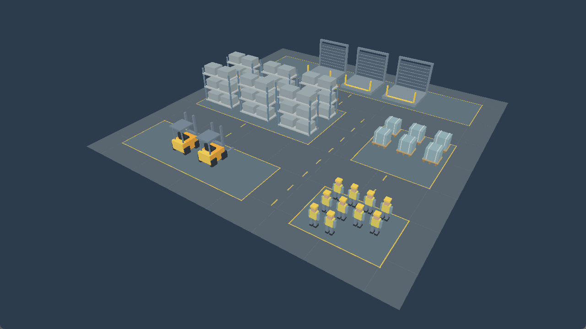

# Scenario-driven warehouse visualization

The graphical sandbox now builds a **static representative warehouse** from an
existing validated warehouse scenario. It draws the configured number of loading
bays, forklifts and workers, with procedural storage, cargo staging and travel
aisles. It does not execute or animate the operational simulation.

This document records Commit #13's static mode, which remains available unchanged.
Commit #14 adds opt-in [live operational visualization](live-warehouse-visualization.md)
with actual shipment identities and runtime capacity/usage observations.



## Ownership and dependencies

```text
ScenarioDefinition -> validate -> simforge_visualization::WarehouseLayout
                                      |
                                      v
                              owned RenderFrameData
                                      |
                                      v
                           simforge_renderer (Vulkan)
```

`simforge_visualization` links scenario/core and `simforge_render_scene`, whose
only external dependency is header-only GLM. Neither CPU scene values nor the
adapter links SDL, Vulkan, or a loader. Both are built and tested with
`SIMFORGE_BUILD_RENDERER=OFF`. The Vulkan renderer depends on scene values and
platform support, without including or linking the warehouse visualization/domain
adapter. The sandbox orchestrates them. The dedicated `simforge_headless` target
still links only simulation/core and analysis, with no GLM, SDL or Vulkan imports.

The sandbox loads/validates/builds before creating the SDL window. It retains a
const layout and an independently owned const frame for the graphical lifetime.
Objects are built/copied once and reused every frame. Renderer calls read these
values and retain no borrowed references. GPU meshes, buffers, shader modules,
pipelines, depth images and readback remain renderer-owned. No operational system,
resource manager, clock, snapshot, recording, replay, comparison or metrics code
is changed. No rendering ECS or scene-management framework is introduced.

## Layout mapping and identities

Coordinates are right-handed, Y up, with meters used as representative visual
units. Docks sit at the back (small Z), storage/cargo occupy the middle, and parked
vehicles/worker staging occupy the front (large Z). A 4-unit longitudinal aisle
separates storage/vehicles from cargo/workers; 4-unit transverse aisles separate
the rows of zones. Principal rectangles have disjoint XZ interiors. Asset bounds
stay inside their own zone and never enter travel aisles. Mesh parts intentionally
intersect within an assembled asset. Floor and markings can overlap asset
footprints and one another at different heights; they are not obstacles.

| Scenario field / category | Visual mapping |
| --- | --- |
| `loading_bays` | Exactly one dock per bay |
| `forklifts` | Exactly one parked forklift per capacity unit |
| `workers` | Exactly one worker per capacity unit |
| Storage racks | `max(2, 2 * loading_bays)` |
| Staged cargo pallets | `max(4, 2 * loading_bays)` |
| Floor | One padded rectangle covering all zones |
| Markings | Zone outlines, tile strips and dashed aisle guides |

Each resource accepts **0..256** for visualization (768 resource representatives
in the maximum case); larger valid scenarios produce an actionable error before
graphics initialization and continue to work headlessly under existing schema
limits. Zero capacities produce no corresponding resource objects, while the
representative facility retains racks, pallets, zones and floor. There is no
silent truncation or expensive unbounded packing.

Docks use rows of up to eight, centered within their zone, with 4.8-by-5 cells.
Other grids use `min(8, max(1, ceil(sqrt(count))))` columns. Rack cells are
4.5-by-3.5, pallets 2.2-by-2.2, vehicles 3-by-4, workers 1.2-by-1.6. Zone extents
grow to accommodate their grids; vehicles and workers center within their zone.
The maximum floor is approximately 62-by-524 visual units, bounded well below
float precision/uint32 index limits. Individual figures become small when framing
large facilities; camera controls are deferred.

`WarehouseVisual` carries a kind, a one-based ID local to that kind/layout, a
render object (mesh/transform/color) and conservative bounds. Emission order is
floor, markings, docks, racks, pallets, forklifts, workers; each kind follows
row-major placement. Render objects preserve that ordering. The composite
`(kind, id)` is the mapping key, not an ECS handle or a globally persistent identity.
Changing layout capacities can move objects and alter marking IDs.

Repeated builds from the same validated capacities produce identical ordering,
IDs, transforms, colors and bounds under the supported build/runtime environment.
Name, seed, tick rate, duration and operational arrival/processing timings do not
change the static layout. This does not promise cross-platform bitwise GLM/math
results or fully deterministic simulation across hardware. The schema supplies
capacities rather than an exact blueprint, so visual distance never changes
operational travel time, event scheduling or throughput.

Forklifts and workers represent capacity, not individually identified reserved
runtime resources. Pallets are illustrative staging cargo, not current shipment
IDs or queue contents. Live visualization will need explicit domain identities
and read-only operational state mapping; this commit does not invent that mapping.

## Geometry and drawing

Five reusable, closed low-poly meshes join the original cube/floor/grid IDs:

| Mesh | Construction | Stored vertices / indices |
| --- | --- | --- |
| Dock | Platform, ribbed door, frame, bollards and safety stripe | 360 / 540 |
| Rack | Four supports, three shelves/beams, six cargo blocks | 384 / 576 |
| Pallet | Runners, deck slats, cargo box and straps | 264 / 396 |
| Forklift | Amber body, counterweight, seat, wheel blocks, mast, forks, overhead guard | 384 / 576 |
| Worker | Legs/boots, vest, arms, head, helmet and reflective strips | 264 / 396 |

All parts reuse the existing outward-CCW cube topology with positive scale, baked
face shades and restrained linear-RGB colors. This is inexpensive static ambient
shading, without dynamic lights or material systems. Shelves are muted metallic,
supports slate/blue-gray, vehicles amber, safety markings/vests warm yellow, and
cargo blue-gray with wooden pallet accents. Floors use a subtle tile grid.
Markings sit 0.002..0.014 units above the floor and zone fills, avoiding coplanar
surfaces. Dock markers and stripes distinguish loading positions.

The renderer creates eight unique meshes once per renderer lifetime, packed into
one vertex buffer and one uint32 index buffer: 1,820 vertices, 2,730 indices,
54,600 upload bytes. No per-object GPU mesh allocation, per-frame geometry upload
or runtime shader compilation occurs. Compatible resize reuses one graphics
pipeline and those two buffers. Diagnostic smoke alone allocates one readback
buffer per swapchain generation. Full shutdown/reinitialize creates fresh assets
after safe retirement.

The existing indexed multi-draw approach remains: one push-constant update/draw
per render object. Composite asset geometry is the initial asset representation;
no instancing or measured-before/after optimization is claimed. Baseline has
81 draws and even the supported maximum was measured successfully. Larger-scene
profiling can justify later instancing if necessary.

## Automatic camera framing

Frames optionally own `framing_bounds`. The renderer fits a fixed elevated
three-quarter camera at the actual drawable aspect on every recording, without
rebuilding objects. Without bounds, the original explicit demo camera works as
before. Automatic framing supplies camera position/target/FOV/clipping; the
explicit camera's other settings do not override that mode.

All eight bounds corners are projected onto a fixed camera basis. Pairwise
perspective constraints solve a distance and image-plane translation that fits
and centers the footprint with a 12% tangent margin. Intermediate calculations
use doubles, then validated float matrices. Near is 0.1; far exceeds the entire
bound radius, camera distance and framing translation. Tests project every corner
for capacities 0/1/3/64/256 and aspect ratios 0.25..4, checking positive W,
XY inside clip bounds and Vulkan zero-to-one depth. The RH/Y-up, negative camera Z,
projection-Y-flip and positive viewport conventions remain intact.

## Commands

```powershell
cmake --preset windows-debug
cmake --build --preset windows-debug
ctest --preset windows-debug --output-on-failure
build/windows-debug/apps/sandbox/simforge_sandbox.exe --scenario examples/warehouse-baseline.json
build/windows-debug/apps/sandbox/simforge_sandbox.exe --scenario examples/warehouse-constrained.json
build/windows-debug/apps/sandbox/simforge_sandbox.exe --scenario examples/warehouse-higher-capacity.json
# No arguments preserves the original floor/grid/cube demo:
build/windows-debug/apps/sandbox/simforge_sandbox.exe
# --headless preserves operational scenario execution:
build/windows-debug/apps/sandbox/simforge_sandbox.exe --headless --scenario examples/warehouse-baseline.json
# Visible GPU verification, with validation and synchronization checks:
build/windows-debug/apps/sandbox/simforge_sandbox.exe --scenario examples/warehouse-baseline.json --graphics-smoke 180
# Optional new P6 PPM output, existing parent directory:
powershell -NoProfile -ExecutionPolicy Bypass -File scripts/run-graphics-test.ps1 -Executable build/windows-debug/apps/sandbox/simforge_sandbox.exe -Mode Review -Frames 180 -Scenario examples/warehouse-baseline.json
cmake --preset windows-debug -DSIMFORGE_GRAPHICS_TESTS=ON
ctest --preset windows-debug -L graphics --output-on-failure
cmake --preset windows-debug -DSIMFORGE_GRAPHICS_TESTS=OFF

cmake --preset windows-release
cmake --build --preset windows-release
ctest --test-dir build/windows-release --output-on-failure
build/windows-release/benchmarks/simforge_warehouse_layout_benchmark.exe
```

Graphical `--scenario` accepts only warehouse definitions. Recording, replay,
checkpoint comparisons and experiments still require their headless workflows.
The renderer-disabled executable reports that graphics are unavailable.

## Verification and measurements

Measured on 2026-10-08 with MSVC x64, GLM 1.0.3, SDK/loader 1.4.363 and NVIDIA
GeForce RTX 5080 Laptop GPU (API 1.4.351), B8G8R8A8_SRGB, FIFO, three swapchain
images, D32_SFLOAT, graphics/present family 0. Debug and Release compile with no
compiler warnings. The new GPU-free cases cover repeated equality, stable IDs,
capacity counts, zero/minimum/maximum, varied spatial layouts, zone/aisle clearance,
finite transforms, actual mesh vertices inside bounds, per-part outward winding,
index validity, shared mesh identity, frame ownership, all three examples,
nonvisual parameter invariance and invalid inputs. A CLI test checks invalid,
oversized and nonwarehouse scenarios exit before graphics initialization.

Final Debug CTest passed **125/125**, including the four opted-in graphics tests;
Release passed **121/121** ordinary tests, with separate live graphics runs;
renderer-disabled Debug passed **101/101** without Vulkan discovery. The default
ordinary graphics-enabled suite now has 121 GPU-free tests. Headless warehouse,
movement/warehouse snapshots and replay, analytical outcomes, comparison rankings
and exports pass unchanged. A separate isolated-headless comparison/export CLI
run wrote JSON/CSV, retaining 63 versus 87 completions for the tested checkpoint
branches. Import inspection confirms the layout test and headless executable
import neither SDL3 nor Vulkan.

Debug opt-in CTest exercised the original demo and all three warehouse examples.
Release graphics runs exercised those same scenes plus zero, medium and maximum
capacities. All passed with **zero validation warnings/errors**, including depth,
resize/minimize/restore, static image repeat, resource reuse and lifecycle checks.
The final maximum run requested 600 frames and presented 605 including diagnostic
probes/restoration. Both Debug and Release normal warehouse desktop runs closed
through a native window-close request and exited 0. The default demo retains its
236 referenced vertices / 354 indices and all four GPU-verified cube colors.

| Example | Bays / forklifts / workers | Racks / pallets | Markings | Render objects / draws | Referenced vertices / submitted indices |
| --- | --- | --- | --- | --- | --- |
| Constrained | 3 / 1 / 10 | 6 / 6 | 53 | 80 | 8,208 / 12,312 |
| Baseline | 3 / 2 / 10 | 6 / 6 | 53 | 81 | 8,592 / 12,888 |
| Higher capacity | 3 / 3 / 10 | 6 / 6 | 56 | 85 | 8,988 / 13,482 |

Baseline contains 27 category assets, one floor and 53 markings. The third
forklift creates a second parking row, extending the floor and adding three
markings. Counts are built from the scenario, not hardcoded in the sandbox.
Submitted vertex totals mean referenced mesh vertex counts per draw, not hardware
vertex-shader invocation counts or cache measurements.

Release CPU layout measurements (100 repetitions, one observed run):

| Bays / workers / forklifts | Logical/render objects | Approx retained bytes | Layout mean | Owned frame mean |
| --- | --- | --- | --- | --- |
| 3 / 10 / 2 | 81 | 12,544 | 2.079 us | 5.072 us |
| 32 / 100 / 32 | 388 | 60,428 | 34.688 us | 22.084 us |
| 256 / 256 / 256 | 2,148 | 313,564 | 192.697 us | 121.654 us |

Release steady CPU render/present measurements, required validation enabled,
1280-by-720 final extent, same multi-draw path, 600 requested frames, 500 samples
after the first 100:

| Scene | Draws | Vertices / indices | Mean | Stddev | p50 / p95 | Min / max |
| --- | --- | --- | --- | --- | --- | --- |
| Baseline | 81 | 8,592 / 12,888 | 4.163 ms | 0.100 ms | 4.159 / 4.307 ms | 3.718 / 4.629 ms |
| Medium | 388 | 92,064 / 138,096 | 4.163 ms | 0.096 ms | 4.156 / 4.318 ms | 3.607 / 4.667 ms |
| Maximum | 2,148 | 591,248 / 886,872 | 5.259 ms | 0.218 ms | 5.206 / 5.550 ms | 5.036 / 7.131 ms |

The small/medium timings are consistent with presentation limiting the measured
host loop; FIFO is the selected mode. The maximum has a higher CPU wall cost,
without demonstrating a GPU bottleneck. Asset initialization was about 0.67 ms
and pipeline creation 13.76 ms in the final maximum smoke. These are observations,
not portable performance guarantees. No optimization speedup is asserted.

The tracked screenshot `docs/artifacts/warehouse-scene.png` was captured from the
actual DPI-aware 1280-by-720 Release desktop client, inspected visually and checked
for multiple palette groups. Native window close exited 0. Ordinary Release uses
validation off; graphics smoke explicitly enables required validation and
synchronization validation. This is automated desktop/GPU observation, not human
interactive testing. Capture of GPU output additionally verifies geometry across
multiple screen regions, amber/blue-gray/metal colors, and identical repeated
static frames. The baseline GPU image contains 14,151 / 233,810 / 25,661 pixels
in those palette groups. A controlled near-first cube depth probe stays unchanged
with reversed draw order; an empty frame clears all pixels. Resize, minimize/restore,
four swapchain/depth generations, one pipeline, two static plus four diagnostic
buffers, wrapper-first native-window destruction and full renderer reinitialize
are exercised. Actual desktop composition shows distinct docks, racks, pallets,
forklifts, workers and readable markings, without observed flicker/Z-fighting.

GPU timing is not measured. CPU render/present wall time includes validation,
submission/fence waits and FIFO presentation, so it is not raw GPU throughput.
Steady samples begin after frame 100 (resize phases finish by frame 80), are bounded
to 10,000 measurements, and report mean, population standard deviation, p50/p95
and min/max. The CPU layout benchmark uses 100 repetitions with allocation
included; frame construction separately includes copying and validation. Approximate
retained memory sums value sizes and vector capacities for layout plus frame,
excluding allocator bookkeeping, scenario strings, shared mesh data and GPU memory.

## Limits and next milestone

Only the NVIDIA path was tested live. Intel Graphics API 1.4.328 / driver 101.8331
still lacks both KHR and EXT swapchain-maintenance1 presentation fences and remains
unsupported. The lifetime guarantee is unchanged; there is no new fallback or
broader hardware claim. Other devices, split queues and operating systems were
not live-tested. No allocation-failure/device-loss fault injection was performed.

There is no live shipment state, activity animation, interpolation, simulation
playback, editor, mouse camera, selection, shadows, PBR, HDR or render graph.
The supported maximum is a bounded representative facility; individual workers
are small in the full-scene view. No arbitrary physical blueprint or calibrated
visual travel time is inferred.

Recommended Commit #14: define a read-only operational visualization snapshot
with real shipment IDs and explicit capacity/activity mapping, then update visual
states from fixed ticks with independent render interpolation. Preserve existing
domain snapshots/replay/metrics, own frame values, and test paused/stepped/replayed
visual state before introducing interactive controls. This recommendation is
documentation only; none of that future milestone is implemented here.
