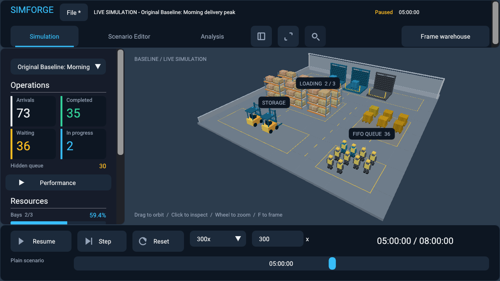
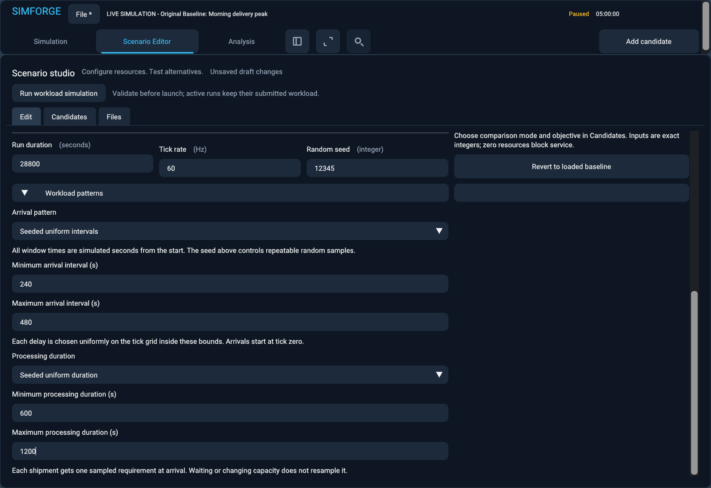
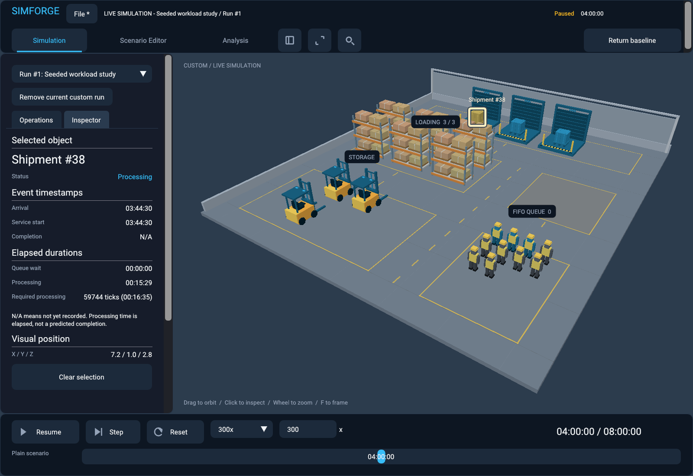

# Reproducible warehouse workloads

The generator-1 contracts below remain unchanged. See [seeded Poisson arrivals and explicit observation coverage](stochastic-arrivals-and-coverage.md) for generator 2, its count/time sampling, safety limits and supported-toolchain reproducibility contract.

Commit #24 extends the existing event-driven warehouse engine with demand windows and bounded, seeded variability. It does not introduce another simulator. The engine owns all arrivals, processing requirements, queues, completions and metrics; the renderer consumes observations.

## Configuration and compatibility

Scenario schema remains version 1. Old `shipment_interval_seconds` and optional `processing_duration_seconds` remain the canonical fixed-workload representation, including the original 600-second processing default. Their serialized definitions, v1/v2 snapshot bytes, event ordering and established eight-hour results remain unchanged: 96 arrivals, 64 starts, 63 completions, 32 waiting, one processing with two forklifts; three forklifts give 96 starts, 94 completions, zero waiting and two processing.

Advanced scenarios replace both timing fields with `warehouse.workload`. Resource fields remain alongside it. For example:

```json
"warehouse": {
  "loading_bays": 3, "workers": 10, "forklifts": 2,
  "workload": {
    "generator_version": 1,
    "arrivals": {"mode": "uniform", "minimum_seconds": 240, "maximum_seconds": 480},
    "processing": {"mode": "uniform", "minimum_seconds": 600, "maximum_seconds": 1200}
  }
}
```

`simulation.random_seed` supplies the seed. Supported arrival objects are:

| Mode | Required parameters | Meaning |
|---|---|---|
| `constant` | `interval_seconds` | Original fixed interval, first arrival at zero |
| `profile` | `segments` | Ordered demand windows with fixed intervals |
| `uniform` | `minimum_seconds`, `maximum_seconds` | Seeded, discrete uniform interarrival ticks; first arrival at zero |

Processing supports `constant` with `duration_seconds`, or `uniform` with the same bound names. Either processing mode works with every arrival mode. A profile looks like:

```json
"arrivals": {
  "mode": "profile",
  "segments": [
    {"start_seconds": 0, "end_seconds": 7200, "interval_seconds": 600},
    {"start_seconds": 7200, "end_seconds": 18000, "interval_seconds": 180},
    {"start_seconds": 18000, "end_seconds": 28800, "interval_seconds": 480}
  ]
}
```

An explicit workload containing two constant modes is normalized to the old timing-field representation. Mixing a workload object with either legacy timing field is rejected. Internally the old scalar is authoritative only for its constant mode; it is zero for an advanced mode. Inactive random bounds and profile data must be absent. There is no second conflicting timing source.

Validation is shared by files, editor, runtime, comparisons, snapshots and projects. Durations/bounds are integer seconds in 1..604800, minimum <= maximum. Demand windows have integer second boundaries, start < end, lie inside the horizon, and are ordered and non-overlapping. At most 64 windows and a conservative worst-case 100,000 arrivals are accepted. Existing tick-rate, horizon, resource and input-size limits still apply. Unknown fields, modes, generator versions, negative/fractional/string numbers and excessive volumes fail before running.

## Tick and boundary policy

Uniform distributions sample every integer tick in the inclusive range `[minimum_seconds * tick_rate, maximum_seconds * tick_rate]` equally. They are discrete distributions, not continuous samples rounded afterward. At 60 Hz, 1..3 seconds means all 121 ticks from 60 through 180, including subsecond values. Equal bounds give an exact fixed duration. All intervals and requirements are positive; zero-time event chains cannot occur.

Profile windows are half-open `[start,end)`. Each window has an arrival at its start and then every interval while strictly before its end. The next window starts its own cadence. Gaps are idle; full coverage is optional; an empty profile has no arrivals. A long interval still produces the window's first arrival. For example `[0,5)` every two seconds, `[5,10)` every three, and `[12,15)` every ten produce `0,2,4,5,8,12`.

No arrivals occur at or after the horizon. Completions due at the horizon are processed; new service cannot start there. Unfinished reservations and future completions remain in the snapshot, consistent with the original fixed-horizon model. Stable completion/arrival/sequence ordering and FIFO dispatch remain authoritative.

## Generator and sampling contract

Generator version 1 uses the integer SplitMix64 transform from [Sebastiano Vigna's public-domain reference implementation](https://prng.di.unimi.it/splitmix64.c). It uses unsigned 64-bit wrapping arithmetic and explicit constants; no `std::uniform_*_distribution`, floating-point probability transform, wall clock, worker scheduling or renderer RNG participates.

For shipment ID `i`, first mix a temporary counter initially equal to `i`. Initialize sample state as `seed XOR domain XOR mixed_counter`. Advance SplitMix64 on that state for each draw. Arrival domain is `0xa0761d6478bd642f`; processing domain is `0xe7037ed1a0b428db`. The interval after shipment `i` uses its arrival-domain sample. Shipment `i` gets its processing-domain requirement once, at arrival, including when queued. Capacity, waiting and starts never resample it. Separate domains prevent processing changes from consuming arrival samples and vice versa.

Range reduction rejects draws below `(0 - range) % range`, then applies modulo plus minimum. Rejection removes modulo bias. The sampler allows 64 trials and throws explicitly on exhaustion; there is no biased fallback or unbounded loop. Version 1 tick ranges are bounded to 604,800,000.

Known raw seed-zero outputs begin `e220a8397b1dcdaf`, `6e789e6aa1b965f4`, `06c45d188009454f`. For seed 42 and inclusive ticks 100..200, arrival samples IDs 0..7 are `161,163,152,125,196,106,117,159`; processing samples are `102,108,195,132,103,166,174,136`. Tests freeze these separately from runtime round trips.

This specifies portable integer workload sequences. Validation was performed on Windows x64/MSVC; execution on another platform has not been independently tested. Full runtime snapshots also contain clock presentation state, which callers must preserve when claiming exact equality.

## Runtime, snapshots, replay and persistence

The old arrival event branch still schedules the original fixed interval. Advanced arrivals lazily schedule just the next event. Processing samples are stored in `ShipmentRecord.required_processing_ticks`. Completion events use that stored requirement; actual completed processing totals sum those requirements. Variable durations can finish out of shipment order. A bounded ordered active-ID set replaces the completed-prefix observation shortcut only for random processing; frames do not scan historical completed shipments. The legacy shortcut remains for fixed processing, including profiles.

Advanced workloads use warehouse snapshot v3 and recording schema v3. Snapshots carry generator version, canonical definition/seed, every sampled requirement, next arrival/completion events, ordering counters, queue, reservations, capacities, intervention history and metric accumulators. Counter-keyed sampling has no hidden mutable PRNG cursor. Validation regenerates the external arrival sequence and per-ID requirements and checks pending events and lifecycle totals before transactional restoration. Restoring rebuilds only the active-ID index, not another random history. Tests compare future event traces and final complete state after restore and recording replay.

Old v1/v2 readers/writers retain their original binary layout. Project envelope version 1 and existing engine identifier remain, with mandatory `workload_v1` feature when advanced definitions or extended raw drafts exist. Existing legacy projects remain readable and retain the original feature list. Old applications reject new workload projects rather than silently dropping data. Raw invalid editor bounds/windows are stored independently of validated runnable definitions. Integrity checks, bounded arrays/strings, atomic replacement, recovery, independent runs and historical reports remain in force. Reopening continues the saved runtime; tampered validated workload data fails without replacing the current workspace.

## Comparisons and interpretation

Resource-only alternatives with identical seed, workload, timing and horizon share the exact arrival ticks and per-shipment requirements. This applies to candidate capacities and add-one bottleneck probes, fresh runs and compatible checkpoint branches. Capacity changes affect service outcomes, never external workload samples. Candidate evaluation order does not change samples. Checkpoint comparisons reject changed workload specifications. Async execution uses the same engine and preserves active graphical playback; cancellation retains the previous successful report.

JSON reports contain the canonical scenario and checkpoint with workload metadata; CSV retains its established metric columns. Expected arrivals are computed from the actual seeded schedule, and processing metrics use sampled durations. Report replay still checks exact computed outcomes. Single-seed results describe one paired realization, not expected performance or a confidence interval. Changing the seed/workload/horizon breaks the paired-exogenous-workload guarantee. Fresh comparisons may still compare different scenarios, with their explicit definitions preserved.

The offline interpreter and its 3,609-case coverage remain intact. Resource requests such as “I want to see ten more bays” preserve advanced workload fields and still require explicit proposal approval. Fixed timing language commands against an advanced corresponding mode are rejected with guidance; advanced workload editing uses the editor. No unsupported distribution language is guessed.

## Desktop and headless use

Open **Scenario Editor → Workload patterns**. Choose constant, profile or uniform arrivals; choose constant or uniform processing. Uniform modes expose minimum/maximum seconds. Profiles expose editable start/end/interval rows with add/remove controls and a 64-window limit. Fixed timing inputs are disabled when their mode is inactive. Raw errors remain visible and prevent validation/run. Mode changes preserve inactive draft text for returning to a previous mode. Seed and discrete-tick semantics are shown beside the controls.

The persistent **Run workload simulation** action creates a normal independent custom run. Play/pause, speed, seeking, restart, run switching, resize and project restoration use the existing controller. Simulation metrics show workload modes, seed, bounds or current demand window/gap and the single-realization caveat. Shipment inspection shows the exact sampled tick requirement. The scene reflects real FIFO/processing state, including out-of-order finishes; aggregate worker/forklift visual motion remains illustrative.

Three executable examples are included:

- [Morning peak](../examples/warehouse-morning-peak.json): quiet/peak/recovery demand windows, fixed processing.
- [Variable deliveries](../examples/warehouse-variable-deliveries.json): uniform arrivals, fixed processing.
- [Variable processing](../examples/warehouse-variable-processing.json): fixed arrivals, uniform requirements.

Run `simforge_sandbox.exe --headless --scenario examples/warehouse-variable-deliveries.json` headlessly, or replace `--headless` with `--live` for interactive playback. Headless output labels advanced modes, generator and seed; the original fixed-workload output remains unchanged.

## Scope and next step

This milestone deliberately supports bounded discrete uniform distributions. Exponential and triangular distributions are deferred. Exponential has unbounded support and would need an explicit volume/tail policy plus a specified portable transform; silently truncating it would change its claimed distribution. No exponential statistical claims are made. Multi-seed replications, uncertainty intervals, shifts and scheduled capacity changes are not added here. The next useful milestone is paired multi-seed experiments with confidence intervals and explicit aggregation, using this versioned workload contract.

## Verification and actual examples

Eighteen workload test entries cover the two established legacy capacity results and independent arrival/start/completion formulas; profile boundaries, gaps and empty demand; frozen raw and domain-separated sample vectors; equal and extreme bounds; same/different seeds; independent random domains; invalid schemas and volume limits; all six fixed/profile/random combinations through binary restore and future-event trace comparison; recorded resource interventions; paired candidates and bottleneck probes; evaluation-order independence; async/checkpoint equivalence and incompatible-workload rejection; genuine in-progress cancellation preserving the previous report; out-of-order completion observations; project continuation and transactional rejection; invalid raw editor persistence; and approved natural-language resource changes preserving workloads.

The statistical test uses 100,000 samples per domain, fixed seed 12345, inclusive ticks 100..1099. Expected mean is 599.5 and variance 83,333.25. Arrival mean/variance were 598.694/83,308; processing were 598.102/82,929. Both satisfy mean error <3, variance error <1600 and every ten-bin count between 9,000 and 11,000. These are deterministic sanity checks with preselected loose tolerances, not a claim of statistical certification or calibration to a warehouse.

Three headless CLI tests and three SDL/Vulkan integration tests exercise the supplied examples. Native tests select both random modes using actual controls, edit all four bounds, play/pause, inspect requirements, seek across windows, compare complete snapshots to headless state, restart, switch runs, compare asynchronously without advancing playback, replay exports, resize/minimize/restore, save a project through the File UI, then reopen in a fresh process and continue the captured runtime. Established project, language, live-viewer and renderer tests remain enabled.

The frozen language holdout remains byte-identical (SHA-256 `eb1a53c55fff3020e35535ab5ed59e9a38a24c3829d7a9964fbc7bbd596aab82`); its existing 24/28 supported and 20/20 rejected results and the 3,609-case language coverage are preserved.

Eight-hour example results at 60 Hz, seed 12345 and resources 3 bays / 10 workers / 2 forklifts:

| Example | Arrived | Started | Completed | Waiting | Processing | Average completed processing (s) |
|---|---:|---:|---:|---:|---:|---:|
| Morning peak | 95 | 60 | 59 | 35 | 1 | 900 |
| Variable deliveries | 80 | 64 | 63 | 16 | 1 | 900 |
| Variable processing | 96 | 66 | 64 | 30 | 2 | 874.069 |

The profile graphics test observes zero waiting just before the two-hour boundary and 36 at five hours. That is measured queue growth from actual events, not a configured queue animation. The custom combined workload uses three forklifts, 240..480-second arrivals and 600..1200-second processing bounds.

## Regression results

Windows x64/MSVC, 2026-10-10; configured/built all three presets. No compiler warnings appeared in the final builds.

| Configuration | Passed | Failed | Full suite elapsed |
|---|---:|---:|---:|
| Debug, renderer and opt-in graphics enabled | 394 | 0 | 193.43 s |
| Release, renderer and opt-in graphics enabled | 394 | 0 | 146.56 s |
| Debug, renderer disabled | 362 | 0 | 59.66 s |

Each graphics-enabled suite includes all 12 native graphics tests. The final larger review captures also exercised the added capture path and fresh-process continuation after rebuilding Release. All three new workload integration cases passed in both configurations. The reviewed run and its reopened process each reported **0 Vulkan validation errors / 0 warnings**, with synchronization validation enabled. Tests use the existing managed PNG retention/cleanup script; successful test runs are reclaimed, review retention remains capped at three runs. No unlimited PPM capture path was added.

## Measurements

Run `build/windows-release/benchmarks/simforge_workload_benchmark.exe`. [Raw workload measurements](workload-benchmarks.csv) include 10K and 100K conservative arrival budgets, actual arrivals/events, storage, pending events, snapshot capture/restore, complete-run project size and serialization. Fixed seed 42, 60 Hz, capacities 16 each, constant interval one second and fixed processing four seconds. The 64-window profile partitions the same horizon with one-second intervals, preserving the constant arrival sequence. Uniform arrivals use 1..3 seconds and processing 1..8 seconds. Simulation times are medians of three event loops; snapshot/project values are single measurements. The final measurement ran without concurrent test suites. These local timings are observations, not performance guarantees.

| Mode, 100K arrival budget | Actual arrivals | Events | Run (ms) | Million events/s | Snapshot bytes | Capture / restore (ms) | Project bytes |
|---|---:|---:|---:|---:|---:|---:|---:|
| Legacy constant | 100,000 | 199,997 | 5.335 | 37.49 | 3,100,512 | 1.751 / 7.092 | 6,202,486 |
| Profile, 64 windows | 100,000 | 199,997 | 5.847 | 34.21 | 3,904,731 | 1.636 / 7.916 | 7,818,142 |
| Uniform arrivals | 50,024 | 100,045 | 3.022 | 33.11 | 1,951,549 | 0.756 / 3.644 | 3,904,866 |
| Uniform processing | 100,000 | 199,996 | 10.784 | 18.55 | 3,900,630 | 1.742 / 9.109 | 7,803,028 |
| Both uniform | 50,024 | 100,045 | 4.927 | 20.31 | 1,951,567 | 0.867 / 4.125 | 3,904,916 |

At the same 199,997 events, the profile costs about 9.6% more simulation time than the preserved constant path. Random processing costs about twice the fixed-path time because service requirements vary, heap work changes, and the ordered active set maintains correct observations. Random arrival workloads have fewer realized arrivals; their shorter absolute time is not evidence of a speedup. No per-tick full horizon loop or per-frame random sampling was introduced.

At 100K arrival budget, approximate runtime storage is 6,113,360 bytes for constant, 6,119,207 for profile and 6,113,638 for combined random work. Payload accounting includes reserved shipment/queue capacity, profile storage and an estimated active-index node cost; it excludes allocator/container overhead. All modes reserve the conservative arrival budget even when the random realization has fewer arrivals. The new requirement adds eight bytes per in-memory shipment record, including legacy runs (800,000 bytes at 100K records); legacy persisted records remain unchanged. Peak pending events were 5 constant/profile, 9 random processing and 7 combined. The whole benchmark process peak working set was 56,295,424 bytes (53.69 MiB), including transient snapshots, projects and async worker results; it is not a per-runtime figure.

Combined random work with a 100K arrival budget and three resource candidates took 103.045 ms synchronously and 122.915 ms asynchronously, including existing comparisons/probes and async retained results; submission took 0.051 ms. Outcomes matched exactly. Five actual in-progress candidate cancellations took 0.133 / 0.146 / 0.165 ms minimum/median/maximum. No artificial pause was used in that latency benchmark. Full snapshot validation/restoration and project serialization remain bounded synchronous work; these values do not promise the same cancellation latency while those stages execute. Complete 100K projects serialized in 65.6..130.9 ms depending on realized workload/record count.

Native review on NVIDIA GeForce RTX 5080 Laptop GPU, FIFO presentation, Vulkan API 1.4.351 and synchronization validation: 298 frames in the workload walkthrough and 185 after reopening. Main-thread total frame means were 3.867 and 4.023 ms, including polling, commands, runtime, UI, GPU fence waits and presentation. Record/submit/present means were 3.390 and 3.679 ms; UI build means 99.9 and 87.1 microseconds; dynamic observation/presentation means below one microsecond. These are CPU frame timings on a GPU-backed viewer, not isolated GPU execution timings; no GPU timestamp measurement is claimed. A complete saved graphical study with baseline, custom run, candidate and report was about 51 KB.

The footprint check retained existing Debug symbols and bounded artifact policy. Before curating these images it measured 2,331 MiB for the repository including all three build trees/dependencies, with 1,023 MiB of Debug symbols. New tool targets disable incremental linking; existing historical build files were not broadly removed. The three committed review PNGs total 566,377 bytes.

## Inspected native screenshots

The screenshots are actual renderer captures, inspected for readable controls, bounds, queue metrics, sampled requirements and separation between baseline/custom runs. Small windows retain the existing scrolling editor and inspector; the test also exercises 640x480 and restoration to larger dimensions. No claim of additional unscripted manual interaction is made.







## File map

- `scenario/workload.hpp`, `scenario/workload.cpp`, `workload_json.hpp` and `scenario.cpp`: typed schema, validation, exact sampling and compatibility mapping.
- `warehouse_simulation`, `warehouse_state`, `warehouse_observation`, `warehouse_snapshot`, `warehouse_serialization` and `warehouse_input`: event integration, stored requirements, bounded active observations and v3 snapshot/recording contracts.
- `analysis/comparison.cpp` and `report_export.cpp`: paired workload evidence, sample-aware validation and single-seed limitations.
- `workspace/workload_draft.cpp`, `scenario_workspace.cpp`, `project.cpp` and corresponding headers: raw editor state, compatible branching, language preservation and project feature negotiation.
- `apps/sandbox/workspace_panel`, `dashboard`, `main` and `viewer`: editor, workload/inspection display, headless labels and native verification.
- Three warehouse examples, `tests/workload_test.cpp`, `tests/CMakeLists.txt`, `scripts/run-graphics-test.ps1`, `benchmarks/workload_benchmark.cpp`, benchmark/engine CMake files, README, this guide, measurements and curated PNGs.
